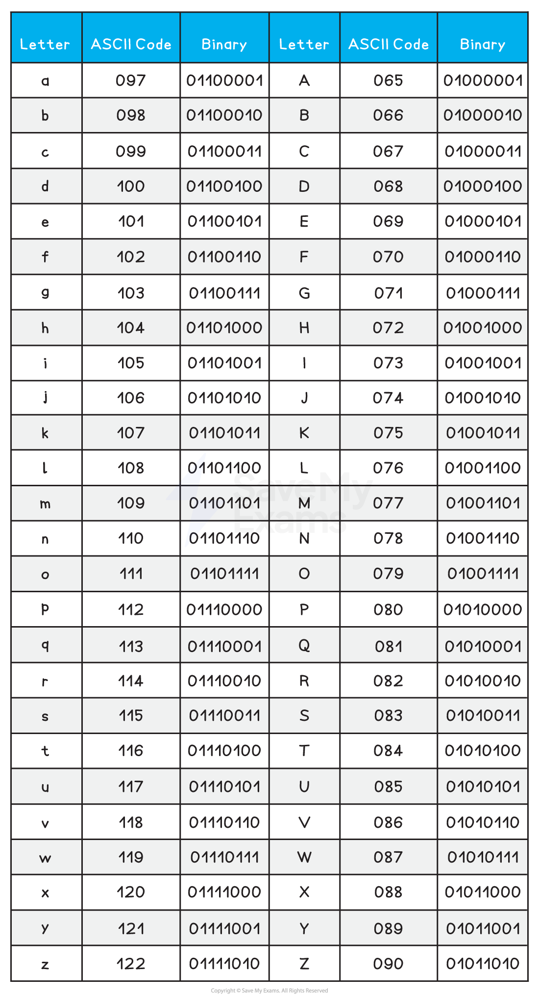

# Character Encoding

## Character sets

### What is a character set?

- A character set is **all the characters and symbols** that can be **represented **by a computer system
- Each character is given a **unique **binary code
- Character sets are **ordered logically**, the code for ‘B’ is one more than the code for ‘A’
- A character set provides a ***standard*** for computers to communicate and send/receive information
- Without a character set, one system might interpret *01000001 *differently from another
- The number of characters that can be represented is determined by the** number of bits used** by the character set
- Two common character sets are:

  - American Standard Code for Information Interchange (**ASCII**)
  - Universal Character Encoding (**UNICODE**)

## ASCII

> **Spec point** — `spcpt_NnMxGWyGN55Xt4t5`

## ASCII

### What is ASCII?

- ASCII is a character set and was an accepted standard for information interchange
- ASCII uses **7 bits**, providing 27 unique codes (128) or a maximum of **128 characters **it can represent
- This is enough to represent the letters, numbers, and symbols from a **standard keyboard**
- The **sixth bit** changes from 1 to 0 when **comparing uppercase and lowercase characters**

  - **a** *0110 0001*
  - **A** *0100 0001*
  - **b** *0110 0010*
  - **B*** 0100 0010*
- This made conversion between the two much easier
- This speeds up the overall usability of the character set

*Part of the ASCII code table*

- ASCII **only** represents basic characters needed for **English**, limiting its use for other languages

## Extended ASCII

> **Spec point** — `spcpt_ZChTwM4bV6bXWSph`

## Extended ASCII

#### What is extended ASCII?

- Extended ASCII uses an **8th bit**, providing 256 unique codes (28 = 256) or a maximum of **256 characters **it can represent
- Extended ASCII provides** essential characters** such as mathematical operators and more recent symbols such as ©
- This allows for** non-English characters** and for drawing characters to be included

## UNICODE

> **Spec point** — `spcpt_3cMhSypHmPYmSpGB`

## UNICODE

### What is UNICODE?

- UNICODE is a **character set** and was created as a solution to the limitations of ASCII
- UNICODE uses a minimum of **16 bits**, providing 216  unique codes (65,536) or a minimum of **65,536 characters** it can represent
- UNICODE can represent characters from **all the major languages** around the world
- UNICODE was designed to **create a universal standard** that covered all languages and all writing systems
- The** first 128 characters** in the UNICODE character set are the same as ASCII

#### ASCII vs UNICODE

| ** ** | **ASCII** | **UNICODE** |
|---|---|---|
| **Number of bits** | 7-bits | 16-bits |
| **Number of characters** | 128 characters | 65,536 characters |
| **Uses** | Used to represent characters in the English language. | Used to represent characters across the world. |
| **Benefits** | It uses a lot less storage space than UNICODE. | It can represent more characters than ASCII.  It can support all common characters across the world.  It can represent special characters such as emoji's. |
| **Drawbacks** | It can only represent 128 characters.  It cannot store special characters such as emoji's. | It uses a lot more storage space than ASCII. |
