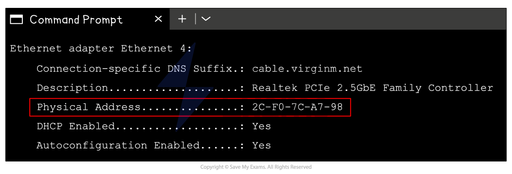

# Uses of Number Systems

## Applications of BCD

> **Spec point** — `spcpt_8khG62swj8NKqrXS`

## Applications of Binary Coded Decimal (BCD)

### What are the uses of binary-coded decimal (BCD)?

| Use Case | Why BCD is used |
|---|---|
| **Electronic calculators** | Keeps numbers in decimal format for easier display and accuracy |
| **Digital clocks and watches** | Time is naturally decimal (e.g. 12:45), so BCD makes display logic simpler |
| **Banking and financial systems** | Avoids rounding errors when doing decimal calculations, especially with money |
| **Old digital systems / embedded systems** | Simpler to implement with hardware that displays digits individually |

- Binary coded decimal is commonly used in systems that need to** display decimal numbers clearly** and accurately
- BCD is ideal for applications like digital clocks, calculators, and financial systems **where decimal precision matters**
- Using BCD **avoids rounding errors** that can occur in binary-based arithmetic, especially with money and time
- It’s still found in older or embedded systems where **simple hardware-based decimal** output is needed

## Applications of hexadecimal

> **Spec point** — `spcpt_dFZDFtbK5sqy4WNY`

## Applications of hexadecimal

### Why is hexadecimal used?

- In Computer Science hexadecimal is often preferred when working with** large values**
- It takes **fewer digits to represent a given value** in hexadecimal than in binary

  - 1 hexadecimal digit corresponds 4 bits and can represent 16 unique values (0-F)
- It is **beneficial **to use hexadecimal over binary because:

  - The more bits there are in a binary number, the **harder it makes for a human to read**
  - Numbers with more bits are more **prone to errors** when being copied
- Examples of where hexadecimal can be seen:

  - **MAC addresses**
  - **Colour codes**
  - **URLs**

#### MAC addresses

- A typical MAC address consists of **12 hexadecimal digits**, equivalent to** 48 digits** in binary

  - **AA:BB:CC:DD:EE:FF**
  - **10101010:10111011:11001100:11011101:11101110:11111111**
- **Writing down** or **performing calculations** with 48 binary digits makes it** very easy to make a mistake**

#### Colour codes

- A typical hexadecimal colour code consists of **6 hexadecimal digits**, equivalent to** 24 digits** in binary

  - **#66FF33** (green)
  - **01100110:11111111:00110011**

#### URL's

- A URL can only contain **standard characters** (a-z and A-Z), **numbers **(0-9) and some **special symbols** which is enough for basic web browsing
- If a URL needs to include a character **outside of this set**, they are converted into a **hexadecimal code**
- Hexadecimal codes included in a URL are prefixed with a **% **sign
