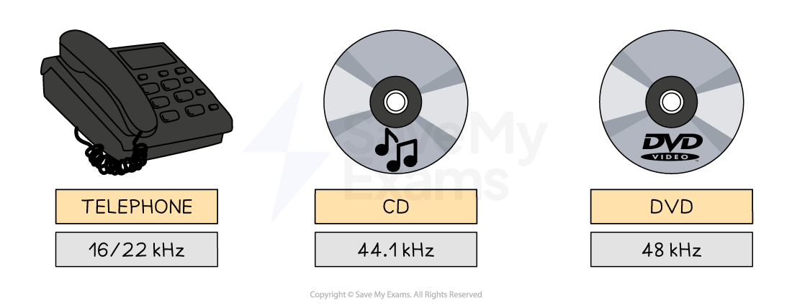

# Sound Representation

## Sound encoding

> **Spec point** — `spcpt_XjJ6QDc8QQjfDmS6`

## Sound encoding

### How is sound encoded in a computer system?

- Computers represent all data in binary, including sound that we **record **using a microphone (input) or sound that we **playback **from a speaker (output)
- For this to happen, analogue sound must be **sampled and stored**

#### Analogue sound

- Sound waves begin as ***analogue*** and for a computer system to understand them they must be converted into a **digital form**
- Measurements of the original sound wave are **captured **and **stored as binary** on secondary storage
- This process is called **Analogue to Digital conversion** (**A2D**)
- The process begins by measuring the loudness (**amplitude**) of the analogue sound wave at a point in time, this is called **sampling**
- The higher the amplitude, the **louder **the sound
- Each measurement (**sample**) generates a value which can be represented in **binary **and **stored**
- Using the **samples**, a computer is able to create a **digital version **of the original analogue wave
- The digital wave is **stored **on **secondary storage **and can be played back at any time by reversing the process

- In this example, the grey line **represents the digital wave **that has been created by taking samples of the original analogue wave
- In order for the digital wave to** look more like the analogue wave** (black line) the **sampling rate**, **sampling resolution **and **sample interval** can be changed

### Sampling rate vs sampling resolution

#### Sampling rate

- The sampling rate is the amount of **samples taken per second** of the analogue wave
- Samples are taken for the ***duration***** **of the sound
- The sampling rate is measured in **Hertz **(**Hz**)
- **1 Hertz is equal to 1 sample** of the sound wave

- The sample rate of a typical audio CD is **44.1kHz** (44,100 Hertz or 44,100 samples per second), a **sampling resolution **of 16 bits and is recorded in ***stereo sound***
- Using the graphic above to compare common sampling rates, the question, “*Why does telephone hold music sound so bad?*” can now be answered

#### Sampling resolution

- Sampling resolution is the **number of bits **used to represent **each sound sample**
- Sampling resolution is closely related to the** bit depth of a bitmap image**, they measure the same thing in different contexts

- In the example above, the higher the sample resolution, the** closer to the original **sound wave the digital version looks

## Impact of sampling settings

> **Spec point** — `spcpt_WHbBx8dF2xkkkZDB`

## Impact of sampling settings

### What are the impacts of sampling settings?

| **Factor** | **Effect of playback quality** | **Effect on file size** |
|---|---|---|
| **Sampling rate** | ⬆️**higher **= more detail, better sound quality | ⬆️**higher **= more data, larger file size |
| **Sampling resolution** | ⬆️**higher **= bigger range, better sound quality | ⬆️**higher **= more data per sample, larger file size |
