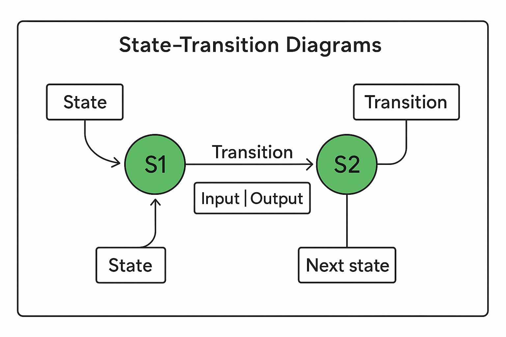

# State-Transition Diagrams

## State-Transition Diagrams

> **Spec point** — `spcpt_9QcSm6ZgBSQmZRX3`

## State-Transition Diagrams

### What are state-transition diagrams?

- A state-transition diagram shows **how a system moves between different states** based on inputs
- Each **state** represents a condition or situation of the system
- **Transitions** are arrows that show movement between states when certain inputs occur
- Transitions may also produce **outputs**, shown as labels on the arrows
- These diagrams model **finite-state machines (FSMs)**, which are widely used in computing

#### Key elements

| Element | Description |
|---|---|
| **State** | Circle labelled with a name (e.g. S1, S2) showing a situation the system can be in |
| **Initial state** | Starting point, sometimes marked with an arrow pointing to it |
| **Transition** | Arrow from one state to another, labelled with input and output |
| **Input** | Event or data that causes a transition (e.g. Button-Y pressed) |
| **Output** | Action or signal produced by a transition (e.g. Output-A) |
| **Next state** | The state the system moves into after the transition |

#### How to read labels on transitions

- Labels are often written as **Input | Output**
- If no output is produced, “none” may be written
- Example: `Button-Y | Output-B` means pressing Button-Y in the current state produces Output-B and causes a transition to the next state
- The diagram below shows the key features of a state-transition diagram:

- States are circles labelled S1, S2, etc
- Transitions are arrows between states, labelled with Input | Output
- The initial state is marked with an incoming arrow

#### Completing transition tables

- Exam questions often ask you to convert a diagram into a **table**
- The table normally has columns for **Current state, Input, Output, Next state**
- Work through the diagram row by row, following the arrows for each possible input

Example table structure:

| Current state | Input | Output | Next state |
|---|---|---|---|
| S1 | Button-Y | Output-A | S2 |
| S1 | Button-Z | Output-B | S3 |

> **Exam Hint**
> - Always identify the **initial state** before tracing
> - Highlight or mark inputs and outputs on your diagram to avoid missing one
> - For tables, keep the order consistent: Input → Output → Next state
> - Use arrows systematically, avoid guessing paths
> - Remember: more than one sequence can sometimes reach the same state, but exams often ask for the **minimum changes**

> **Worked Example**
> Part of a program is represented by the following state‑transition diagram
> 
> 
> 
> **A**. Complete the table to show the inputs, outputs and next states.
> 
> Assume that the current state for each row is given by the ‘Next state’ on the previous row. For example, the first Input‑A is made when in state S1.
> 
> If there is no output for a given transition, then the output cell should contain ‘none’.
> 
> The first two rows have been completed.
> 
> | Input | Output | Next state |
> |---|---|---|
> |   |   | S1 |
> | Input-A | none | S3 |
> |   | Output-W |   |
> |   | none |   |
> | Input-B |   |   |
> | Input-A |   |   |
> |   |   | S4 |
> 
> **[5]**
> 
> **B**. Identify the input sequence that will cause the minimum number of state changes in the transition from S1 to S4
> 
> **[1]**
> 
> **Final answer:** **Answers**
> 
> **A.**
> 
> | Input | Output | Next state |
> |---|---|---|
> |   |   | S1 |
> | Input-A | none | S3 |
> | **Input-A** | Output-W | **S3** |
> | **Input-B** | none | **S2** |
> | Input-B | **none** | **S5** |
> | Input-A | **none** | **S2** |
> | **Input-A** | **Output-X** | S4 |
> 
> - One mark per row 3 to 7 **[5 marks]**
> 
> **B**. Input-B, Input-A **[1 mark]**
