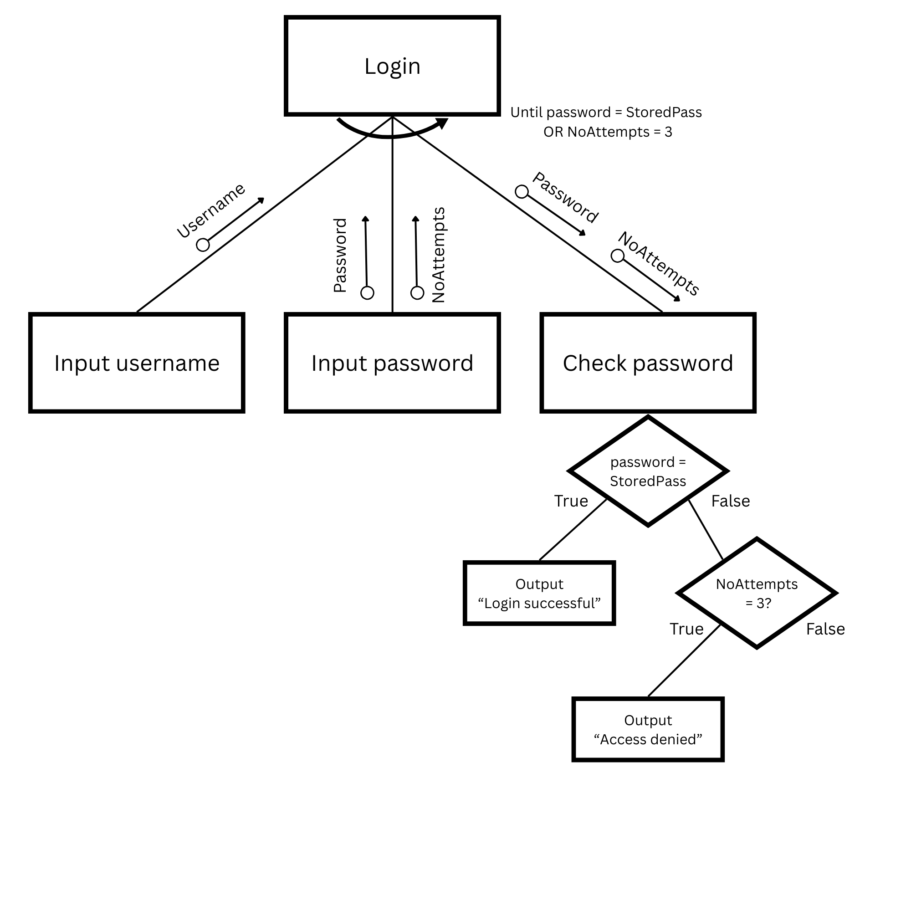

# Structure Charts

## Structure charts

> **Spec point** — `spcpt_sWprJjYGW6NjMnHZ`

## Structure charts

### What is a structure chart?

- A structure chart is a **modelling tool** used in the **design stage** of program development
- It helps to **decompose a problem** into smaller, manageable **sub-tasks**, representing each as a **module**
- Structure charts focus on **what the program does**, not how it does it

#### Example

- A program that asks a user to enter their username and password
- Checks if the password matches the stored password and uses a counter to track how many times it is checked
- If the password matches, a successful message is displayed, else after three failed attempts a 'denied' message is displayed
- A structure chart might look like:

#### Key features

| **Feature** | **Explanation** |
|---|---|
| **Top-down design** | The chart starts with the **main program** and breaks it into sub-modules |
| **Decomposition** | Each module represents a **specific task** or **function** |
| **Module boxes** | Each module is shown as a **box** |
| **Vertical lines** | Show **control flow** – which module calls which |
| **Parameter arrows** | **Arrows** pointing into modules show **data being passed in or returned** |
| **Stepwise refinement** | Each level adds **more detail** to the task above |
| **Diamond shape** | Shows a **condition **that could be** true or false** |
| **Semi-circular arrow** | Indicates **repetition** |

### Pseudocode from structure chart

- The first step is to create an **identifier table**

| **Identifier** | **Data type** | **Description** |
|---|---|---|
| `Username` | STRING | Stores the username entered by the user |
| `Password` | STRING | Stores the password entered by the user |
| `StoredPass` | STRING | The correct password stored in the system for comparison |
| `NoAttempts` | INTEGER | Counts the number of failed login attempts |
| `LoginSuccess` | BOOLEAN | Indicates whether the login was successful |

- Next, identify is any **functions **or **procedures **could be used

| **Module** | **Type** | **Purpose** |
|---|---|---|
| `GetCredentials` | **PROCEDURE** | Asks the user to input username and password |
| `CheckPassword` | **FUNCTION** | Compares input password with stored password and returns TRUE/FALSE |
| `ShowAccessMessage` | **PROCEDURE** | Displays success or failure message |

- Any finally, write the pseudocode
