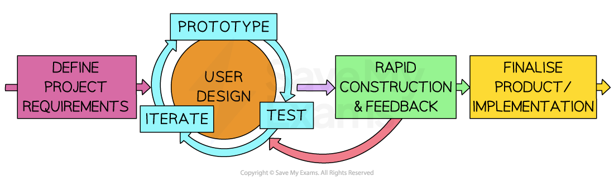

# Development Models

## Waterfall

> **Spec point** — `spcpt_TWY32Pg5w73rKmNQ`

## Waterfall

### What is the waterfall model?

- The Waterfall Model is a **sequential software development process** divided into **distinct stages**
- Each stage **must be completed** before the next one begins

#### Stages

1. **Analysis**: The problem is investigated and the client's requirements are identified and documented, e.g. in a requirements specification
2. **Design**: The solution is planned, e.g. algorithms, data structures and identifier tables, the user interface and the test plan
3. **Coding**: The design is implemented in a programming language
4. **Testing**: The program is tested against the test plan to find and correct errors
5. **Maintenance**: After the program is in use, it is corrected, adapted or improved

- In a waterfall diagram, the downward arrows show that the result of one stage is passed to the next stage as its input
- The upward arrows show that more work is needed at a previous stage before the current stage can be completed

#### Benefits and drawbacks

| **Benefits** | **Drawbacks** |
|---|---|
| **Simple and linear** – easy to understand and follow | **Inflexible** – difficult to make changes once development begins |
| **Clear stages and milestones** – easy to track progress | **Expensive to fix late problems** – issues found late are harder to resolve |
| **Ideal for well-defined projects** – works best when requirements are fixed | **Long development cycle** – each stage must be completed before moving on |

#### Suitability

- The Waterfall Model is most suitable for projects where **requirements are well understood** and **unlikely to change**
- It works well when **high quality and compliance are essential**, and there is a clear understanding of the project's goals and constraints

## Iterative (Agile)

> **Spec point** — `spcpt_5RdXPcmMFgBQyRjC`

## Iterative (Agile)

### What is the iterative model?

- In the iterative model the stages of the program development life cycle (**analysis**, **design, coding and testing**) are **repeated** several times
- Each repeat (iteration) produces a **working version** of the program, which is reviewed by the client
- The client's feedback is used to **change or add to the requirements** for the next iteration
- Each new version **adds functionality** to the previous one, until the client is satisfied and the final program is released and then maintained

#### Benefits and drawbacks

| **Benefits** | **Drawbacks** |
|---|---|
| **Working software early**: an early version is available long before the whole program is finished, so it can reach the market sooner | **High client involvement**: the client must be available to give feedback throughout the life cycle |
| **Copes with change**: changes to the requirements are easier and quicker to make than in the waterfall model | **Hard to estimate**: it is difficult to estimate the total cost and time to complete the project |
| **Early feedback**: problems are found and corrected early, at the end of each iteration | **Changing requirements**: it is easy for the client to keep changing their mind |

#### Suitability

- The iterative model is most suitable when the **requirements are not fully known at the start** or are **likely to change**, and the client is available to review each version

## Rapid Application Development (RAD)

> **Spec point** — `spcpt_TB8bWgz3Rzb9Fnxr`

## Rapid Application Development (RAD)

### What is RAD?

- Rapid Application Development (**RAD**) is a software development methodology that **emphasises fast and iterative development**

#### Steps

1. **Requirement planning:** Gather general system requirements, define constraints and assumptions
2. **User design and prototyping:** Collaborate with users to develop prototypes, ensuring alignment with user needs
3. **Construction or iterative development:** Build the system incrementally, with continuous user feedback and adaptation
4. **Cutover or deployment:** Transition the product into the live environment, including user training, support, and documentation
5. **Maintenance and updates:** Continue to adapt and improve the system based on user feedback and needs

***Rapid Application Development (RAD) Model of Software Development***

#### Benefits and drawbacks

| **Benefits** | **Drawbacks** |
|---|---|
| **Speed** – fast development and delivery at relatively low cost | **Requires strong team collaboration** – skilled and cohesive teams are essential |
| **User involvement** – client feedback shapes the system throughout | **Potential quality issues** – speed may reduce testing and documentation |
| **Flexibility** – adapts quickly to changing requirements | **Not ideal for small projects** – may be too complex for simple systems |
| **Incremental development** – builds in small, testable parts | **Scope creep risk** – flexibility can lead to ever-expanding requirements |

#### Suitability

- Rapid Application Development is most suitable for projects where **rapid delivery is required** and where requirements can be developed and **refined on the go**
