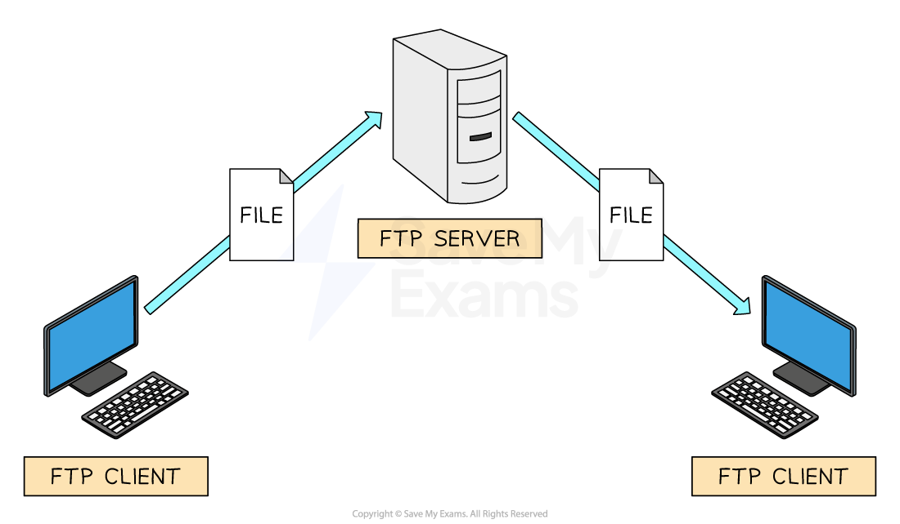
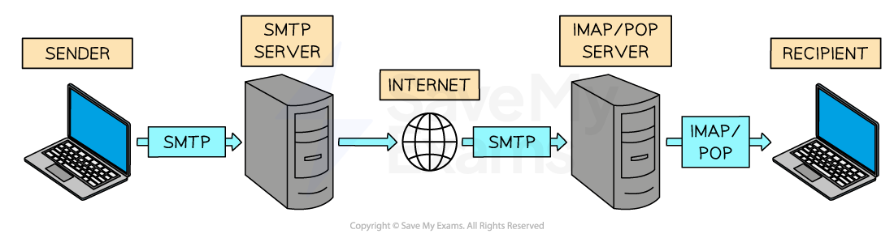

# Protocol Examples

## Standard protocols

> **Spec point** — `spcpt_yBvfCkxCYJPX6n34`

## Standard protocols

- A protocol is a **set of rules** that govern **communication **on a network
- There are protocols for different purposes, such as:

  - **HTTP & HTTPS**
  - **FTP**
  - **POP3, IMAP & SMTP**
  - **BitTorrent**

### HTTP & HTTPS

- Hypertext Transfer Protocol (**HTTP**) allows communication between clients and servers for **website viewing**
- HTTP allows clients to **receive data** from the server (fetching a webpage) and **send data** to the server (submitting a form, uploading a file)
- **HTTPS **works in the same way as HTTP but with an **added layer of security**
- All data sent and received using HTTPS is **encrypted**
- HTTPS is used to **protect sensitive information **such as passwords, financial information and personal data

### FTP

- File Transfer Protocol (**FTP**) allows **sending and receiving files between computers**
- Uploading and downloading files** to/from a web server** is often completed using FTP
- FTP offers **greater efficiency** and support for **bulk transfers and large files** such as resuming interrupted transfers
- **FTP clients **are software applications that use the FTP protocol to make the process easier for users

### POP3, IMAP & SMTP

- A family of protocols that handle **sending and receiving of email** across the internet (WAN)

#### SMTP

- SMTP is a **push protocol**: it is used for **sending (uploading) emails**
- In the diagram above, **SMTP** is used to transfer the senders email to their email providers server and SMTP is used to transfer the email to the recipients email server

#### POP3

- POP3 is a **pull protocol**: it is used for **receiving (downloading) emails** from a mail server
- Once the email has been retrieved **it is removed from the server**

#### IMAP

- IMAP is also a **pull protocol** used for **receiving (downloading) emails** from a mail server
- Once the email has been retrieved, **a copy is retained on the mail server**

### BitTorrent

- BitTorrent is a protocol for **peer-to-peer file sharing** over a network
- It allows files to be shared between **thousands of users** who are connected together over the internet
- Users **share files directly with each other**: the users' computers act as **peers**
- **No web server or central device** is used, and all users are of **equal status**
- This makes it efficient for sharing **large files**, as no single server has to supply the whole file to everyone
- While BitTorrent is a legal technology, it is sometimes used for sharing **copyrighted content illegally**, so ethical and legal use is important
