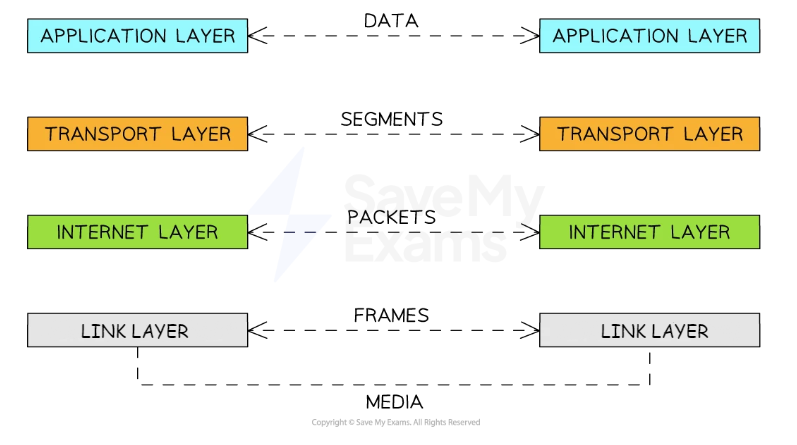

# Protocol Fundamentals

## Need for protocols

> **Spec point** — `spcpt_jbJ42BnWMbSxD9nX`

## Need for protocols

### What is a protocol?

- A protocol is a set of rules that define how computers **communicate over a network**
- They ensure that data is **sent**, **received**, and **understood **correctly by all devices, regardless of their manufacturer or operating system
- Without protocols:

  - Devices would** not know how** to structure or interpret data
  - Data could be** lost**, **corrupted**, or **misrouted**
  - Communication between **different hardware and software** systems would break down
- **Protocols are essential** to guarantee:

  - Reliable data transfer
  - Consistent formatting and addressing
  - Error checking and correction
  - Security during transmission
- **Examples **of protocols include:

  - TCP, IP, HTTP, FTP, SMTP

#### Protocol stacks

- The protocol stack is a way of **organising network protocols into layers**, where each layer is responsible for a specific function

  - Each layer **handles its own task independently**
  - Layers **communicate with the layers directly above and below**

- Allows different technologies to **work together** using standardised rules
- An example of a protocol stack is **TCP/IP**

## TCP/IP

> **Spec point** — `spcpt_ZDpQfF9ZSQdcbNnr`

## TCP/IP

### What is TCP/IP?

- TCP/IP, or the Transmission Control Protocol/Internet Protocol, is a **suite of communication protocols** used to interconnect network devices on the internet
- This model splits the various protocols into four layers:

  - **Application**
  - **Transport**
  - **Internet**
  - **Link**

#### Application layer

- This is the layer where the **communication process begins**
- The application layer **interacts directly with software applications**, such as web browsers and email clients
- The application layer **prepares data for transmission** over the network by converting it into a format that can be sent and received over the network

#### Transport layer

- The transport layer **receives data from the application layer**
- The transport layer is **responsible for end-to-end communication** between the source and destination
- The transport layer **breaks the data it receives down into smaller units** called packets
- Each packet is **assigned a sequence number** (so the data can be reassembled in the correct order at the destination)
- Each packet is also **labelled with a header** containing information (e.g. the packet number)

#### Internet layer

- The internet layer **receives packets from the transport layer**
- It **adds a header to each packet**, including the sender's ***IP address*** and the receiver's IP address
- The internet layer is responsible for **routing each packet across the network** using the IP addresses in the headers

#### Link layer

- The link layer** receives packets from the Internet layer** and prepares them for transmission over the physical network
- The link layer** translates the digital packets** into an electrical, optical, or wireless signal that can be sent over the network
- Once the signal reaches the receiving end, the **link layer translates it back** into digital packets

*TCP/IP Diagram*
