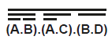

# Boolean Algebra

## Boolean algebra

> **Spec point** — `spcpt_qB5xbpNWQFbdXBMW`

## Boolean algebra

### What is Boolean algebra?

- Boolean algebra is a **mathematical system** used to **manipulate Boolean values**
- **Complex expressions** can be made **simpler **using the rules of **Boolean algebra**
- This is a **more powerful simplification** method than Karnaugh maps and can simplify expressions that Karnaugh maps cannot
- There are various different **rules **that you need to learn and that can then be applied to certain expressions to simplify them
- **Combining these rules** can mean that **complex expressions** can be** reduced to much simpler ones**

#### General rules

- **General AND rules**

  - X AND 0 = 0
  - X AND 1 = X
  - X AND X = X
  - NOT X AND X = 0
- Note, the value of X is unknown and it is used as a placeholder
- Therefore **X AND 1 = X** means that the output will be whatever the value of X is
- **General OR rules**

  - X OR 0 = X
  X OR 1 = 1
  X OR X = X
  NOT X OR X = 1

### Boolean algebra notation

- In Boolean algebra, expressions are written using shorthand notation:

| **Symbol** | **Meaning** | **Example** | **Explanation** |
|---|---|---|---|
| $A \times B$  or `AB` | **AND** | `A · B` | True only if **both** A and B are 1 |
| $A+B$ | **OR** | `A + B` | True if **either** A or B is 1 |
| $\overline{A}$ | **NOT** / complement | $\overline{A}$ | True if A is 0, False if A is 1 |
| `( )` | Brackets / grouping | `(A + B)·C` | Do A OR B **first**, then AND with C |

> **Exam Hint**
> A dot (`·`) for **AND **is often omitted, so `AB` means `A AND B`

- A **line drawn above** a variable or expression means that the value is **inverted** or **negated**
- It's the **NOT** of that value

| **Notation** | **Meaning** | **Explanation** |
|---|---|---|
| $\overline{A}$ | **NOT A** | True if A is False, False if A is True |
| $A.\overline{B}$ | A AND (**NOT B**) | B is negated before the AND operation |
| $\overline{A+B}$ | **NOT** (A OR B) | The entire OR expression is negated (use De Morgan) |
| $\overline{A.B.C}$ | **NOT** (A AND B AND C) | All values are ANDed together, then the result is negated |

- When you see **multiple horizontal lines**, for example:

- It means the **whole expression is negated**, not just one part
- Always apply **De Morgan’s Law** starting with the **outermost line** first

## De Morgan's Law

> **Spec point** — `spcpt_tg2CcHpVKFFNPG6V`

## De Morgan's Law

### What is De Morgan’s Law?

- De Morgan’s Laws are used to **simplify Boolean expressions** involving **negation** of **conjunctions (AND)** or **disjunctions (OR)**
- They are particularly useful for rewriting logic circuits using only **NAND** or **NOR** gates
- There are two key rules:

  1. **NOT (A AND B)** is equivalent to **(NOT A) OR (NOT B)** $\overline{A.B}=\overline{A}+\overline{B}$
  2. **NOT (A OR B)** is equivalent to **(NOT A) AND (NOT B)** `A + B -bar = top A . top B`

#### Worked example 1: Simplify ¬(A ∧ B)

| **Step** | **Explanation** | **Expression** |
|---|---|---|
| Step 1 | Start with the original expression | `top A . B` |
| Step 2 | Apply De Morgan’s Law: change ∧ to ∨ and negate both terms | $\vec{A} + \vec{B}$ |
| Step 3 | Remove unnecessary brackets | $\vec{A} + \vec{B}$ |

#### Worked example 2: Simplify ¬(A ∨ B)

| **Step** | **Explanation** | **Expression** |
|---|---|---|
| Step 1 | Start with the original expression | `top A + B` |
| Step 2 | Apply De Morgan’s Law: change ∨ to ∧ and negate both terms | $\vec{A} . \vec{B}$ |
| Step 3 | Remove unnecessary brackets | $\vec{A} . \vec{B}$ |

### Why use De Morgan’s Laws?

- Simplifying Boolean expressions using De Morgan’s Laws:

  - Allows for implementation using only **NAND** or **NOR** gates
  - Makes **circuit design more efficient** and cost-effective
  - Is essential in hardware where NAND/NOR logic is cheaper or faster to implement
  - Is commonly used in **microprocessor** and **memory device** design (e.g. flash drives)

> **Worked Example**
> Simplify the following expression using Boolean algebra, including De Morgan’s laws. Show your working.**[3]**
> 
> 
> 
> **Final answer:** **Answer**
> 
> - Correct application of De Morgan’s Law **[1 mark]**
> - Correct application of Double Negation Law or Distributive Law **[1 mark]**
> - Correct answer **[1 mark]**
> 
> ![Boolean expression showing logical transformations: top row negating (A.B).(A.C).(B.D); resulting in A̅.(B̅ + C) + B.D [1].](assets/49d040980cbc-32895-2025-06-04-0ic-kleki.png)
