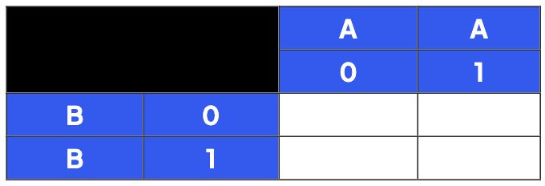
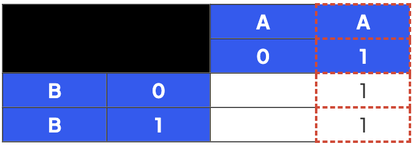
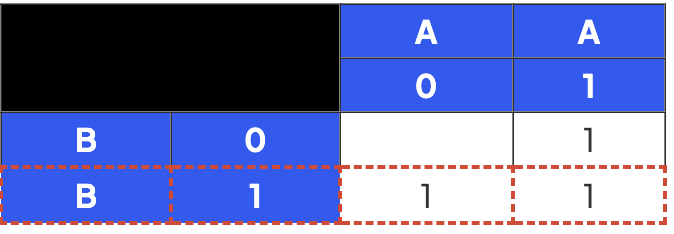
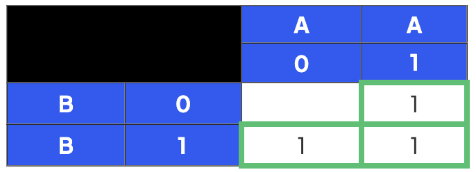
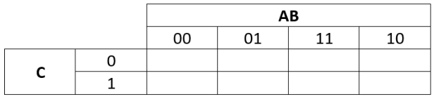
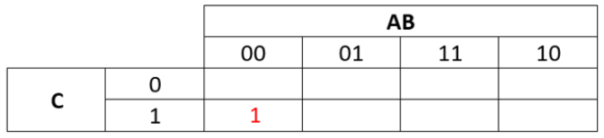
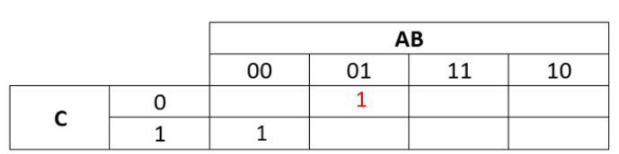
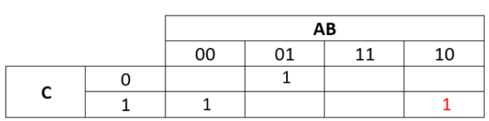
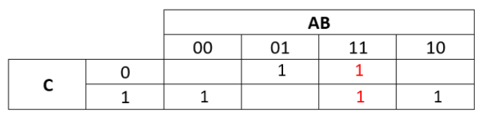

# Karnaugh Maps

## Karnaugh maps

> **Spec point** — `spcpt_v5FF96rrRjkm65jk`

## Karnaugh maps

### What is a Karnaugh map?

- A Karnaugh map (**KMap**) is a tool that is used for **simplifying Boolean algebra expressions**
- It offers a **visual method** of **grouping together expressions** with **common factors**
- The format of the map makes it **easy to identify** and **eliminate redundant terms**
- They are used in **digital logic design**, such as simplifying the logic of digital circuits

#### Steps:

1. **Create the Map**: Each cell in the grid corresponds to a term in the Boolean expression. Fill cells with 1s and 0s corresponding to the output of that term
2. **Grouping**: Group the 1s in the grid. Each group must be a rectangle and the size of the group must be a power of 2. A cell can be part of multiple groups
3. **Simplifying**: Write down a simplified Boolean expression for each group. The simplified expression for a group consists of the variables that remain constant in all terms in the group
4. **Final Expression**: Combine the simplified expressions from each group using OR operations to get the final simplified Boolean expression

### Creating Karnaugh Maps

- A Karnaugh Map (**KMap**) can be used to **simplify a Boolean expression** with 2 inputs
- Here is an example for the expression** A + B** (**A OR B**)

#### Step 1

- **Add each variable** starting with **A **at the top and **B **down the side
- **Add each possible state** for **A **and **B**

#### Step 2

- Take each expression in turn **separated** by the **V **(**OR**)
- First look at **A **on it's own
- Find **all cells where A is 1**
- **Add 1 to the cell**

#### Step 3

- **Repeat for B**

#### Step 4

- This is now a **completed KMap** for the expression **A +  B** (**A OR B**)

### Simplifying expressions using Karnaugh Maps

- Simplify** **$\overline{A}.\overline{B}.C+\overline{A}.B.\overline{C}+A.\overline{B}.C+A.B$** **using a KMap
- In this example there will be **3 variables** A,B and C so the empty KMap will look like this:

#### Step 1:

- Split this long term at each **OR **giving 4 smaller expressions (subterms) to add to the table:

  - $\overline{A}.\overline{B}.C$
  - $\overline{A}.B.\overline{C}$
  - $A.\overline{B}.C$
  - $A.B$

#### Step 2:

- Take the first subterm $\overline{A}.\overline{B}.C$
- Put a **1** in the map for **every cell where this term would be TRUE (1)**
- So if **A** and **B** were **0** and **C** was **1** this subterm would be **1**
- So put a **1** in every cell in the KMap where **A is 0**, **B is 0** and **C is 1**

#### Step 3:

- The next subterm is $\overline{A}.B.\overline{C}$
- Put a **1** in the KMap where **A is 0**, **B is 1** and **C is 0**

#### Step 4:

- The next subterm is** **$A.\overline{B}.C$
- Put a **1** in the KMap where **A is 1**, **B is 0** and **C is 1**

#### Step 5:

- The final subterm is $A.B$
- Put a **1** in the KMap where **A is 1** and **B is 1** (2 cells this time)

### Making the groups

- Once you have written the 1s and 0s into your Karnaugh Map, you can then use this to **simplify the expression**
- In order to do this, you need to **identify the groups**
- This is the **key **to using the Karnaugh map to derive the simplified expression
- The aim of making the groups is to

  - **Make rectangular groups **
  - **Make groups that are as large as possible**
  - **Make groups that contain either 8,4,2 or 1 ones**
  - **Groups can overlap** (i.e. some ones can be in multiple groups)
  - **The Karnaugh map ‘grid’ wraps round in all directions so the groups can wrap round**

#### Example grouping

- The completed map has 1s in five cells: AB = 00 with C = 1, AB = 01 with C = 0, AB = 11 with C = 0, AB = 11 with C = 1 and AB = 10 with C = 1
- **Group 1:**

  - The two 1s in the C = 1 row under AB = 00 and AB = 10 (note the wrapping around)
  - A changes, B stays at 0 and C stays at 1, so this group represents $\overline{B}.C$
- **Group 2:**

  - The two 1s in the C = 0 row under AB = 01 and AB = 11
  - A changes, B stays at 1 and C stays at 0, so this group represents $B.\overline{C}$
- **Group 3:**

  - The two 1s in the AB = 11 column (C = 0 and C = 1)
  - C changes, A and B both stay at 1, so this group represents $A.B$
- **Final simplified expression**

  - OR the terms for the three groups together
  - The simplified expression is $\overline{B}.C+B.\overline{C}+A.B$

> **Exam Hint**
> In questions where you have to use a Karnaugh Map always show the groups by drawing a box/circle round them.
