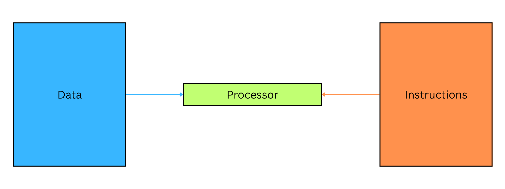
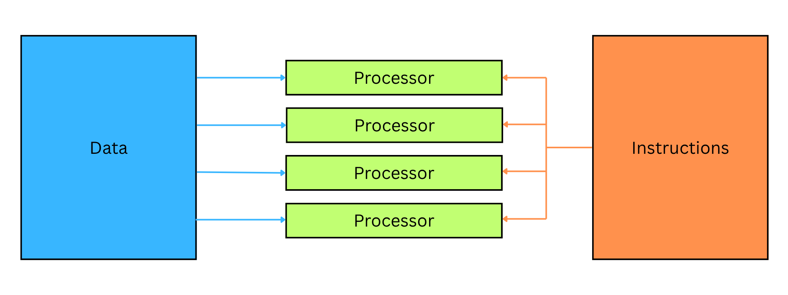
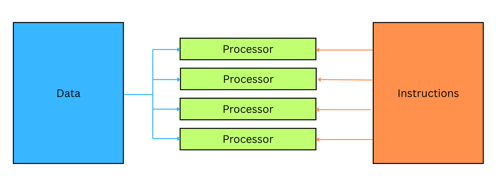
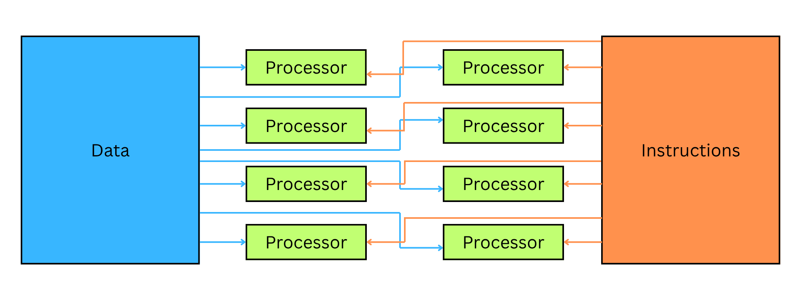

# Computer Architectures

## Architecture types

> **Spec point** — `spcpt_hn7PRVxWyP4SzNWt`

## Architecture types

### What is a computer architecture?

- A computer architecture is the design and structure of a computer system
- It describes how it **fetches, processes, and stores data and instructions**
- It defines how components like the CPU, memory, and input/output devices **work together to execute programs**
- Each architecture is categorised as:

  - **S**ingle or **M**ultiple **Instruction** stream
  - **S**ingle or **M**ultiple **Data** stream

### SISD – Single Instruction, Single Data

| **Description** | **Key Features** |
|---|---|
| One processor executes **one instruction** on **one data stream** at a time | Traditional serial (non-parallel) architecture |
| Used in **basic, single-core processors** | Step-by-step processing |

**Example**: Classic desktop CPU running one task at a time

*Single Instruction, Single Data Diagram*

### SIMD – Single Instruction, Multiple Data

| **Description** | **Key Features** |
|---|---|
| One instruction is applied to **multiple pieces of data** at once | Useful for **parallel processing** |
| All processing units perform the **same operation** in parallel | Ideal for graphics or scientific computation |

**Example**: GPU operations, image processing

*Single Instruction, Multiple Data Diagram*

### MISD – Multiple Instruction, Single Data

| **Description** | **Key Features** |
|---|---|
| Multiple processors execute **different instructions** on the **same data** | Very uncommon in practice |
| Used in specialised systems for **fault tolerance** | Each unit checks the same input differently |

**Example**: Redundant systems in safety-critical environments

*Multiple Instruction, Single Data Diagram*

### MIMD – Multiple Instruction, Multiple Data

| **Description** | **Key Features** |
|---|---|
| **Multiple processors** execute **different instructions** on **different data sets** | Most **modern multi-core processors** use this model |
| Allows full **concurrent processing** of independent tasks | Flexible and scalable for parallel programs |

**Example**: Multi-core CPUs, distributed systems, cloud computing

*Multiple Instruction, Multiple Data Diagram*

#### Summary table

| **Architecture** | **Instruction Stream** | **Data Stream** | **Used In** |
|---|---|---|---|
| **SISD** | Single | Single | Standard sequential processors |
| **SIMD** | Single | Multiple | Vector processing (e.g. GPUs) |
| **MISD** | Multiple | Single | Specialised fault-tolerant systems |
| **MIMD** | Multiple | Multiple | Multi-core processors, parallel systems |
