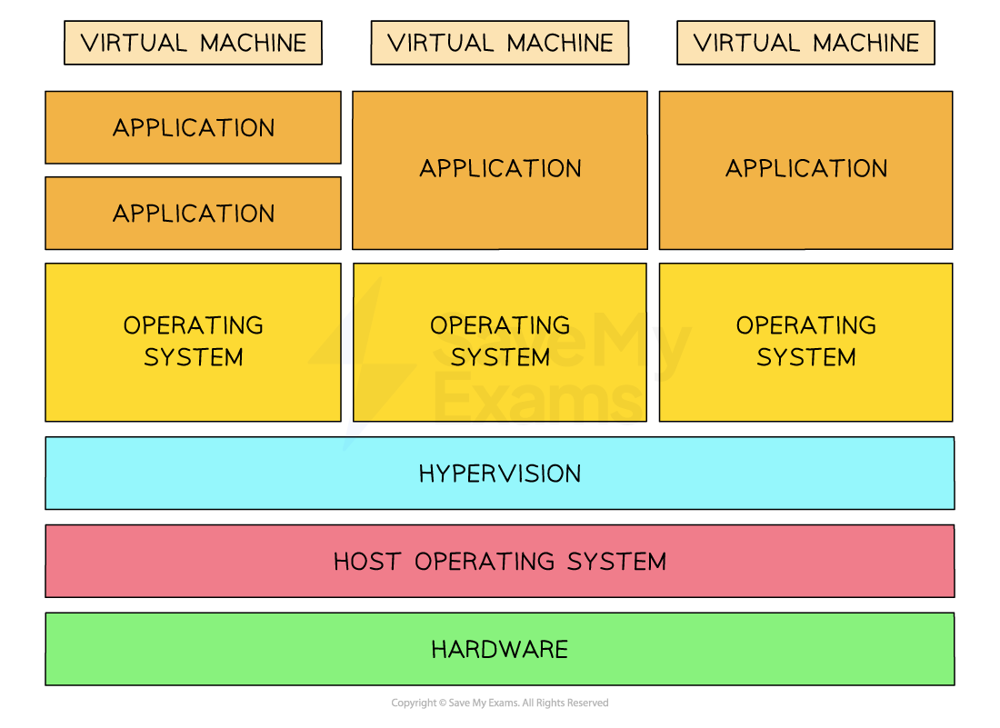

# Virtual Machines

## Virtual machines

> **Spec point** — `spcpt_t4rHbRNyK8FV5Qx2`

## Virtual machines

### What are virtual machines?

- Virtual machines (VMs) are entire operating systems **running inside another operating system**
- A user running **Windows 11** could run a **virtual machine of MacOS**
- This would allow them to **navigate the GUI** of MacOS and **install software** on it
- Running a virtual machine **helps access software** that is only **designed to run on specific** operating systems
- VM management software includes a **Hypervisor** that monitors all activity happening inside the VM

#### Structure of several virtual machines running on a single piece of hardware

#### Cross-platform and forwards compatibility

- Not all software is designed to run on all operating systems
- Apple commonly makes software that **only runs on MacOS** for performance reasons
- A Windows user could run a virtual machine of MacOS and install the software they need
- Most software **needs to be updated** to work on the latest versions of operating systems
- A user running the latest release of Windows may need to run a virtual machine of a *previous* release of Windows to use an application that hasn't received a **forwards-compatibility update**

#### In software testing

- VMs are a way to create **isolated test environments**, that leave the host operating system unaffected
- Isolated environments allow a developer to:

  - Monitor the way their software **affects system performance**
  - Test on a **clean-slate system**, while no other applications are running
- VM management software can create virtual machines that **act** like they have **older hardware**
- This allows developers to build software that can be run on older hardware so that **more users can use the software**
- A developer can test against **various operating systems**, such as MacOS, Linux and Windows, for **greater compatibility**
- In A Level Computer Science, **intermediate code** is generated through compilation and allows programs to run across different operating systems

#### Consequences

- VMs **share** the same system **hardware** as the **host** OS
- Over-use of VMs can **exhaust** the host OS of the system of CPU, hard disk and memory

  - VM software such as **VirtualBox** can set maximum limits on system resources
  - A **low-specification** machine could be configured to allocate only 1GB of memory and 20% of CPU
  - A **high-specification** machine could afford up to 8GB of memory and 50% of the CPU
- Operating systems are commonly **free to download**, but require an **activation payment** to access all features
