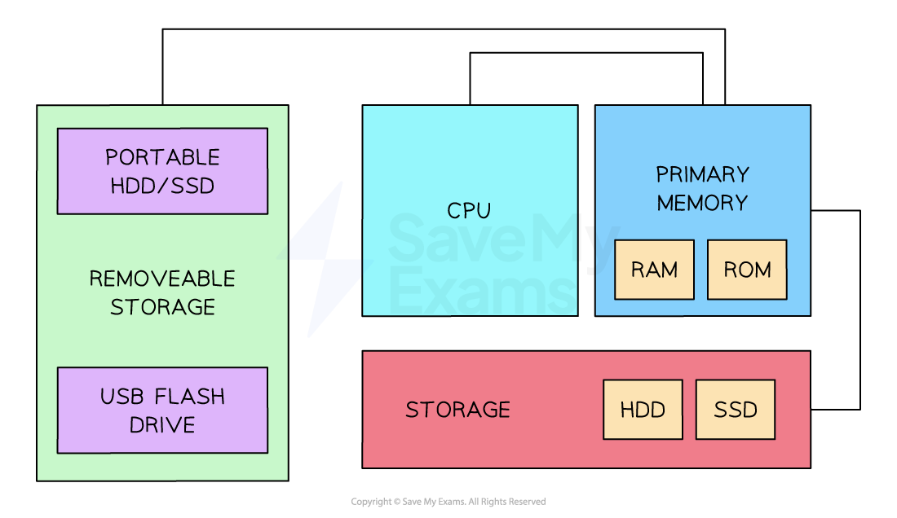
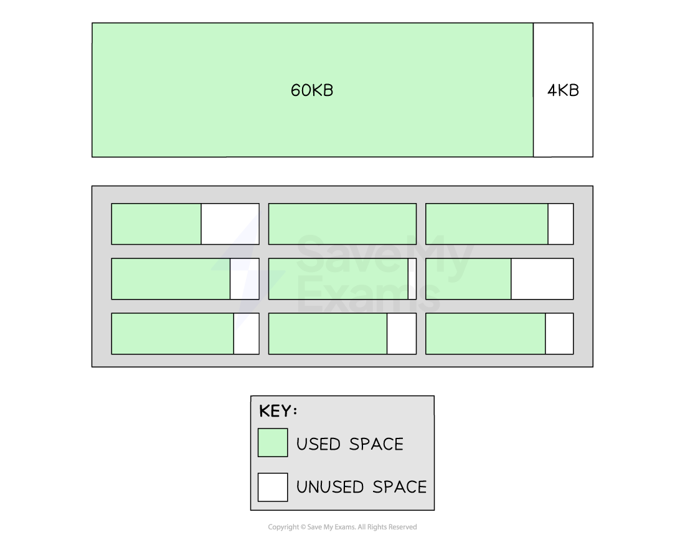
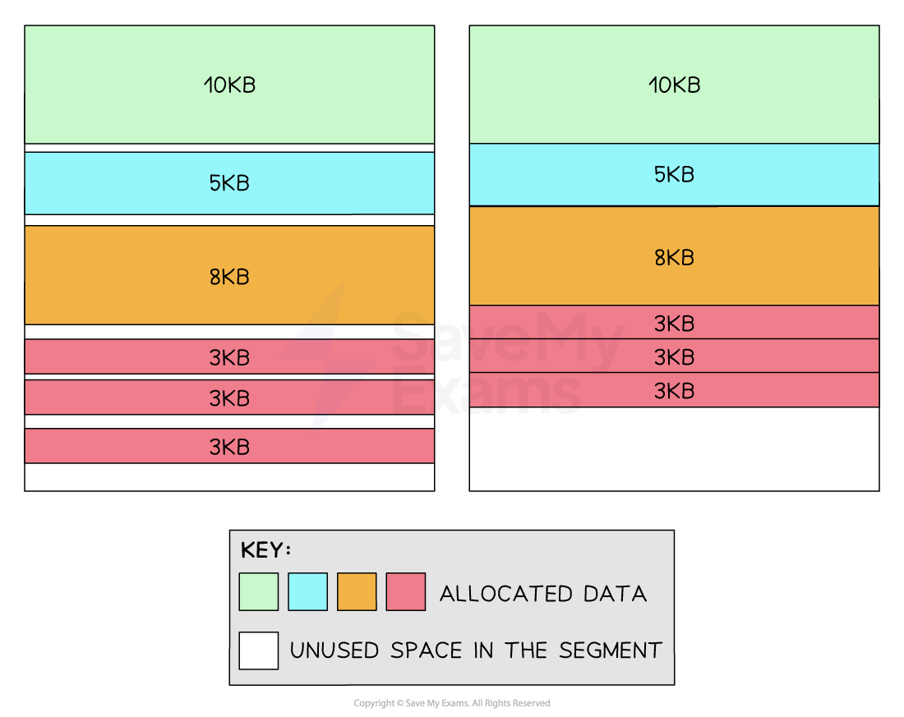

# Memory Management

## Memory management

> **Spec point** — `spcpt_4BtYyv8hgvms2CFG`

## Memory management

### What is memory management?

- Memory management is a **fundamental** role of the operating system, dealing with the **allocation** and **deallocation** of the computer's primary memory
- When a user opens an application, its **data is loaded from storage** into active memory so that it can run **smoothly**
- When a user opens a file from the file system, e.g. word document, the CPU loads this **file data,** as well as **application data, **into the primary memory
- Primary memory is a **limited resource** in the system, so it needs **careful management**
- **Benefits **of memory management are:

  - Efficient allocation of memory **enables multitasking**, allowing multiple programs to run at once
  - Memory management **maintains security**, it does not let programs access memory reserved for other programs
- Memory management is made **more efficient** through 3 techniques:

  - **Paging**
  - **Segmentation**
  - **Virtual memory**

***Links between different types of memory***

> **Exam Hint**
> - The main benefit of memory management is to make computer systems run smoothly. Most users don’t realise that as they effortlessly move between applications, it’s made possible because the OS is rapidly reallocating memory depending on the task that the user is completing.
> - Make sure you can name one benefit and one drawback for each memory management method in this revision note.

## Paging

> **Spec point** — `spcpt_75hmrd2yg9xz7V8W`

## Paging

### What is paging?

- In A Level Computer Science, paging is a method of **chunking** the primary memory **into equal-sized blocks**
- Data stored in memory will lead to the smooth running of applications
- When an application is launched, data will be moved from the hard disk into Pages for faster access
- As users move between applications, memory is dynamically allocated
- Pages will be taken away from applications not in active use and granted to applications that are in active use
- Paging can lead to **internal fragmentation**
- If a 200KB file is divided into four 64KB Pages, the last Page would have 56KB of unused space

  - **First 64KB** → Full page (64KB used, 0KB unused)
  - **Second 64KB** → Full page (64KB used, 0KB unused)
  - **Third 64KB** → Full page (64KB used, 0KB unused)
  - **Fourth 64KB **→ Partial page (**8KB** used, **56KB unused)**
- Unused space in a Page is wasteful because other unrelated data cannot be stored in this Page
- Over time, more pockets of wasted space will exist across the memory; this process is called **internal fragmentation**
- The image below shows a single 64KB Page with 4KB of unoccupied space
- The box below this shows many Pages, each with varying sizes of internal fragments

***Internal fragmentation***

## Segmentation

> **Spec point** — `spcpt_ztV4XcxXGcRJ9KRK`

## Segmentation

### What is segmentation?

- Segmentation is a method of **chunking** memory into **blocks that correspond to different types of data** needed by an application
- A video editing application may have a Segment for video data, audio data and special effects
- Segments are **not all the same size**; they are sized depending on their allocated data
- Segmentation is space-efficient due to only allocating space depending on the amount an application needs
- Segmentation can lead to **external fragmentation**
- As Segments fill up the memory, physical gaps reduce the maximum size of new Segments that can be allocated
- Below (left) shows different application data assigned to a Segment
- The arrangement of data in the segment **becomes more fragmented over time** because as blocks are taken away it's not possible to guarantee a new block will occupy the same amount of space
- Below (right) shows a defragmented version of the Segment to highlight the total unused space

***External fragmentation***

## Virtual memory

> **Spec point** — `spcpt_y7VT64ymwJ6m4GnB`

## Virtual memory

### What is virtual memory?

- If a computer is **running low** on primary memory, it can make secondary storage act as an 'extension' of the main memory
- The operating system can **offload data** from the primary memory into virtual memory
- Virtual memory creates **an illusion of a larger memory** and enables applications to continue to multitask
- However, accessing data in virtual memory is **considerably slower** compared to RAM
- ***Solid-state drives*** are faster than traditional hard-disk drives, but **neither are as fast** as RAM
- **Over-reliance** on virtual memory can lead to **performance issues**

| **Memory Management Technique** | **Description** | **Example** | **Benefits** | **Drawbacks** |
|---|---|---|---|---|
| **Paging** | Divides memory into fixed-sized blocks (pages) | A process needing 200KB of memory is divided into four 64KB pages, leaving 8KB unused in the last page | Facilitates efficient memory management and enables the use of virtual memory | This can lead to internal fragmentation |
| **Segmentation** | Divides memory into variable-sized segments based on logical parts of a process | In a video editing application, different segments may be created for video data, audio data, effects, and UI elements | Allows for intuitive and efficient memory access | This can result in external fragmentation |
| **Virtual Memory** | Uses hard drive space as an 'extension' of RAM | When memory-intensive applications exceed the available RAM, the OS moves less frequently accessed pages to the hard disk | Allows more extensive programs to be run and facilitates effective multitasking | Slower to access than physical memory, which degrades performance if overused |

> **Worked Example**
> Virtual memory, paging and segmentation are used in memory management.
> 
> (a) Explain what is meant by virtual memory.**[3]**
> 
> (b) State one difference between paging and segmentation in the way memory is divided.**[1]**
> 
> **Final answer:** **Answers**
> 
> **(a)**
> 
> - Disk / secondary storage is used to extend the RAM / memory available **[1 mark]**
> - … so the CPU appears to be able to access more memory space than the available RAM **[1 mark]**
> - Only the data in use needs to be in main memory so data can be swapped between RAM and virtual memory as necessary **[1 mark]**
> - Virtual memory is created temporarily **[1 mark]**
> 
> **(b)**
> 
> - Paging allows the memory to be divided into fixed size blocks and Segmentation divides the memory into variable sized blocks  **[1 mark]**
> - The operating system divides the memory into pages, the compiler is responsible for calculating the segment size  **[1 mark]**
> - Access times for paging is faster than for segmentation **[1 mark]**
