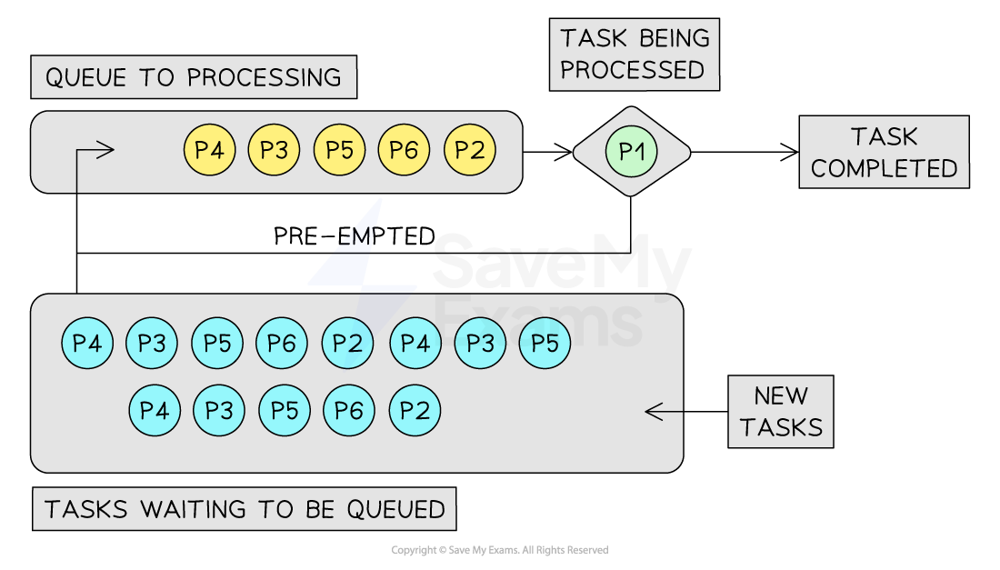
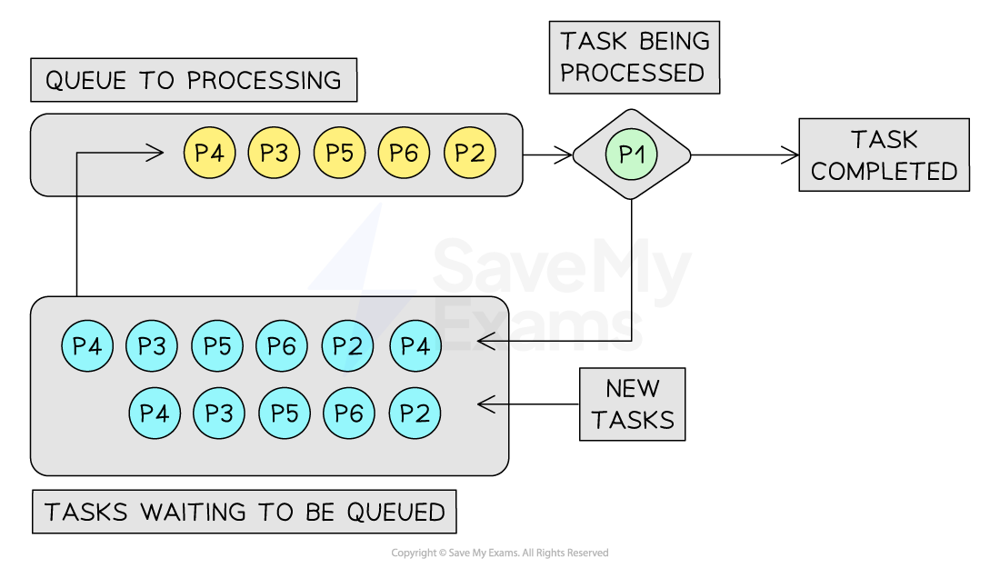
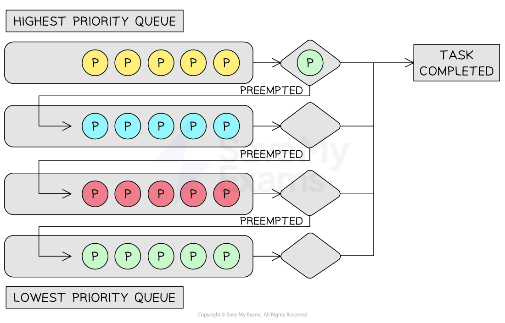
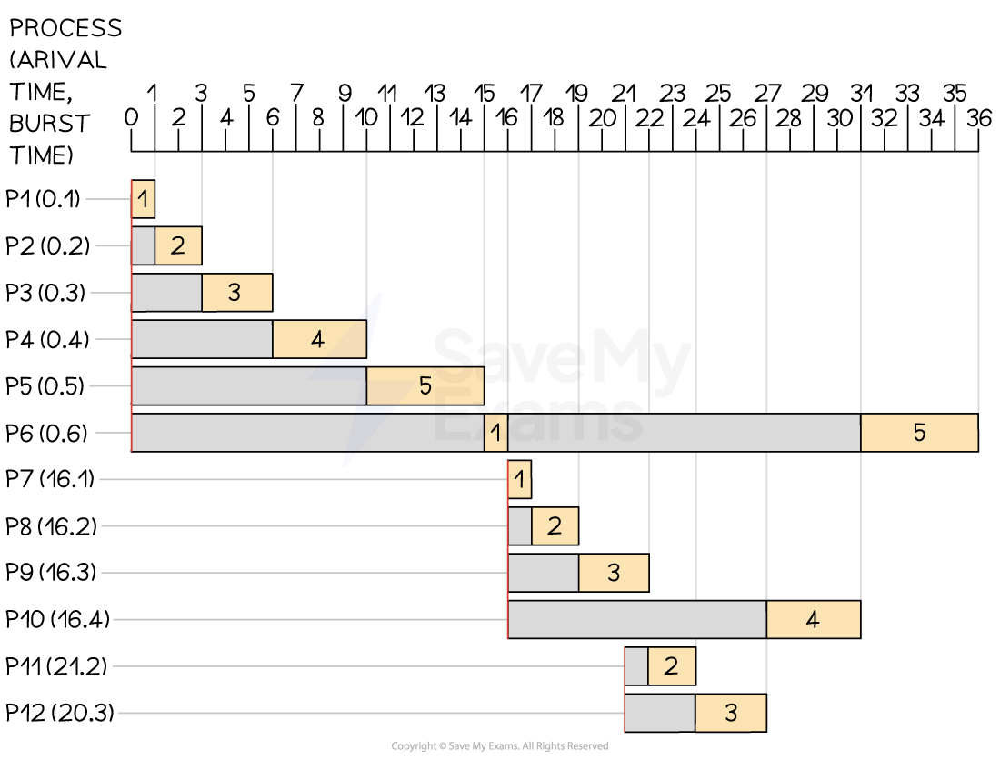
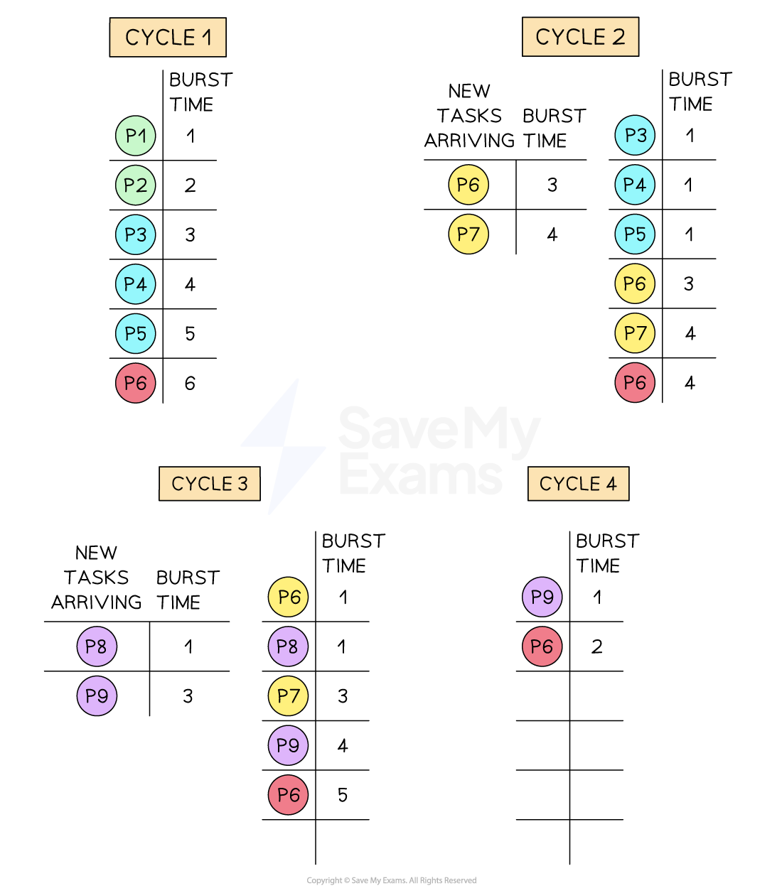
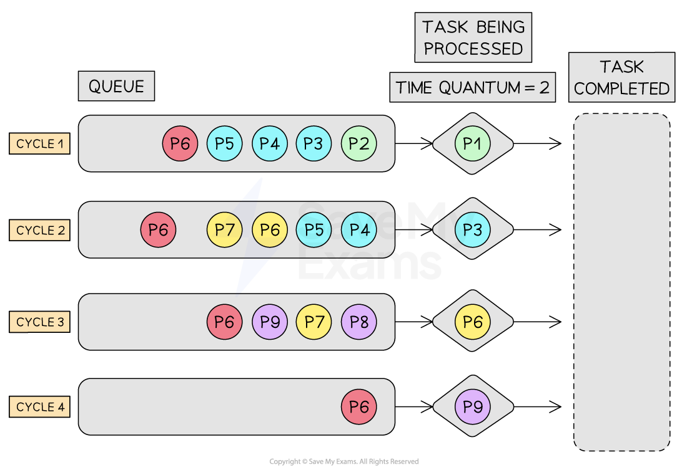

# Process Management

## Multitasking & process states

> **Spec point** — `spcpt_GMyF3qVHqNnkQ5Gv`

## Multitasking & process states

### What is multitasking?

- Multitasking is the ability of the operating system to **manage system resources** (such as memory and the CPU) in a way that **gives the user the impression** that multiple programs are running at the same time
- In reality, the CPU can only execute **one instruction at a time**
- It can process **billions of instructions per second**, and can switch between tasks so quickly that it gives the **illusion **of programs running simultaneously
- The OS **splits tasks and allocates system resources** based on a priority

### What is a process?

- A process is a **program in execution**
- This includes:

  - **The program code**
  - **Current data**
  - **Register values**
  - **Memory space**
- Each running application is **treated as a separate process** by the OS
- A process** does not always run continuously**
- It **changes state** depending on what it’s doing and whether it has access to the CPU or is waiting for something

#### Process states

| **State** | **Description** |
|---|---|
| **Running** | The process is actively being executed by the CPU |
| **Ready** | The process is prepared to run but is **waiting for the CPU** to be available |
| **Blocked** | The process is **waiting for an event or resource**, such as I/O completion |

## Scheduling routines

> **Spec point** — `spcpt_NCSN5NHRmwzRpzNk`

## Scheduling routines

### What is scheduling?

- Deciding **which tasks **to process, for **how long**, and in **what order** is achieved through scheduling algorithms
- A CPU is responsible for **processing tasks** as fast as possible
- Different algorithms are used to** prioritise and process** tasks that need CPU time
- The algorithms have different **uses**, **benefits **and** drawbacks**

#### Scheduling categories

- **Pre-emptive**: allocates the CPU for** time-limited slots**

  - Allocates the CPU for a specific ***time quantum*** to a process
  - Allows interruption of processes currently being handled
  - It can result in low-priority processes being neglected if high-priority processes arrive frequently
  - Example algorithms include **Round Robin** and **Shortest Remaining Time First**
- **Non-pre-emptive**: allocates the CPU to tasks for **unlimited time slots**

  - Once the CPU is allocated to a process, the process holds it until it completes its ***burst time*** or switches to a 'waiting' state
  - A process cannot be interrupted unless it completes or its burst time is reached
  - If a process with a long burst time is running, shorter processes will be neglected
  - Example algorithms include **First Come First Serve** and **Shortest Job First**

### Scheduling algorithms

#### Round robin (RR)

- RR is a pre-emptive scheduling algorithm
- Equally distributing processor time amongst all processes
- Each process is given a ***time quantum*** to execute
- Processes that are ready to be worked on get queued
- If a process hasn’t been completed by the end of its time quantum, it will be moved to the back of the queue

***Round robin scheduling algorithm***

#### First-Come-First-Served (FCFS)

- FCFS is non-pre-emptive, prioritising processes that arrive at the queue first
- The process currently being worked on will block all other processes until it is complete
- All new tasks join the back of the queue

***First-Come-First-Served scheduling algorithm***

#### Multi-Level Feedback Queue (MLFQ)

- MLFQ is a pre-emptive priority algorithm where shorter and more critical tasks are processed first
- Multiple queues are used so that tasks of equal size are grouped together
- All processes will join the highest priority queue but will trickle down to lower priority queues if they exceed the time quantum

***Multi-Level Feedback Queue scheduling algorithm***

#### Shortest Job First (SJF)

- SJF is non-pre-emptive, where all processes are continuously sorted by burst time from shortest to longest
- When new processes arrive on the queue, they are prioritised based on their burst time in the next cycle
- Shorter jobs are placed at the front of the priority queue
- Longer jobs have lower priority, so they are placed at the back

***Shortest job first scheduling algorithm***

#### Shortest Remaining Time First (SRTF)

- SRTF is a pre-emptive version of SJF, where processes with the shortest remaining time are higher priority
- Time quantum is set, and if a task doesn’t complete in time, it will be re-queued for further processing
- Before the next cycle starts, all processes are inspected and ordered by the shortest remaining time to complete

***Shortest remaining time first scheduling algorithm***

### Summery

| **Algorithm** | **Benefits** | **Drawbacks** |
|---|---|---|
| **Round Robin** | All processes get a fair share of the CPU  Good for time-sharing systems  Predictable, as every process gets equal time | Choosing the right time quantum can be difficult  This can lead to a high turnaround time and waiting time for long processes |
| **First Come, First Served** | Simple and easy to understand  Fair in the sense that processes are served in the order they arrive | This can lead to poor performance if a long process arrives before shorter processes  High-priority tasks wait for their turn in the queue |
| **Multi-Level Feedback Queues** | Smaller tasks are prioritised  Creates a prioritisation system where similar-sized tasks are queued together | More complex than other algorithms  Setting the correct parameters (e.g., number of queues, ageing rules) can be complex |
| **Shortest Job First** | Minimises waiting time  Efficient and fast for short processes | Requires knowing the burst time of processes in advance  Long processes can starve if short processes keep arriving |
| **Shortest Time Remaining** | Ideal for jobs that have shorter burst times  It is pre-emptive, so it can be aligned with CPU for best performance (time quantum) | Like SJF, it requires knowing the burst time of processes in advance  High context switching overhead due to pre-emption |

- The suitability of a scheduling algorithm largely depends on the **specific scenario** and the **system requirements**
- A drawback in one scenario may not be a drawback in another

## Interrupt handling & kernel

> **Spec point** — `spcpt_C3mgT4G7C6jMqGSq`

## Interrupt handling & kernel

### What is the interrupt handling process?

1. **Interrupt signal occurs** (e.g. input from keyboard, DMA completion, timer)
2. **Current process is paused** and its state is saved (registers, PC, etc.)
3. The kernel identifies the **source and priority** of the interrupt
4. The appropriate **Interrupt Service Routine (ISR)** is called
5. Once complete, the original process is **restored and resumed**

#### Low-level scheduling via interrupts

- Interrupts are essential for the **OS to perform low-level scheduling**, which involves:

| **Interrupt Type** | **Scheduling Role** |
|---|---|
| **Timer Interrupts** | Used to trigger a context switch between processes, supporting **pre-emptive multitasking** |
| **I/O Interrupts** | Signals that an I/O task (e.g. file write, printer job) has finished — unblocks waiting processes |
| **Hardware Interrupts** | Responds to urgent external events (e.g. power failure, mouse input) |
| **Software Interrupts** | Generated by programs to request system-level services (e.g. memory allocation) |

- The **scheduler**, which is part of the kernel, uses these interrupts to decide which process should run next, often based on a **priority** or **time slice** system
