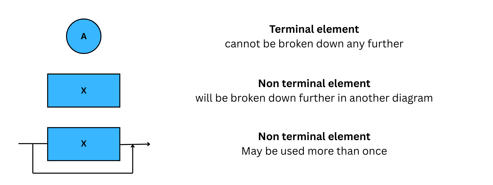
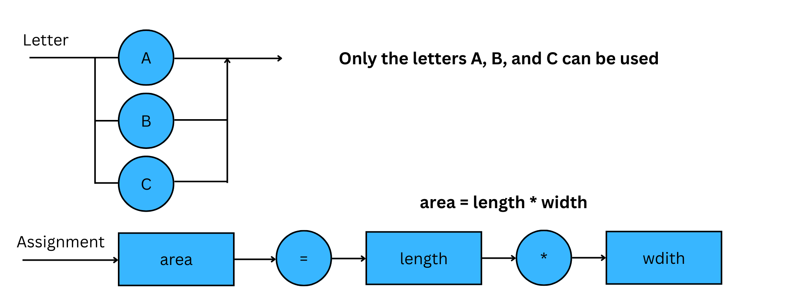

# Syntax Rules

## BNF & syntax diagrams 

> **Spec point** — `spcpt_gWsF6g49PnYds2Bw`

## BNF & syntax diagrams

- When writing programs, you must follow a set of strict rules known as **syntax** — the structure that defines how code must be written.

  - Just like spoken languages have grammar rules, **programming languages have syntax rules**
  - **Each language has its own syntax**, e.g. Python uses indentation, Java uses semicolons
- Programs are first written in **source code** (a high-level language like Python, Java, etc.)
- To run the program, this source code must be **translated into machine code**
- For translation to work, syntax must be **precisely defined** to avoid **ambiguity**
- Translators (compilers or interpreters) rely on these rules to correctly convert the program into a form the CPU can understand

#### Regular expressions and meta-languages

- Regular expressions are used to **describe simple patterns** in text or syntax
- Many programming constructs (like variable names or simple statements) **can be defined** using regular expressions
- However

  - Some aspects of a programming language are **too complex** for regular expressions alone
- When regular expressions aren't enough, we use a **meta-language**
- A language used to **describe the structure of another language**
- The most common example is **Backus-Naur Form (BNF)** or **syntax diagrams**
- These allow us to define:

  - Full grammar rules
  - Nested structures
  - Hierarchical syntax

### What is Backus-Naur form (BNF)?

- BNF is a **meta-language**, a way of writing rules that define the **syntax of programming languages** or **data structures**
- BNF is used to:

  - Describe **formal grammar**
  - Define how statements and expressions are **structured**
  - Ensure that syntax rules are **unambiguous** and **machine-readable**
- BNF uses a set of **rules** made up of:

| **Term** | **Meaning** |
|---|---|
| **Non-terminal** | A category or component (e.g. `<digit>`, `<identifier>`) |
| **Terminal** | An actual value or symbol (e.g. `0`, `1`, `+`, `if`) |
| **::=** | "Is defined as", separates the name from its definition |
| **\|** | "or", it gives alternative definitions |

#### Example 1

- `<digit>` is defined as any single digit 0–9
- `<number>` is defined as:

  - a single digit, or
  - a digit followed by another number (i.e. multiple digits)

#### Example 2

- `<number>` contains one or more digits
- BNF for `<number>` and use it to define `<IDcode>`, which consists of a `<number>` followed by either a `<letter>` or another `<number>`

- Recursive definition of one or more items
- Use of `|` for choice
- Application to a second rule with multiple components

### What is a syntax diagram?

- A syntax diagram is a** graphical representation of BNF** (meta-language)
- It uses** symbols** to map directly to the structure of BNF
- The symbols used are:

#### Examples

