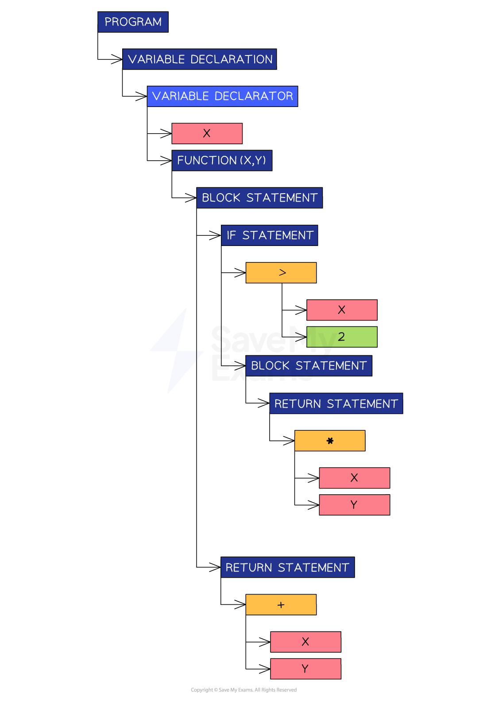

# Translation Process

## Interpreter execution

> **Spec point** — `spcpt_8VQwpnTM66wPN9h8`

## Interpreter execution

### What is an interpreter?

- An interpreter is a type of translator that **executes high-level code line by line**
- It **does not** convert the entire program into a separate machine code file

#### How does it work?

- The source code is **read, analysed, and executed** **one line at a time**
- No complete machine code file is produced, only **immediate execution** happens
- If there is an error in a line**, execution stops**, and the **error is reported immediately**

| **Feature** | **Explanation** |
|---|---|
| No output file | It does **not generate** a standalone `.exe` or machine code file |
| Immediate execution | Runs the code **as it is interpreted** |
| Slower execution | Each line is **translated every time** the program runs |
| Useful for development | Good for testing and debugging during coding |
| Stops on first error | Detects and reports errors **as they occur** |

### Example use cases

- Used in **educational tools**, like Python shells or BASIC interpreters
- Helpful for **rapid prototyping** or when frequent changes are made

## Compilation stages

> **Spec point** — `spcpt_3vWyRRTy5kDyk84q`

## Compilation stages

### What is compilation?

- Compilation is a **process **that** translates a program** written in a high-level programming language into machine code
- **Only machine code** can be executed by a computer
- There are four stages involved in this process:

  - **Lexical Analysis**
  - **Syntax Analysis**
  - **Code Generation**
  - **Optimisation**

### Lexical analysis

- In A Level Computer Science, lexical analysis means studying the **words or vocabulary** of a language
- This stage involves **identifying lexical 'tokens'** in the code
- Tokens represent small meaningful units in the programming language, such as:

  - **Keywords**
  
    - var, const, function, for, while, if
  - **Identifiers**
  
    - Variable names, function names
  - **Operators**
  
    - '+', '++', '-', '*'
  - **Separators**
  
    - ',' ';', '{', '}', '(', ')'

- During this stage, unnecessary elements like comments and whitespace are ignored
- For example, if the following code is being compiled:

`var x = function(x,y) {`

`if(x>2) {`

`return x*y;`

`}`

`return x+y;`
`}`

- The result of lexical analysis is a **token table**

| ** ** | **Token** | **Type** |
|---|---|---|
| 1 | var | Keyword |
| 2 | x | Identifier |
| 3 | = | Operator |
| 4 | function | Keyword |
| 5 | ( | Separator |
| 6 | x | Identifier |
| 7 | , | Separators |
| 8 | y | Identifier |
| 9 | ) | Separator |
| 10 | { | Separator |
| 11 | return | Keyword |
| 12 | x | Identifier |
| 13 | * | Operator |
| 14 | y | Identifier |
| 15 | ; | Separator |
| 16 | } | Separator |

### Syntax analysis

- Now that tokens have been identified, syntax analysis makes sure they all **adhere to the syntax rules** of the programming language
- A symbol, e.g. '\$' could be a valid token but not a valid character according to particular programming languages
- The dollar symbol would be flagged as breaking the syntax rules
- Other syntax errors programmers commonly make include **mismatched parentheses** or **missing semicolons**
- If the code passes the syntax analysis, the compiler can create an **Abstract Syntax Tree** (AST)
- An AST is a graph-based representation of the code being compiled
- An AST is an efficient way to represent the code for the next step

### Example abstract syntax tree

- For the same code as above, the following abstract syntax tree can be created

***Abstract syntax tree***

### Code generation

- This step takes the AST and traverses it to generate ***object code*** that can be executed by the computer

### Optimisation

- This step **modifies the code** to make it **more efficient** without changing its functionality
- This is important to attempt because it** reduces the memory required** to run the code, which leads to faster execution
- A common optimisation action is** removing duplicate code**
- If an 'add' function is written twice in the source code, a sophisticated compiler will notice this and include it only once in the object code
