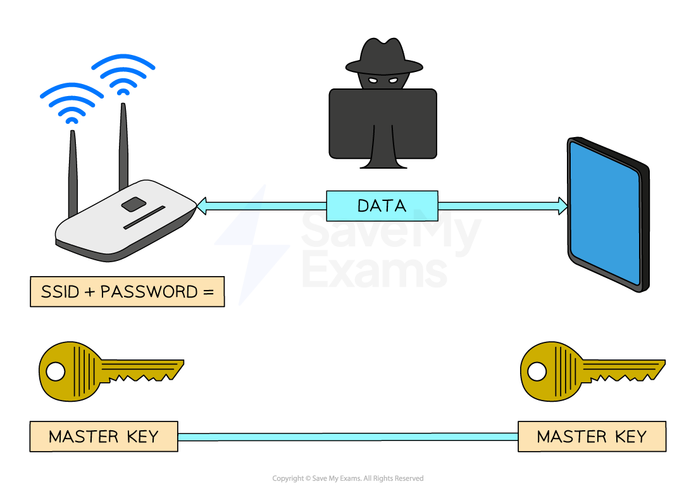
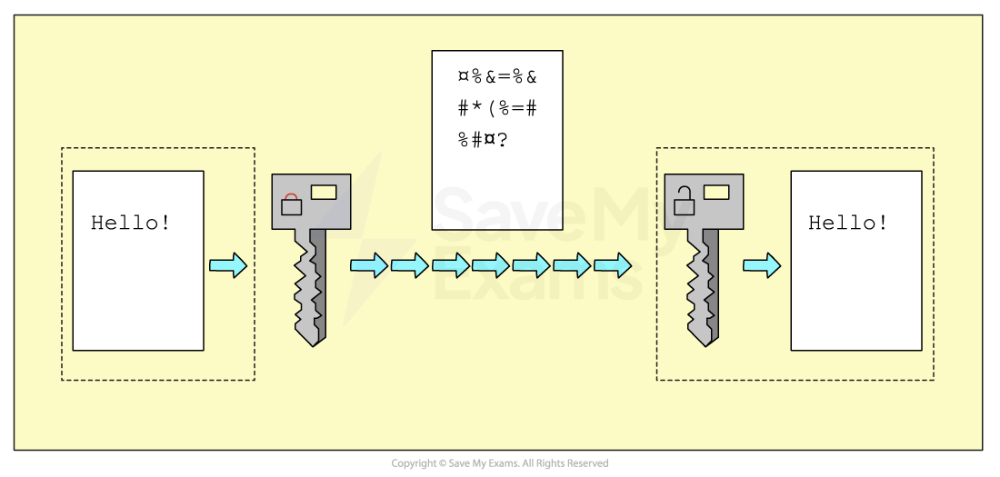
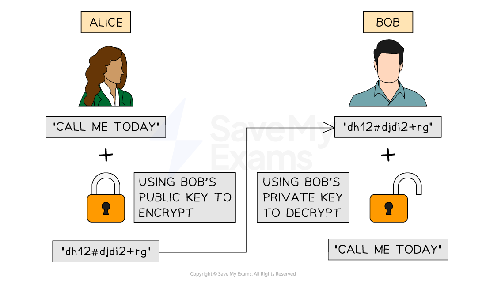

# Encryption

## How encryption works

> **Spec point** — `spcpt_YKWdkZyRCKkV3zsj`

## How encryption works

### What is encryption?

- Encryption is a method of **scrambling data **before being transmitted across a network
- Encryption helps to protect the contents from unauthorised access by** making data meaningless**
- While encryption is important on both **wired** and **wireless **networks, it's even more critical on wireless networks due to the data being transmitted over radio waves, making it easy to **intercept**

### How is wireless data encrypted?

- Wireless networks are identified by a 'Service Set Identifier' (**SSID**) which along with a password is used to create a '**master key**'
- When devices connect to the **same wireless network** using the SSID and password they are given a copy of the master key
- The master key is used to **encrypt **data into '**cipher text**', before being transmitted
- The receiver uses the same master key to **decrypt **the cipher text back to '**plain text**'
- To guarantee the security of data, the **master key is never transmitted**. Without it, any intercepted data is rendered useless
- Wireless networks use dedicated ***protocols*** like **WPA2 **specifically designed for **Wi-Fi** security

### How is wired data encrypted?

- Wired networks are encrypted in a very similar way to a wireless network, using a **master key to encrypt** data and the **same key to decrypt** data
- Encryption on a wired network differs slightly as it is often left to **individual applications to decide** how encryption is used, for example **HTTPS**

## Symmetric & asymmetric encryption

> **Spec point** — `spcpt_Kff6dyNm2C3y8JYR`

## Symmetric & asymmetric encryption

### How does symmetric encryption work?

- The sender uses a key to **encrypt** the data before transmission
- The receiver **uses the same key** to **decrypt** the data
- It's usually **faster**, making it ideal for encrypting **large amounts of data**
- The significant downside is **the challenge of securely sharing this key** between the sender and receiver
- If a **bad actor** captures the key, they can **decrypt all messages intercepted** in transmission

***Structure of Symmetric Encryption***

### How does asymmetric encryption work?

- Asymmetric encryption uses **two keys**:

  - a **public key** for encryption
  - and a **private key** for decryption
- **Receivers** openly share** **their** public key**
- **Senders** use this public key to **encrypt** the data
- The **receiver's private key** is the **only key **that can decrypt the data and is kept locally on their side
- The public and private keys are created at the same time and are **designed to work together** in this way
- It is typically **slower than symmetric encryption**
- It is generally used for **more secure and smaller **data transactions, e.g. **passwords**, **bank details**

***Structure of Asymmetric Encryption***

### Choosing an encryption type

- **Symmetric encryption is fast** but has key-sharing issues; **asymmetric is slower** but solves these issues.
- The choice should be made based on the **situation's needs**: whether **speed** or **security** is more critical.

| **Encryption Type** | **Suitable For** | **Reasons to choose** |
|---|---|---|
| **Symmetric** | Large files, databases | - Fast and efficient for bulk data. - The same person encrypts and decrypts, e.g. when backing up data. |
| **Asymmetric** | Confidential/secret communications | - Sharing highly secure data, e.g. passwords, government communications |

## Quantum cryptography

> **Spec point** — `spcpt_cNf6KNtZmJ4yMYZD`

## Quantum cryptography

## What is quantum cryptograhy?

- Quantum cryptography uses **quantum mechanics** to securely transmit encryption keys
- Its main goal is to enable **unbreakable communication** by detecting any attempt to intercept or tamper with the key
- The most well-known method is:

  - **Quantum Key Distribution (QKD)** – uses quantum particles (like photons) to share a secret key between two parties securely

#### Benefits of quantum cryptography

| Benefit | Explanation |
|---|---|
| **Unbreakable key transmission** | Uses quantum physics – measuring a quantum state disturbs it, so eavesdropping is detectable |
| **Eavesdropper detection** | Any interception changes the quantum state of the key, alerting the users |
| **Perfect forward secrecy** | Keys are used once and then discarded, reducing the impact of future key leaks |
| **Stronger than classical encryption** | Not based on mathematical problems like factoring large primes, so it's not vulnerable to advances in computing (e.g. quantum computers) |

#### Drawbacks of quantum cryptography

| Drawback | Explanation |
|---|---|
| **Expensive and complex** | Requires advanced technology, including specialised hardware like photon detectors and fibre-optic channels |
| **Short distance limits** | Works best over short ranges (limited by current fibre-optic and signal loss issues) |
| **Slow transmission speed** | QKD is typically slower than traditional key exchange methods |
| **Still evolving** | Technology is new and not yet widely available or standardised |
| **Only secures key exchange** | Quantum cryptography secures the key, but not the actual data encryption itself – traditional algorithms still needed |

> **Exam Hint**
> Quantum cryptography isn't about encrypting the message – it’s about securing the **key** used in encryption (e.g. with QKD). Always mention this to show clear understanding.

> **Worked Example**
> Encryption is used to alter data into a form that makes it meaningless if intercepted.
> 
> Describe the purpose of asymmetric key cryptography.
> 
> **Final answer:** **Answer**
> 
> - To provide better security **[1 mark]**
> - … by using two different keys / a public key and a private key **[1 mark]**
> - One of the keys is used to encrypt the message **[1 mark]**
> - … the matching key is used to decrypt the message **[1 mark]**
