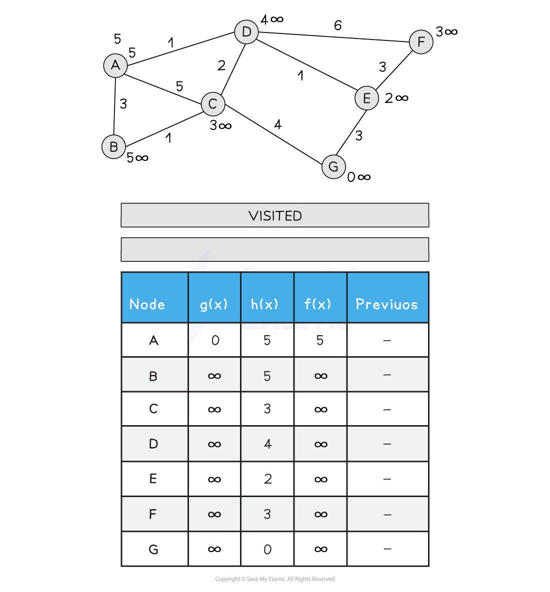
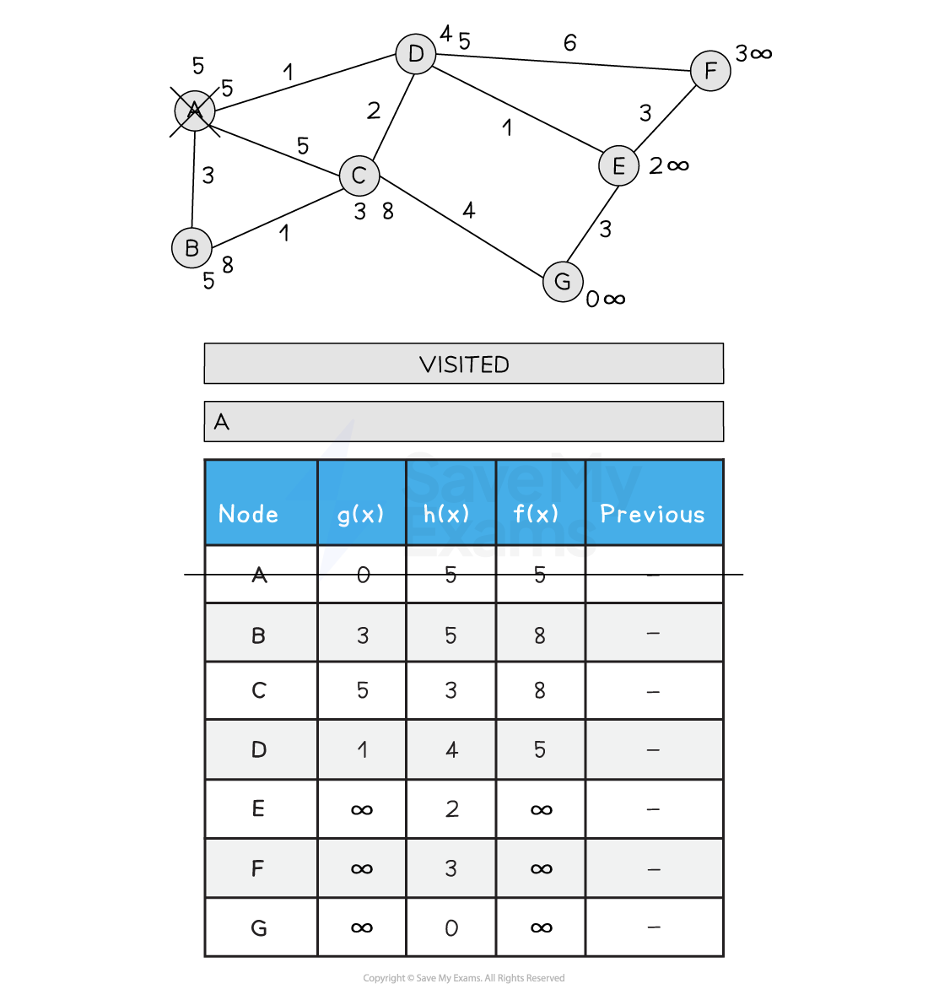
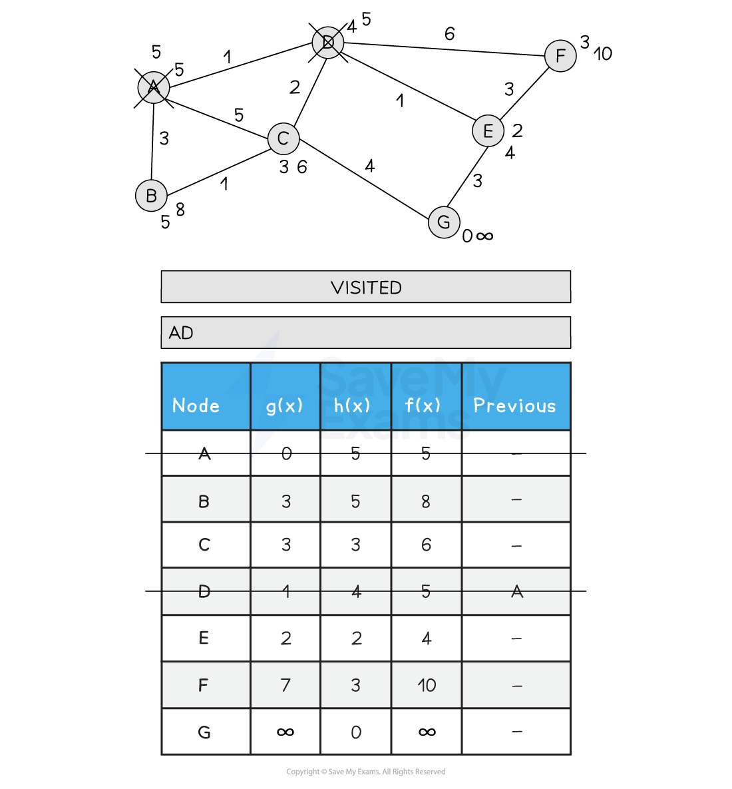
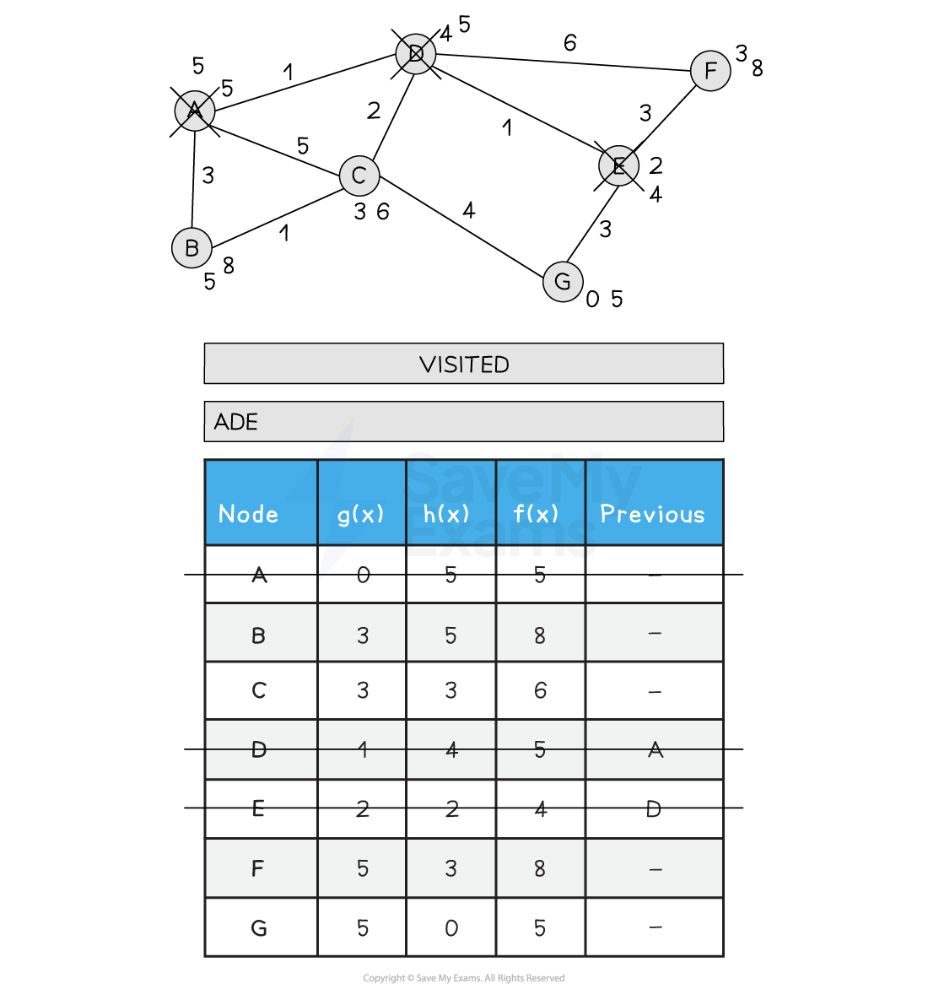
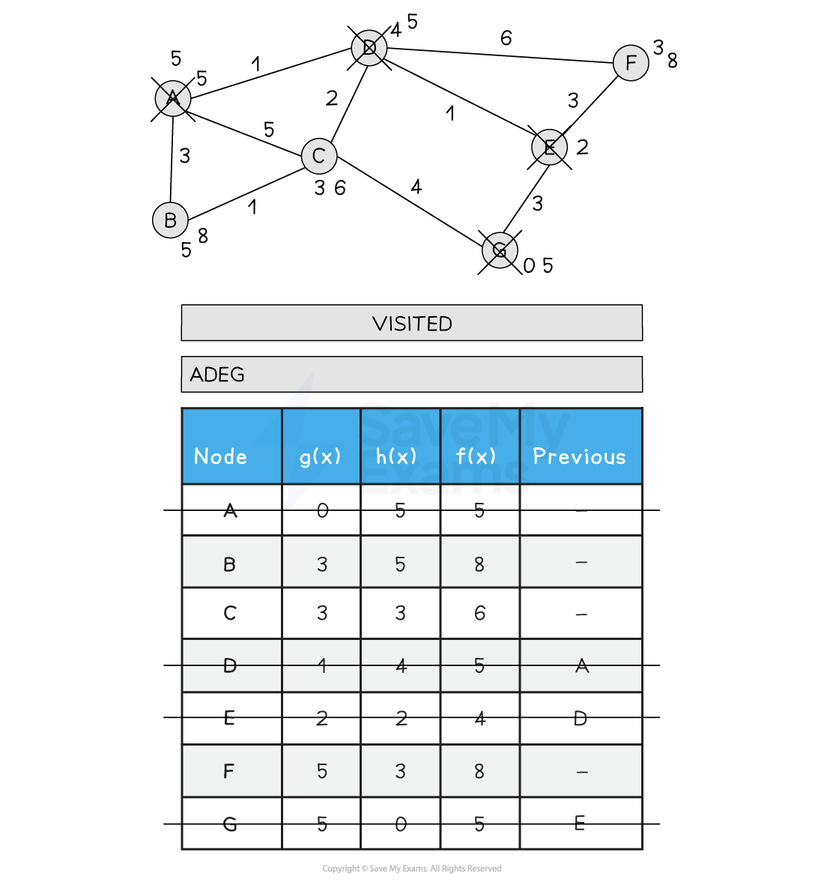
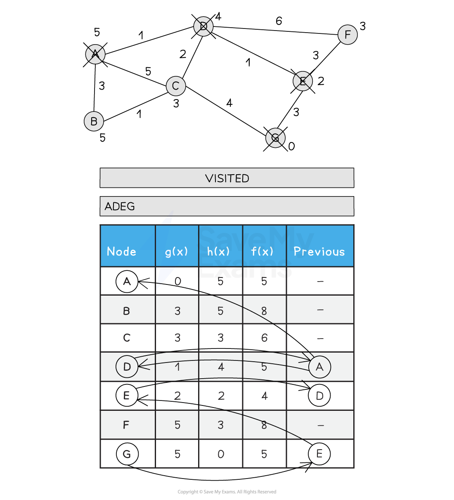

# A* Algorithm

## A* algorithm

> **Spec point** — `spcpt_2bSXG5sGhv7NbRdz`

## A* algorithm

### What is the A* algorithm?

- The **A*** (A-star) algorithm is a **pathfinding algorithm** that builds upon [Dijkstra’s algorithm](https://www.savemyexams.com/a-level/computer-science/cie/19/revision-notes/18-artificial-intelligence-ai-/artificial-intelligence-ai/dijkstras-shortest-path-algorithm/)
- It introduces a **heuristic function** to improve efficiency
- It is used to find the shortest path from a starting node to a goal node in a graph
- While Dijkstra’s algorithm considers only the **actual cost** from the start node:

  - A* enhances this by estimating the **remaining distance** to the goal
  - This makes it **more goal-oriented** and often more efficient

#### How A* improves on Dijkstra’s

- To avoid inefficient detours, A* introduces a **heuristic function**, called **h(x)**
- It estimates the **straight-line distance** (Euclidean distance) from the current node to the goal
- A* combines both cost and estimate using the formula:

  - **f(x) = g(x) + h(x)**
  
    - **g(x)** = the actual cost from the start node to the current node
    - **h(x)** = the heuristic estimate to the goal node
    - **f(x)** = the total estimated cost of the cheapest solution through node x
- By choosing nodes with the lowest **f(x)** value, A* aims to explore paths that are both cheap and **move closer to the goal**

#### Heuristics in A*

- The heuristic function **h(x)** should **never overestimate** the true cost to the goal
- This ensures A* remains **optimally efficient**
- The closer h(x) is to the true cost, the **fewer nodes** A* needs to explore
- If h(x) increases, it may indicate the algorithm is moving **away from the goal**, helping it backtrack or choose a better path
- Below is an illustration of the A* search:

**Figure 2: Performing the A* Search**

### A* vs Dijkstra’s

| Feature | Dijkstra’s | A* Search |
|---|---|---|
| Goal-aware? | No | Yes |
| Cost function | `g(x)` | `g(x) + h(x)` |
| Speed | Slower (explores more) | Faster (more direct toward goal) |
| Use of heuristic | None | Yes, estimates distance to goal |
| Best for... | Full shortest path map | Fastest route to a specific destination |

## Programming A* algorithm

> **Spec point** — `spcpt_J5BcvM4Rh6DBbXJb`

## Programming A* algorithm

### How do you write an A* algorithm?

#### Pseudocode

- `graph[min]` assumes you're storing adjacency lists
- `h[node]` is your heuristic table
- `g[]` and `f[]` are maps (dictionaries) for real cost and estimated total cost
- `cost(min, neighbour)` should be defined or assumed available

#### Python

**Example usage:**

**Output:**

- A possible shortest path from `'A'` to `'E'`, guided by the heuristic values
