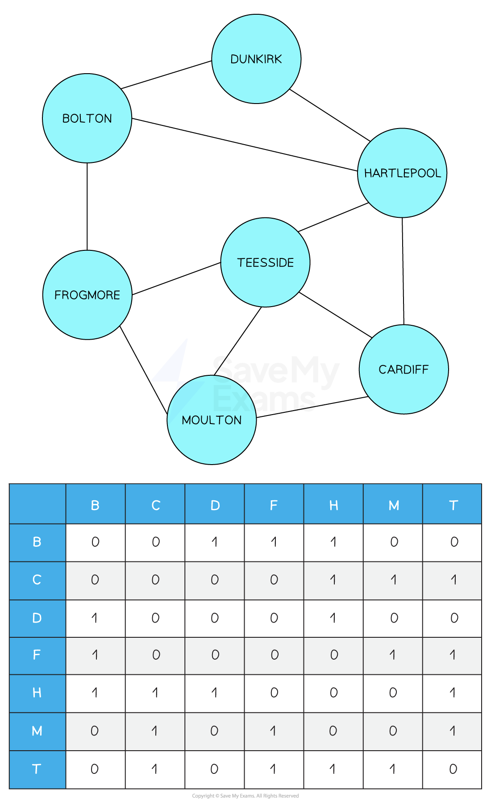
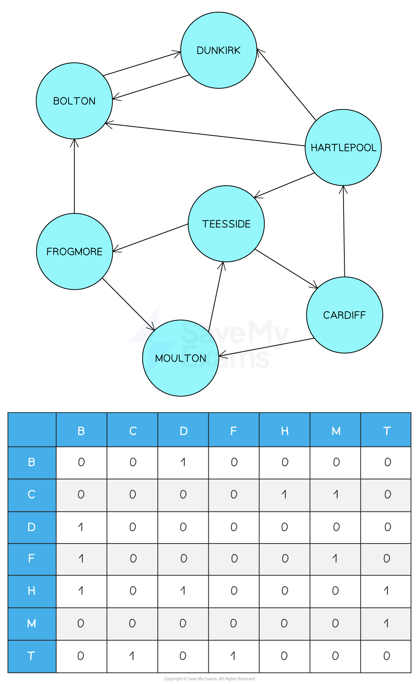
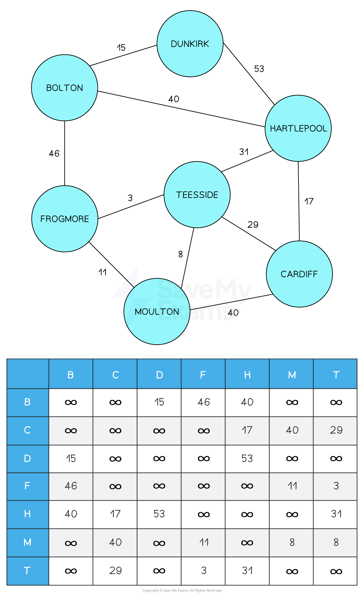

# AI & Graphs

## Graphs to aid AI

> **Spec point** — `spcpt_HNS3xKz4BqMRHX7K`

## Graphs to aid AI

### What is a graph?

- A graph is a set of **vertices/nodes** connected by **edges/arcs**
- In AI, graphs are used to **model relationships, networks, and decision-making problems**
- They can represent things like:

  - Routes between cities (pathfinding)
  - Connections in a neural network
  - State transitions in decision trees or planning

#### Types of graphs

| **Type** | **Use in AI** |
|---|---|
| **Directed Graph** | Models one-way relationships, such as **state transitions** in search algorithms (e.g. A*) |
| **Undirected Graph** | Useful for **bidirectional relationships**, such as undirected social connections in a graph |
| **Weighted Graph** | Represents **costs or heuristics**, commonly used in **shortest path algorithms** like Dijkstra's or A* |

#### Representation of graphs

- Graphs can be represented using:

  - **Adjacency Matrix** – ideal for dense graphs and fast lookup
  - **Adjacency List** – more space, efficient for sparse graphs (often used in AI search)
- Both can be **used in AI to represent problem spaces** such as:

  - Game boards
  - Map-based navigation
  - Resource allocation networks

### Undirected, unweighted graph

- An **undirected, unweighted graph** is a type of graph where:

  - **Edges have no direction** , connections go both ways
  - **All edges are equal**, there are no weights or costs
  - It is represented with a **symmetric adjacency matrix**, where a `1` indicates a connection and a `0` means no connection

- In this example:

  - Each **node** is a town (e.g. Bolton, Dunkirk, Teesside)
  - A `1` in the matrix shows a **connection exists** between two towns
  - A `0` means no direct connection
- Example:

  - Bolton and Frogmore have a `1` at their intersection → they are connected
  - Dunkirk and Moulton have a `0` → no direct connection
- The matrix is **symmetric**, confirming that the graph is **undirected**

#### AI relevance

- Undirected, unweighted graphs are useful in AI for:

  - **Exploring environments**, e.g. mapping rooms in a building with equal-cost connections
  - **Clustering** in **machine learning**, where the presence of a connection implies similarity
  - **Social network analysis**, where mutual connections (friendships, links) are undirected
- These graphs are often used in:

  - **Depth-first** or **breadth-first search**
  - **Graph traversal algorithms** to explore all reachable nodes

### Directed, unweighted graph

- A directed graph (or digraph) is one where **edges have a direction**
- This means connections go from one node **to another**
- Connections** cannot be traversed in reverse** unless another directed edge exists

- In this example:

  - Each node represents a **town**
  - Arrows show the **direction** of travel
  - A `1` in the matrix at (row X, column Y) means there is a **directed edge from X to Y**
  - A `0` means there is **no direct connection**
- For instance:

  - `B → D` is allowed (matrix value = 1)
  - `D → C` is not allowed (matrix value = 0)
- Because this matrix is **not symmetric**, it reflects the **one-way nature** of connections

#### AI relevance

- Directed, unweighted graphs are essential in AI for:

| **Use case** | **How the graph is used** |
|---|---|
| **Search algorithms** | Used in **A***, **BFS**, **DFS** where state transitions are directional |
| **Expert systems / rule engines** | Representing dependencies between logical conditions or actions |
| **Planning and scheduling** | Modelling **prerequisites** and directed workflows |
| **Navigation** | Handling one-way streets or directed transport systems |

### Undirected, weighted graph

- An **undirected, weighted graph** is a graph where:

  - **Edges go both ways** (no direction)
  - **Each edge has a weight**, which can represent:
  
    - Cost
    - Distance
    - Time
    - Risk
- If no connection exists between two nodes, the matrix contains **∞ (infinity)**

- Nodes represent **towns**
- Edges represent **roads**, and **weights** represent distances or costs
- In the matrix:

  - `matrix[B][D] = 15` → Bolton to Dunkirk is 15 units
  - `matrix[B][C] = ∞` → Bolton and Cardiff are not directly connected
- The matrix is **symmetric**, confirming this is an **undirected** graph

#### AI relevance

- Undirected, weighted graphs are widely used in AI when:

| **Use case** | **How It helps AI** |
|---|---|
| **Pathfinding (e.g. A*, Dijkstra)** | Finding the **lowest cost path** between nodes |
| **Clustering & similarity graphs** | Edges represent **strength of relationships** or **similarity weights** |
| **Recommendation engines** | Connecting users or items based on weighted similarity |
| **Robotics & navigation** | Planning efficient movement paths through environments |

- In AI, the **weights** are crucial for deciding the **best route or option** when multiple paths are available

### Directed, weighted graph

- A **directed, weighted graph** is a graph where:

  - **Edges have a direction** (e.g. `A → B` but not `B → A`)
  - Each edge has a **weight**, such as:
  
    - Distance
    - Cost
    - Time
    - Probability
- If there is **no edge**, the value is **∞ (infinity)**

- Nodes = Towns
- Edges = One-way roads
- Weights = Travel cost or distance
- The adjacency matrix:

  - `B → D = 15` → there is a road from Bolton to Dunkirk costing 15 units
  - `C → H = 17` → Cardiff to Hartlepool has a weight of 17
  - `H → T = 31` but `T → H = ∞` → you can get from Hartlepool to Teesside, but not the other way
- This matrix is **not symmetric**, confirming the graph is **directed**

#### AI relevance

- Directed, weighted graphs are critical in AI for:

| **Use case** | **Purpose in AI** |
|---|---|
| *A and Dijkstra algorithms** | Choosing the **shortest path** where direction and cost matter |
| **Route planning in robotics** | Modelling direction-sensitive travel (e.g. traffic rules) |
| **Search algorithms** | Tracking cost between **transitions between states** |
| **Reinforcement learning** | Modelling **rewards/costs** for state transitions in decision environments |
| **Game AI** | Movement systems with **terrain costs or restrictions** |
