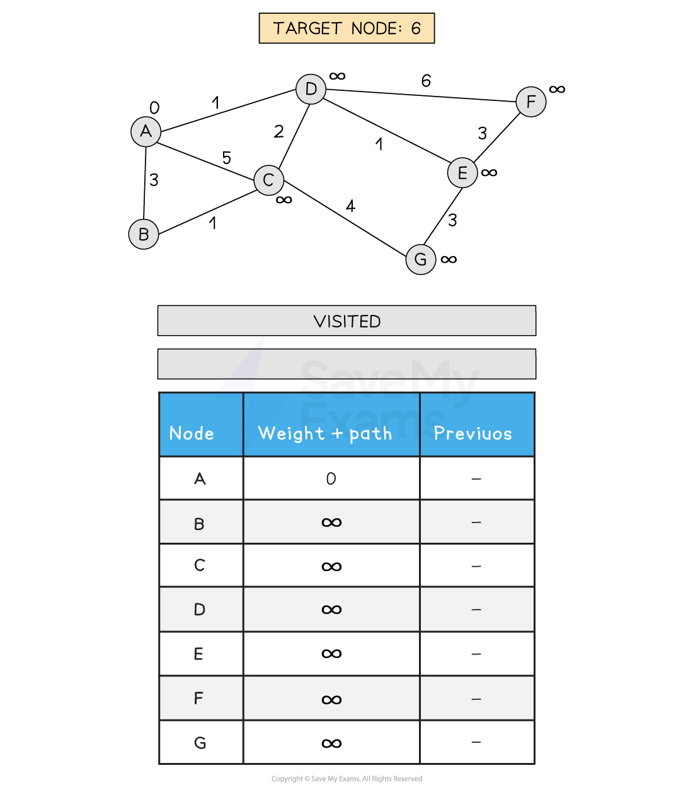
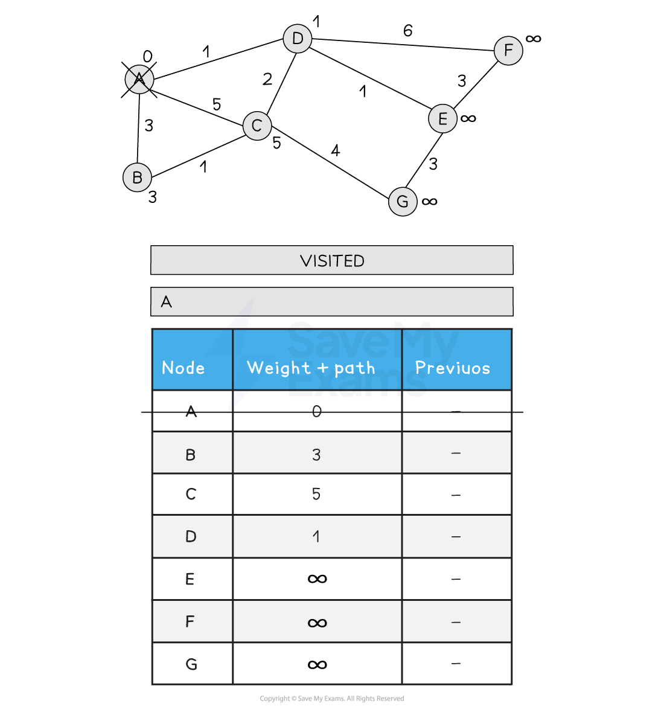
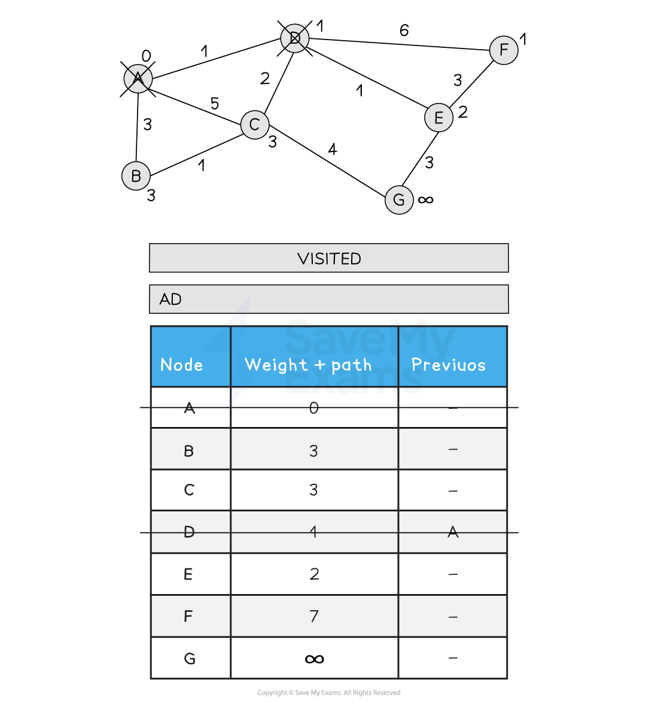
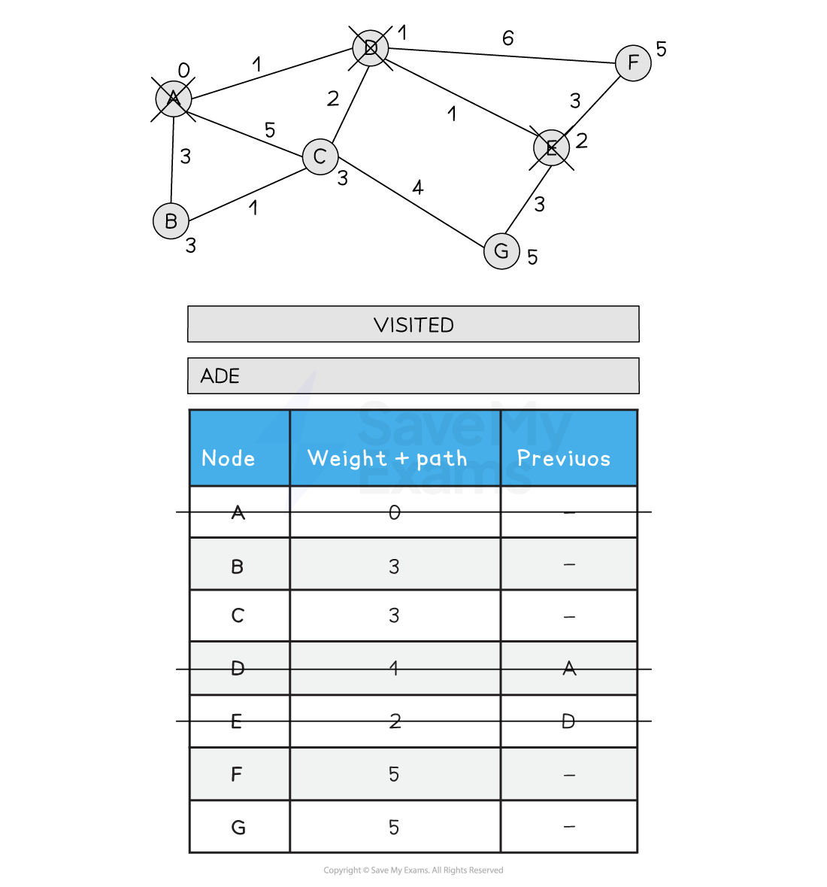
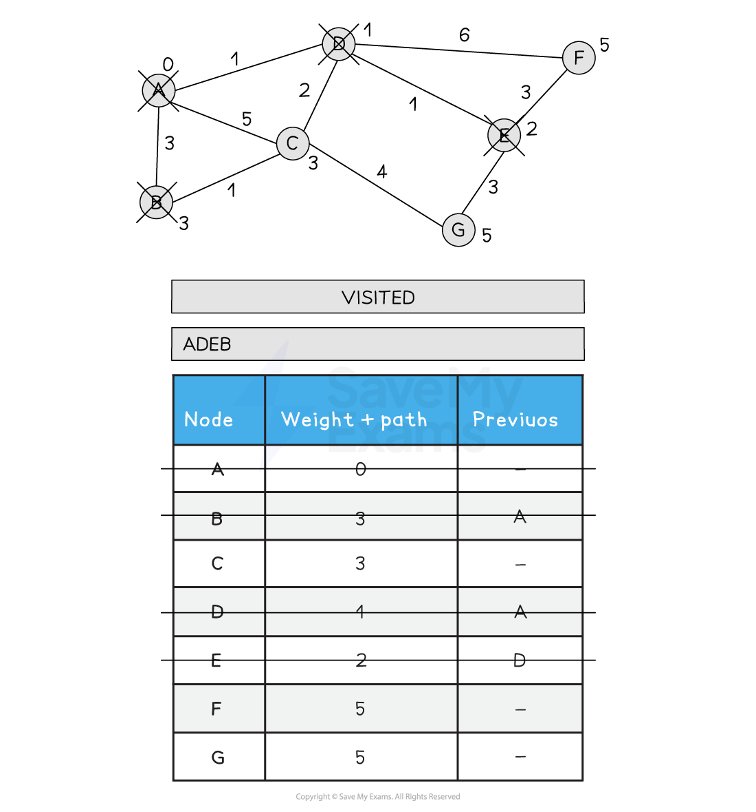
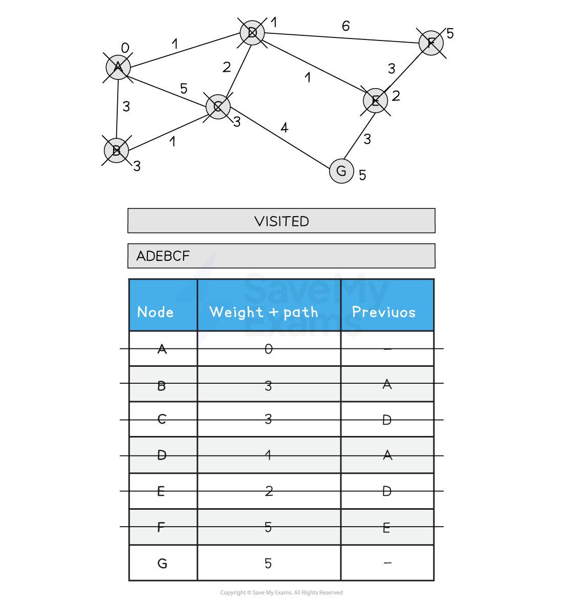
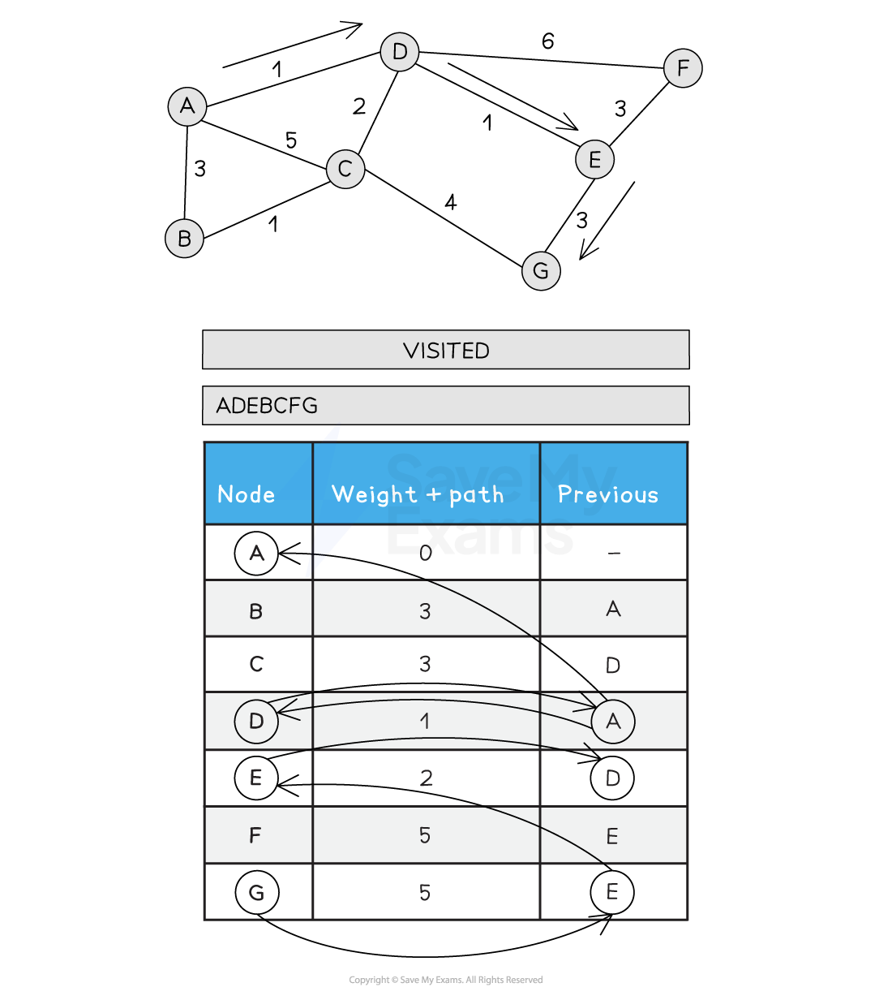

# Dijkstra's Shortest Path Algorithm

## Dijkstra’s shortest path algorithm

> **Spec point** — `spcpt_6F4Xrny7TCtHppSH`

## Dijkstra’s shortest path algorithm

- In Computer Science, an **optimisation problem** involves finding the **most efficient solution** to a given problem
- This could mean **minimising** cost, time, or resource usage, or **maximising **output, efficiency, or value
- Examples of optimisation problems include:

  - **Finding the shortest route** between two locations (e.g. Google Maps)
  - **Minimising resource usage** in manufacturing or video games
  - **Creating efficient timetables** (e.g. for schools or offices)
  - **Scheduling tasks** and staff shifts to avoid conflicts or downtime
- One of the most common real-world examples is **finding the shortest path from A to B**, which is exactly what Dijkstra’s algorithm solves

## What is Dijkstra’s shortest path algorithm?

- In A Level Computer Science, **Dijkstra’s shortest path algorithm** is a classic **optimisation algorithm**
- It calculates the shortest path from a **starting node** to **all other nodes** in a **weighted graph**
- It is often compared to **breadth-first search**, but Dijkstra’s includes edge weights and ensures the **lowest total cost** to reach each destination node

#### How It works:

- The graph is made up of **nodes (vertices)** and **edges (arcs)**
- Each edge has a **weight**, which can represent:

  - Time
  - Distance
  - Cost
- The algorithm **explores all possible routes**, keeping track of the shortest known distance to each node
- It guarantees the **optimal path** from the start node to every other node in the graph
- For revision on graphs, see [section 18 - AI & Graphs](https://www.savemyexams.com/a-level/computer-science/cie/19/revision-notes/18-artificial-intelligence-ai-/artificial-intelligence-ai/ai-and-graphs/)
- An illustrated example of Dijkstra’s algorithm is shown below:

#### Performing Dijkstra's shortest path algorithm

- Set A path to 0 and all other path weights to infinity

- Visit A. Update all neighbouring nodes path weights to the distance from A + A's path weight (0)

- Choose the next node to visit that has the lowest path weight (D)
- Visit D
- Update all neighbouring, non-visited nodes with a new path weight if the old path weight is bigger than the new path weight
- C is updated from 5 to 3 as the new path is shorted (A > D > C)

- Choose the next node to visit that has the lowest path weight (E)
- Visit E
- Update all neighbouring, non-visited nodes from E with a new path weight
- F is updated from 7 to 5 as the new path is shorter (A > D > E > F)

- Choose the next node to visit, alphabetically (B)
- Visit B
- Update all neighbouring non-visited nodes from B with a new weight if the path is less than the current path
- C is not updated as A > B > C is 4

- Choose the next lowest node and visit (C)
- Update C's neighbours if the new path is shorter than the old path
- A > D > C > G is 8, so G is not updated

- Choose the next lowest node and visit (F)
- Update F's neighbours if the new path is shorter than the old path
- F has no non-visited neighbours so no updates are made

- Choose the next lowest node and visit (G)
- G has no non-visited neighbours so no updates are made
- All nodes have been visited
- Back tracking from G gives the following order and total distance A-D-E-G (5)

***Figure 1: Performing Dijkstra’s Shortest path Algorithm***

## Programming Dijkstra's shortest path algorithm

> **Spec point** — `spcpt_xPrbzkS5Gq5kTCcm`

## Programming Dijkstra's shortest path algorithm

### How do you write Dijkstra's shortest path algorithm?

#### Pseudocode

**Assumptions:**

- `graph[node]` returns a list of neighbour nodes
- `weight(x, y)` returns the edge weight between node `x` and `y`
- Lists like `visited`, `unvisited`, and `path` support `ADD` and `REMOVE`

#### Python

**Example usage:**

**Output:**

- A list of nodes representing the **shortest path** from `'A'` to `'E'`
