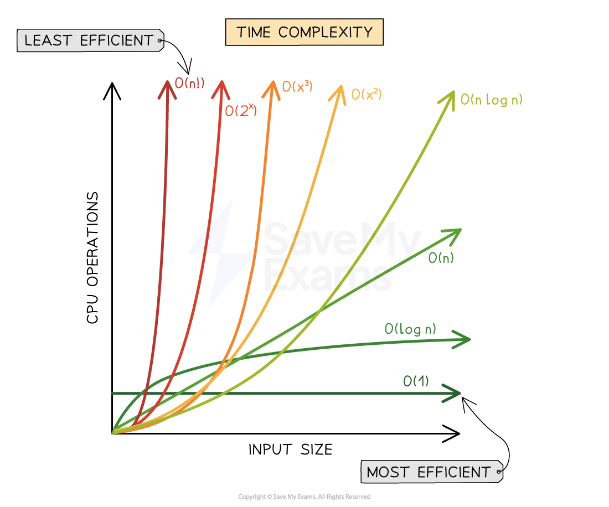

# Algorithm Analysis

## Suitability of algorithms

> **Spec point** — `spcpt_3zm2hqrBFtvw4ZXm`

## Suitability of algorithms

### Why do we need to check the suitability of algorithms?

- Algorithms must be compared to **determine how suitable they are for solving a specific problem **or working with a particular set of data
- Key factors in comparing algorithms include:

  - **How long** they take to complete a task (**time complexity**)
  - **How much memory** they require to complete a task (**space complexity**)
- Generally, the most suitable algorithm is the one that solves the problem in the **shortest time** and using the **least memory**

### Time complexity

- Time complexity refers to the **number of operations or steps** an algorithm takes to complete, **not the actual time in seconds or minutes**
- It is important to understand that time complexity is **independent of hardware performance**
- A faster CPU may execute instructions more quickly, but the number of instructions the algorithm performs remains the same

#### Analogy: Running a marathon

- The marathon distance = the algorithm
- The runners = different CPUs
- Each runner finishes at a different time, but the distance (number of steps) is the same

### Space complexity

- Space complexity refers to the **amount of memory** an algorithm needs to complete its task
- Memory usage includes:

  - Space for input data
  - Temporary variables
  - Any additional data structures (e.g. arrays, stacks, queues)
- For example:

  - If an algorithm **creates a new copy** of the input data, it will require more memory than one that modifies the data in place
  - An algorithm that uses **recursion** may use more memory due to the **call stack**

## Big O Notation

> **Spec point** — `spcpt_35Sp4YK9qjgFjdPx`

## Big O Notation

### What is Big O Notation?

- Big O Notation is a mathematical way to describe the **time** and **space complexity** of an algorithm
- It shows how well an algorithm scales as the size of the input increases

  - It describes the **order of growth** (efficiency) of an algorithm
  - It is **hardware-independent** – it measures steps or operations, not seconds
  - Named after German mathematician **Edmund Landau**

#### Big O Rules:

1. Keep only the **dominant term** (largest exponent or growth rate)
2. **Ignore constants** – they become insignificant as input size grows

## Types of time complexity

#### O(1) – Constant time

- The algorithm always takes the same number of steps, regardless of input size

`totalLength = len(s)`

- The length is returned in one step, even if the string is very long

#### O(n) – Linear time

- The number of steps increases proportionally with the input size `n`

- For input size `n`, the algorithm performs `n + 1` steps
- Example with multiple loops:

- Total steps = `3x + 5` ⇒ Still O(n) as x grows

#### O(n^2) – Polynomial time

- Performance is proportional to the square of the input size
- Caused by **nested loops**

- Steps: `x^2 + x + 2` ⇒ Dominant term is `x^2` ⇒ O(n^2)
- As x increases, the impact of lower-order terms and constants becomes negligible

#### O(log n) – Logarithmic time

- The number of steps grows slowly even as input size grows rapidly
- Common in **binary search**

  - Example: `log2(8) = 3`, because 2^3 = 8
  - Doubling input size barely affects total steps

| x | log2(x) |
|---|---|
| 1 | 0 |
| 8 | 3 |
| 1,024 | 10 |
| 1,048,576 | 20 |
| 1,073,741,824 | 30 |

- Very efficient – useful for large datasets

#### O(2^n) – Exponential time

- The number of steps **doubles** for every additional input value
- Grows extremely fast
- Very inefficient, but some problems (e.g. brute-force solutions) fall into this category

| x | 2^x |
|---|---|
| 1 | 2 |
| 10 | 1,024 |
| 100 | ~10^30 |

- Rare in practice unless necessary

#### O(n log n) – Linear logarithmic time

- Algorithms that **divide** data and **process** each part
- Example: **Merge Sort**
- More efficient than O(n^2), commonly used in sorting

### Best, average, and worst case

- Every algorithm has different performance depending on input:

| Case | Description | Example (Linear Search) |
|---|---|---|
| Best case | Most efficient scenario | Item is first → O(1) |
| Average case | Typical input | Item is in middle → O(n) |
| Worst case | Least efficient scenario | Item not found → O(n) |

- **Big O notation usually describes the worst-case** performance to guarantee a minimum standard

### How to derive Big O from code

1. **Count loops**:

  - 1 loop = O(n)
  - 2 nested loops = O(n^2)
  - No loops = O(1)
2. **Ignore constants and lower-order terms**:

  - `3n^2 + 4n + 5` → O(n^2)

#### Examples

- One loop → O(n)

- One statement → O(1)

### Time complexity graph

- From the graph, **exponential time (2****n****)** grows the** quickest** and therefore is the most **inefficient** form of algorithm, followed by **polynomial time (n****2****)**, **linear time (n)**, **logarithmic time (logn)** and finally** constant time (1)**
- Further time complexities exist such as **factorial time (n!)** which performs **worse than exponential time** and **linear-logarithmic time (nlogn)** which sits **between polynomial and linear time**. Merge sort is an example of an algorithm that uses O(nlogn) time complexity
- The Big-O time complexity of an algorithm can be derived by inspecting its component parts
- It is important to know that when determining an algorithm's Big-O that **only the dominant factor is used**.
- This means the time complexity that **contributes the most** to the algorithm is used to describe the algorithm. For example:

  - 3x2 + 4x + 5, which describes three nested loops, four standard loops and five statements is described as O(n2)
  - x2 is the dominating factor. As the input size grows x2 contributes proportionally more than the other factors
  - Coefficients are also removed from the Big-O notation. The 3 in 3x2 acts as a multiplicative value whose contribution becomes smaller and smaller as the size of the input increases.
  
    - For an arbitrarily large value such as 10100, which is 10 with one hundred 0’s after it, multiplying this number by 3 will have little contribution to the overall time complexity. 3 is therefore dropped from the overall time complexity
