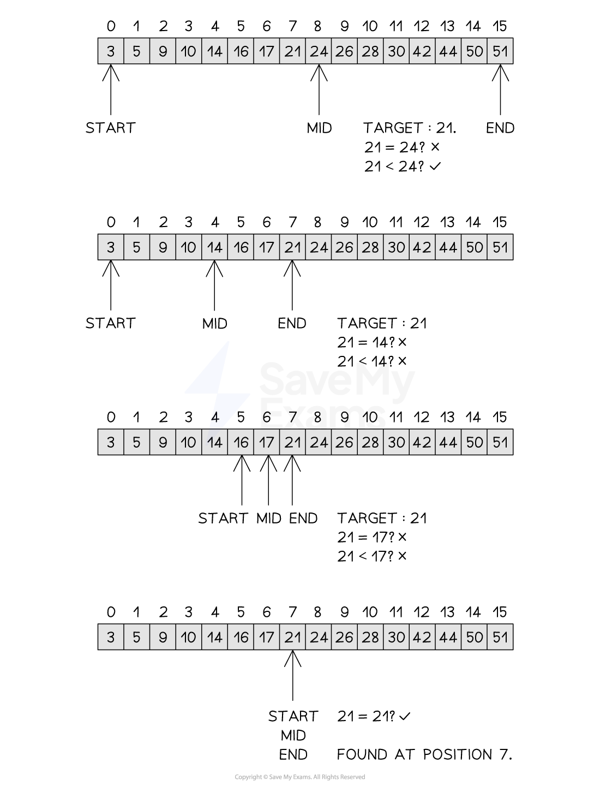

# Binary Search

## Binary search

> **Spec point** — `spcpt_k4NdKwZVJ4bP3VDK`

## Binary search

### What is a binary search?

- The binary search is a more efficient search method than linear search
- The binary search **compares the middle item to the searched for target item**. If the **values match** then the **index is returned**. If not then the list is adjusted such that:

  - the **top half is ignored** if the** target item is less** than the middle value
  - or the **bottom half is ignored** if the **target item is larger** than the middle value
- Once the list has been adjusted, the search continues until the item is found or the item is not in the list
- It is important to note that the** list must be sorted **for the binary search to work correctly
- The implementation of the binary search is shown below

#### Performing the binary search

***Figure 2: Performing the Binary Search***

> **Exam Hint**
> - When determining the rounding of the midpoint, rounding up or down are both valid provided consistent use of the same rounding is used throughout the algorithm
> - It is important to note that the binary search does not discard, delete or remove parts of the list, it only adjusts the start, end and mid pointers. This only gives the appearance that items have been discarded or deleted

#### Time complexity of a binary search

- The binary search is an example of a logarithmic time complexity O(logn) as it halves the search space with each iteration of the while loop. This approach is known as **divide and conquer**, where a problem is progressively reduced in size such that when each problem is at its smallest it is easiest to solve
- The algorithm starts with n items before the first iteration. After the first there are n/2 items, after the second there are n/4 items, after the third there are n/8 items and so on, leading to n/2i after i iterations
- The **worst case scenario** or maximum number of iterations to find one item is where n/2i = 1

  - Multiply both sides by 2i to get: n = 2i
  - Take the logarithm of both sides: logn = log2i
  - Rewrite with i at the front (using laws of logarithms): logn = ilog2
  - Log2 (assuming a base of 2 is used) becomes 1, giving: logn = i
  - The binary search is therefore **O(logn)**
- The **best case scenario would be O(1)** where the item is found on the first comparison, while the **average case** would be O(logn/2) which would find the item somewhere in the middle of the search. Removing coefficients means the average case would therefore still be **O(logn)**

#### Space complexity of a binary search

- As the binary search requires no additional space, it is space complexity O(n), where n is the number of items in the list

#### Tracing a binary search

- Given the following list [3, 5, 9, 10, 14, 16, 17, 21, 24, 26, 28, 30, 42, 44, 50, 51], a trace table for the binary search is shown below

**Trace Table for the Binary Search**

| **item** | **index** | **found** | **start** | **end** | **mid** | **list[mid]** |
|---|---|---|---|---|---|---|
| 21 | -1 | False | 0 | 15 | 8 | 24 |
|   |   |   | 0 | 7 | 4 | 14 |
|   |   |   | 5 | 7 | 6 | 17 |
| 21 | 7 | True | 7 | 7 | 7 | 21 |

### Implementing a binary search

#### Pseudocode

- **Function definition**:
`FUNCTION binarySearch(list : ARRAY OF INTEGER, item : INTEGER) RETURNS INTEGER`

  - The function searches a **sorted array** for a given item.
  - It returns the **index** of the item if found, or **-1** if not found.

- **Variable declarations**:

  - `found` → a flag to indicate if the item is found (initially `FALSE`)
  - `index` → the result to be returned (initially `-1`)
  - `start` → index of the start of the current search range (initially `0`)
  - `end` → index of the end of the current search range (initially `LENGTH(list) - 1`)
  - `mid` → index of the middle element in the current range

- **Loop condition**:
`WHILE start <= end AND found = FALSE`

  - Keep searching while the search range is valid **and** the item hasn't been found.

- **Middle element calculation**:
`mid ← (start + end) DIV 2`

  - Calculates the index of the middle element of the current search range.

- **Check for match**:
`IF list[mid] = item THEN`

  - If the middle element is equal to the target item:
  
    - Set `found ← TRUE`
    - Store the `index ← mid`

- **Adjust search range**:

  - If the middle value is **less than** the item:
  
    - Search the **right half** → `start ← mid + 1`
  - Otherwise:
  
    - Search the **left half** → `end ← mid - 1`

- **Loop ends**:

  - The loop stops when the item is found **or** the search range becomes invalid.

- **Return value**:
`RETURN index`

  - Returns the index if found, or `-1` if not found

#### Python

#### Java
