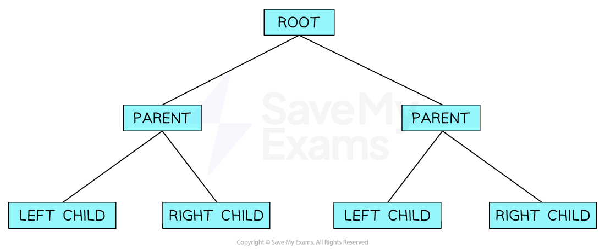
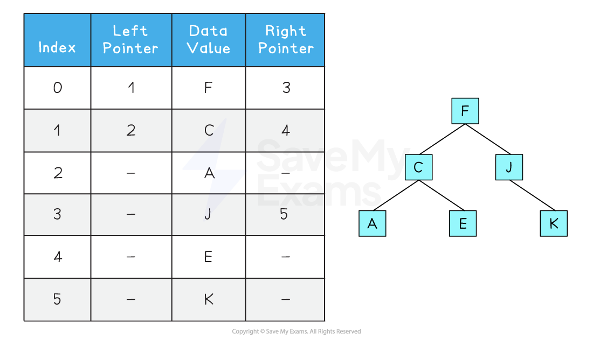

# Binary Trees

## Binary trees

> **Spec point** — `spcpt_hRhHmbZxSpFB7chR`

## Binary trees

### What is a binary tree?

- A binary *tree* is a **rooted tree** where every node has a **maximum of 2 nodes**
- A binary tree is essentially a ***graph*** and therefore can be implemented in the same way
- You must understand:

  - **Tree traversal of a tree data structure**
  - **Add new data to a tree**
  - **Remove data from a tree**

- The most common way to represent a binary tree is by storing each node with a **left and right pointer**

This information is usually implemented **using 2D arrays **

#### Tree terminology

| **Keyword** | **Definition** |
|---|---|
| **Node** | An item in a tree |
| **Edge** | Connects two nodes together and is also known as a branch or pointer |
| **Root** | A single node which does not have any incoming nodes |
| **Child** | A node with incoming edges |
| **Parent** | A node with outgoing edges |
| **Subtree** | A subsection of a tree consisting of a parent and all the children of a parent |
| **Leaf** | A node with no children |
| **Traversing** | The process of visiting each node in a tree data structure, exactly once |

### How do you program a tree?

- In the following example:

  - A tree is represented using a `TreeNode` **structure**, which includes:
  
    - A `value` field to store the data held in the node
    - A `children` field to store a collection (e.g. list or array) of child nodes
  - The `createTreeNode` function is used to **initialise a new tree node**, setting its value and creating an empty collection for its children
  - The `addChild` function allows a new child node to be **added to a parent node**
  
    - It creates a new `TreeNode` with the given value and appends it to the parent's `children` collection
  - Finally, the `createTreeNode` function is used to create the **root node**
  
    - Additional child nodes are added using the `addChild` function, allowing a **multi-level tree structure** to be built with branches and sub-branches

| Pseudocode |
|---|
|   |

| Python |
|---|
|   |

| Java |
|---|
|   |

### Algorithm to traverse a tree structure

| Pseudocode - pre-order tree traversal |
|---|
|   |

| Python - pre-order tree traversal |
|---|
|   |

| Java - pre-order tree traversal |
|---|
|   |

- For a tree like: `Root ` `├── Child 1 ` `│   └── Grandchild 1.1 ` `└── Child 2 `
- The output will be: `Root   ` `Child 1   ` `Grandchild 1.1   ` `Child 2`

### Algorithm to add data to a tree structure

| Pseudocode |
|---|
|   |

| Python |
|---|
|   |

| Java |
|---|
|   |

- These examples all **create a new node** with the provided value and **attach it to the given parent node**
- This approach allows dynamic construction of trees with multiple levels

### Algorithm to remove data to a tree structure

| Pseudocode |
|---|
|   |

| Python |
|---|
|   |

| Java |
|---|
|   |

- This only removes the **first matching child** from the direct children of a node
- If you want to remove nodes **anywhere in the tree**, you’d need a recursive version
- `REMOVE` and `del` and `.remove()` work because the `children` collection is a list/array
