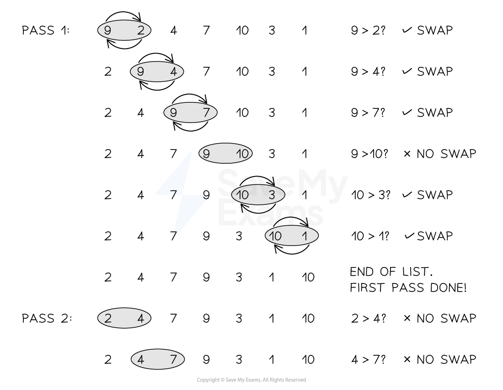

# Bubble Sort

## Bubble sort

> **Spec point** — `spcpt_GKFVVHVJpwRgY6XY`

## Bubble sort

### What is a bubble sort?

- In A Level Computer Science, a bubble sort sorts items into order,** smallest to largest**
- It **compares pairs of elements** and swaps them if they are out of order
- The first element is compared to the second, the second to the third, the third to the fourth and so on, until the second to last is compared to the last. Swaps occur if each comparison is out of order
- This overall process is called a **pass**

> **Exam Hint**
> The highest value in the list eventually “bubbles” its way to the top like a fizzy drink, hence the name “Bubble sort”

- Once the **end of the list** has been reached, the **value at the top of the list is now in order** and the **sort resets back to the start of the list**. The **next largest value** is then **sorted** to the top of the list
- More passes are completed until all elements are in the correct order
- A **final pass** checks all elements and if no swaps are made then the sort is complete
- An example of using a bubble sort would be sorting an array of names into alphabetical order, or sorting an array of student marks from a test

#### Performing the bubble sort

***Figure 1: Performing the Bubble sort***

#### Time complexity of the bubble sort

- To determine the algorithm's execution time as measured by the number of instructions or steps carried out Big-O notation must be used
- Four statements are present in the above algorithm O(1), followed by a while loop O(n) containing two statements and a further for loop O(n). This results in the expression: 2n2 + 4
- As **coefficients and lower order values are not used**, this give the bubble sort **O(n****2****)** **worst case time complexity**
- The** best case scenario** would be an **already sorted list** which means a time complexity of **O(n)** as each item must still be compared to check if they are in order
- The **average case scenario** would be an **almost sorted list** leading to O(n2/2), which if coefficients are removed still gives **O(n****2****)**

#### Space complexity of the bubble sort

- A bubble sort has a space complexity of O(1) because it operates in-place, requiring a fixed amount of memory
- The fixed amount of memory is for variables such as loop counters and a temporary swap variable

#### Tracing a bubble sort

- The trace table follows the algorithm through, updating values that change in the table
- Each iteration of the list reduces the overall size of the list by 1 as after each pass the previously sorted final digit is in order and does not need to be rechecked. This means that 9 is in order and doesn't need to be rechecked, followed by 9 and 7, followed by 9, 7 and 6 and so on
- When the if statement is checked a new row has been added to show the swap of list[j], list[j + 1] and Temp, followed by the subsequent change to Swap from FALSE to TRUE
- After several iterations (that are not shown) the algorithm will eventually output a sorted list

**Trace table of the bubble sort**

| **LastElement** | **Index** | **Mylist[Index]** | **Mylist[Index + 1]** | **Temp** | **Swap** | **Output** |
|---|---|---|---|---|---|---|
| 10 | 1 | 5 | 9 |   | FALSE |   |
|   | 2 | 9 | 4 |   |   |   |
|   |   | 4 | 9 | 4 | TRUE |   |
|   | 3 | 9 | 2 |   |   |   |
|   |   | 2 | 9 | 9 |   |   |
|   | 4 | 9 | 6 |   |   |   |
|   |   | 6 | 9 |   |   |   |
|   | 5 | 9 | 7 |   |   |   |
|   |   | 7 | 9 |   |   |   |
|   | 6 | 9 | 1 |   |   |   |
|   |   | 1 | 9 |   |   |   |
|   | 7 | 9 | 2 |   |   |   |
|   |   | 2 | 9 |   |   |   |
|   | 8 | 4 | 9 |   |   |   |
|   |   | 9 | 4 |   |   |   |
|   | 9 | 9 | 3 |   |   |   |
|   |   | 3 | 9 |   |   |   |
| 9 | 1 | 5 | 4 |   | FALSE |   |
|   |   | 4 | 5 | 5 | TRUE |   |
|   | 2 | 5 | 2 |   |   |   |
|   |   | 2 | 5 |   |   |   |
|   |   |   |   |   |   |   |
| 1 |   |   |   |   | FALSE | 1, 2, 2, 3, 4, 4, 5, 6, 7, 9 |

### Implementing a bubble sort

#### Pseudocode

- **Declare and initialise variables**:

  - `list` is an array of 10 integers to be sorted
  - `last` stores the length of the list
  - `i` is used to track the number of completed passes
  - `swap` is a boolean flag to check if any swaps occurred in a pass
- **Set initial conditions**:

  - `i ← 0` → start from the first pass
  - `swap ← TRUE` → assume a swap will happen to enter the loop
- **Main WHILE loop**:

  - Continues **while** the list still needs sorting (`i < last - 1`) **and** swaps are still happening (`swap = TRUE`)
  - At the start of each pass, `swap` is set to `FALSE`
- **FOR loop (inner loop)**:

  - Iterates through unsorted part of the list: from index `0` to `last - i - 2`
  - Compares each pair of adjacent items
- **IF condition**:

  - If the current item is **greater than the next item**, they are swapped
  - `swap ← TRUE` to indicate a change was made this pass
- **After inner loop**:

  - Increment `i` to shorten the range on the next pass
- **After sorting**:

  - `OUTPUT list` displays the sorted list

#### Python

#### Java

> **Worked Example**
> A global 2D array `Result` of type `INTEGER` is used to store a list of exam candidate numbers together with their marks. The array contains 2000 elements, organised as 1000 rows and 2 columns.
> 
> Column 1 contains the candidate number and column 2 contains the mark for the corresponding candidate. All elements contain valid exam result data.
> 
> A procedure `Sort()` is needed to sort `Result` into ascending order of mark using an efficient bubble sort algorithm.
> 
> Write pseudocode for the procedure `Sort()`.**[8]**
> 
> **Final answer:** **Answer**
> 
> 1. Outer loop **[1 mark]**
> 2. Inner loop **[1 mark]**
> 3. Correct comparison **in a loop ****[1 mark]**
> 4. Correct swap of col1 array elements **in a loop ****[1 mark]**
> 5. Correct swap of col2 array elements **in a loop** (via loop or separate statements) **[1 mark]**
> 6. `'NoSwap'` mechanism: Conditional outer loop including flag reset **[1 mark]**
> 7. `'NoSwap'` mechanism: Set flag in inner loop to indicate swap **[1 mark]**
> 8. Reducing Boundary **in the outer loop ****[1 mark]**
