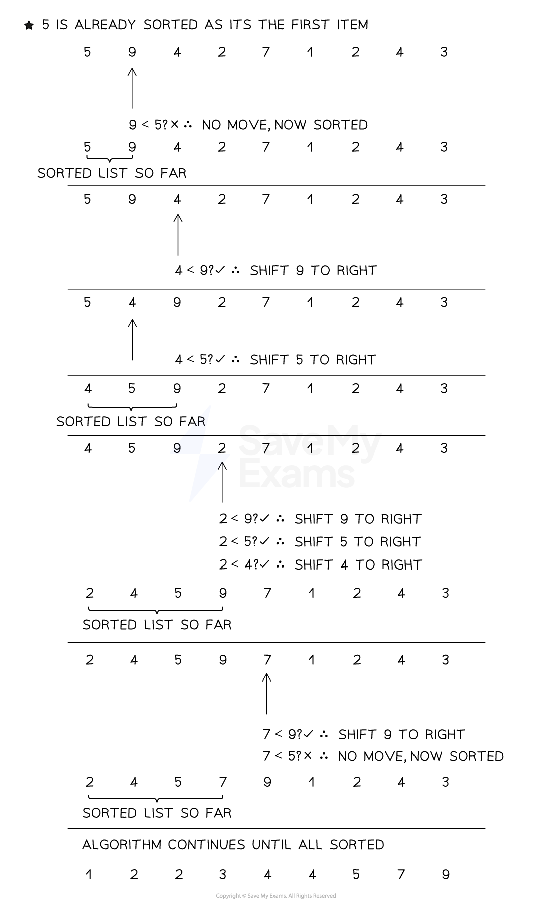

# Insertion Sort

## Insertion sort

> **Spec point** — `spcpt_wMSzdkRTKsHsZcZ6`

## Insertion sort

### What is an insertion sort?

- In A Level Computer Science, the insertion sort** sorts one item at a time** by **placing it in the correct position** of an unsorted list
- This process repeats **until all items** are in the correct position
- Specifically, the **current item being sorted is compared to each previous item**
- If it is **smaller** than the previous item then the **previous item is moved to the right** and the **current item takes its place**
- If the **current item is larger** than the previous item then it is in the **correct position** and the next current item is then sorted as illustrated below

#### Performing the insertion sort

***Figure 2: Performing the Insertion sort***

#### Time complexity of an insertion sort

- In the above algorithm, one statement is present, a for loop with three statements and a nested while loop that contains two statements
- The time complexity for the insertion sort would be 3n*2n + 1, giving 6n2 + 1. 3n comes from the for loop having three statements inside it, not including the while. 2n comes from the while loop having two statements inside it
- Removing coefficients and dominated factors leaves **O(n****2****) as the worst case scenario**
- The **best case scenario** would be an **already sorted list** which means each item is checked one at a time giving a time complexity of **O(n)**

The **average case scenario** would be a **half sorted list** giving O(n2/2), which when coefficients are removed still gives **O(n****2****)**

#### Space complexity of an insertion sort

- As the insertion sort requires no additional space, it is space complexity O(1)

#### Tracing an insertion sort

- Tracing through the insertion sort involves starting at element 1 (not 0)
- i increments through each element one at a time and each item is compared to the one previous. If the previous item is bigger or equal it is set to list[position]
- If position equals 0 then the iteration is at the start of the list and the next iteration begins

**Trace Table of the Insertion sort**

| **list** | **i** | **item** | **position** | **list[position-1]** | **list[position]** |
|---|---|---|---|---|---|
| [5, 9, 4, 2, 7, 1, 2, 4, 3] | 1 | 9 | 1 | 5 | 9 |
|   | 2 | 4 | 2 | 9 | 9 |
|   |   |   | 1 | 5 | 5 |
|   |   |   | 0 |   |   |
| [4, 5, 9, 2, 7, 1, 2, 4, 3] | 3 | 2 | 3 | 9 | 9 |
|   |   |   | 2 | 5 | 5 |
|   |   |   | 1 | 4 | 4 |
|   |   |   | 0 |   |   |
| [2, 4, 5, 9, 7, 1, 2, 4, 3] | 4 | 7 | 4 | 9 | 9 |
|   |   |   | 3 | 5 | 7 |
| [2, 4, 5, 7, 9, 1, 2, 4, 3] | 5 | 1 | 5 | 9 | 9 |
|   |   |   | 4 | 7 | 7 |
|   |   |   | 3 | 5 | 5 |
|   |   |   | 2 | 4 | 4 |
|   |   |   | 1 | 2 | 2 |
|   |   |   | 0 |   | 1 |
| [1, 2, 4, 5, 7, 9, 2, 4, 3] | 6 | 2 | 6 | 9 | 9 |
|   |   |   | 5 | 7 | 7 |
|   |   |   | 4 | 5 | 5 |
|   |   |   | 3 | 4 | 4 |
|   |   |   | 2 | 2 | 2 |
| [1, 2, 2, 4, 5, 7, 9, 4, 3] | 7 | 4 | 7 | 9 | 9 |
|   |   |   | 6 | 7 | 7 |
|   |   |   | 5 | 5 | 5 |
|   |   |   | 4 | 4 | 4 |
| [1, 2, 2, 4, 4, 5, 7, 9, 3] | 8 | 3 | 8 | 9 | 9 |
|   |   |   | 7 | 7 | 7 |
|   |   |   | 6 | 5 | 5 |
|   |   |   | 5 | 4 | 4 |
|   |   |   | 4 | 4 | 4 |
|   |   |   | 3 | 2 | 3 |
| [1, 2, 2, 3, 4, 4, 5, 7, 9] |   |   |   |   |   |

### Implementing an insertion sort

#### Pseudocode

- **Procedure definition**:
`insertionSort` takes an array called `list` and sorts it in ascending order
- **Initialisation**:

  - `n ← LENGTH(list)` stores the number of items
  - The sort begins from index `1` because the first item (index 0) is considered sorted
- **Outer FOR loop (**`i ← 1 TO n - 1`**)**:

  - Each iteration picks the next item in the list to be inserted into the correct position in the sorted portion to its left
- **Store the current item**:

  - `item ← list[i]` stores the current value to be positioned
  - `position ← i` is used to track where `item` should go
- **Inner WHILE loop**:

  - Shifts elements in the sorted portion **to the right** while they are greater than `item`
  - Stops when either:
  
    - The start of the list is reached (`position = 0`)
    - Or the correct spot is found (`list[position - 1] <= item`)
- **Insert the item**:

  - `list[position] ← item` inserts the value in the correct position
- **Repeat**:

  - The next item is considered, and the process repeats until the entire list is sorted
- **After sorting**:

  - `OUTPUT list` displays the sorted array

#### Python

#### Java
