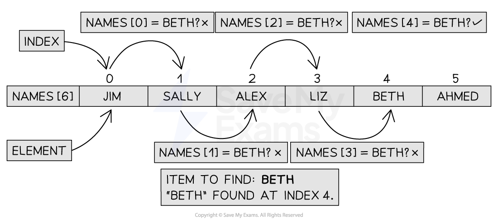

# Linear Search

## Linear search

> **Spec point** — `spcpt_Dmcr2fSnqYKTJzgH`

## Linear search

### What is a linear search?

- The linear search is a standard algorithm used to find elements in an **unordered list**
- The list is searched **sequentially** and **systematically** from the start to the end one element at a time
- **Comparing each element** to the** value being searched** for

  - If the **value is found** the algorithm **outputs where it was found in the list**
  - If the **value is not found** it **outputs a message stating it is not in the list**
- An example of using a linear search would be looking for a specific student name in a list or searching for a supermarket item in a shopping list

#### Performing the linear search

***Figure 1: Performing the Linear Search***

#### Time complexity of a linear search

- To determine the algorithm's execution time as measured by the number of instructions or steps carried out, Big-O notation must be used
- The loop is executed n times, once for each item. There are two instructions within the loop, the if statement and an assignment, hence the Big-O for the loop is O(2n)
- There are three initial statements which are O(1)
- The overall Big-O notation is therefore 2n + 3, which when coefficients are factored out, becomes **O(n) as linear time dominates constant time**. The **constant term and coefficients contribute significantly less** as the input size n grows larger
- It is important to remember here that **O(n) is the worst case scenario**. The **best case scenario O(1)** would find the item the first time, while the **average case** would be O(n/2) which when we remove coefficients still becomes **O(n)**

#### Space complexity of a linear search

- As the linear search requires no additional space, it is space complexity O(n) where n is the number of items in the list

#### Tracing a linear search

- Given the following list [5, 4, 7, 1, 3, 8, 9, 2], a trace table for the linear search is shown below

**Trace Table of the Linear Search**

| **item** | **index** | **i** | **list[i]** | **found** |
|---|---|---|---|---|
| 8 | -1 | 0 | 5 | False |
|   |   | 1 | 4 |   |
|   |   | 2 | 5 |   |
|   |   | 3 | 1 |   |
|   |   | 4 | 3 |   |
| 8 | 5 | 5 | 8 | True |

### Implementing a linear search

#### Pseudocode

- **Function definition**:
`FUNCTION linearSearch(list : ARRAY OF STRING, item : STRING) RETURNS INTEGER`

  - The function takes a list and a target item.
  - It returns the **index** of the item if found, or **-1** if not.
- **Variable declarations**:
`index`, `i`, and `found` are declared:

  - `index` stores the result (default is -1 if not found).
  - `i` is the loop counter.
  - `found` is a boolean used to stop the search once the item is found.
- **Initialisation**:

  - `index ← -1` → start with "not found"
  - `i ← 0` → start from the first index of the list
  - `found ← FALSE` → the item hasn’t been found yet
- **Loop condition**:
`WHILE i < LENGTH(list) AND found = FALSE`

  - Continue looping **while** there are items left to check **and** the item hasn’t been found.
- **Comparison inside loop**:
`IF list[i] = item THEN`

  - Check if the current element equals the search item.
- **If a match is found**:

  - `index ← i` → save the current index
  - `found ← TRUE` → stop searching
- **Increment**:

  - `i ← i + 1` → move to the next item
- **End of loop**:

  - Once the loop finishes (either item is found or end of list is reached), return the result.
- **Return value**:
`RETURN index`

  - Returns the index where the item was found.
  - If it wasn’t found, it returns `-1`.

#### Python

#### Java
