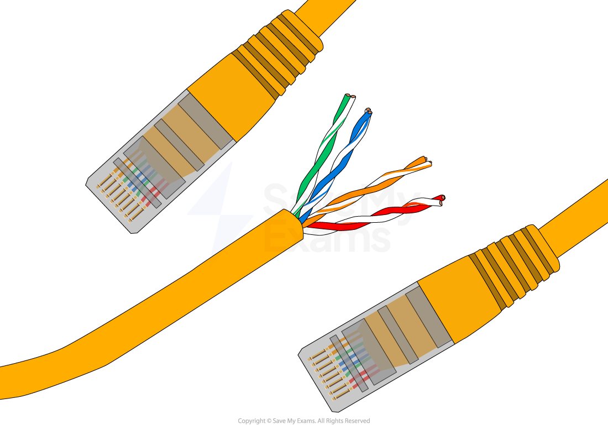

# Ethernet

## Ethernet

> **Spec point** — `spcpt_mrfyRqWntbwWvpnD`

## Ethernet

#### What is Ethernet?

- Ethernet is a **protocol **that controls

  - **Wiring**
  - **Data transmission**
  - ***Data encapsulation***
- A wired networking ***standard*** used in a **Local Area Networks (LANs)**
- Data is transmitted in **frames**
- Uses** CSMA/CD **to help detect and avoid data collisions

#### Ethernet frames

- Data is **transmitted across the network** in structured units called frames
- Each frame typically includes:

  - **Preamble** – A sequence of bits used to **synchronise communication** between devices
  - **Destination MAC Address** – The **unique ID** of the device the data is being sent to
  - **Source MAC Address** – The **unique ID** of the device sending the data
  - **EtherType / Length** – Indicates the **type of data** or the **size** of the payload
  - **Payload** – The **actual data** being sent (e.g. a web page, file, or message)
  - **FCS (Frame Check Sequence)** – Used for **error detection** to check if data arrived correctly

## CSMA/CD

> **Spec point** — `spcpt_jNXvkGRV5nGz2gbD`

## CSMA/CD

### What is CSMA/CD?

- CSMA/CD is a protocol used to **detect and prevent collisions** in a **bus topology**
- Stands for **Carrier Sense Multiple Access with Collision Detection**
- Devices **check if the channel is free** before sending data
- If the **channel is busy**, the device **waits**
- If the **channel is free**, the device **transmits the data**
- Since all devices share the same cable, **two can send data at the same time**, causing a **collision**
- When a collision happens:

  - Devices **detect it**
  - A **jamming signal** is sent to alert other devices
  - Both devices **stop transmitting**
  - Each device waits for a **random amount of time**, then **tries again**

> **Worked Example**
> Ethernet uses Carrier Sense Multiple Access/Collision Detection (CSMA/CD).
> 
> Describe CSMA/CD. **[4]**
> 
> **Final answer:** **Answer**
> 
> 1 mark per point to max 4
> 
> - A workstation / node (wishing to transmit) listens to the communication channel **[1 mark]**
> 
>   - the data is only sent when the channel is free **[1 mark]**
> - As there is more than one computer connected to the same transmission medium **[1 mark]**
> 
>   - two workstations can start to transmit at the same time, causing a collision **[1 mark]**
> - If a collision happens, the workstations send a jamming signal to abort transmission **[1 mark]**
> 
>   - and each waits a random amount of time before attempting to resend **[1 mark]**
