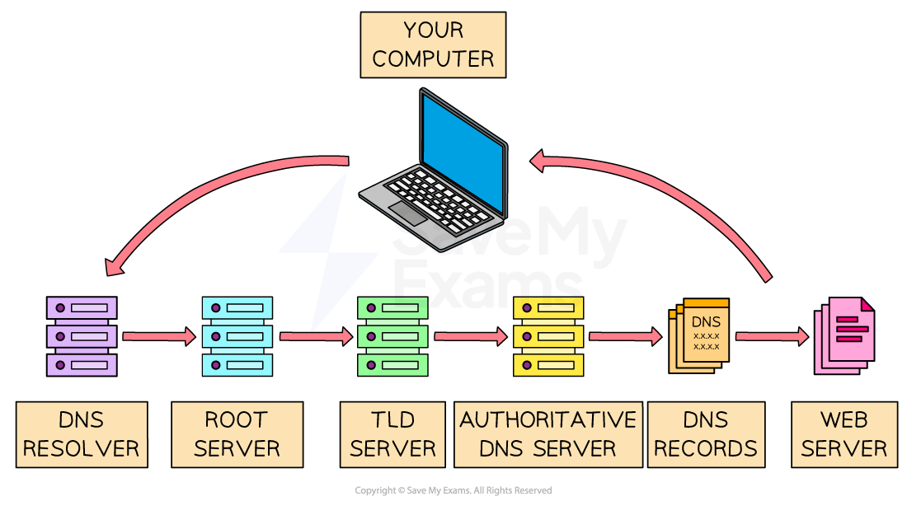

# Locating Resources on the World Wide Web

## URL

> **Spec point** — `spcpt_fPYbQTsWnWcx9zDT`

## URL

### What is a URL?

- A **Uniform Resource Locator** (URL) is a** unique identifier** for a web page, known as the **website address**
- It is **text-based** to make it easier to remember
- A user **enters a URL** into a web browser to view a web page
- An example of a URL is:

  - [https://www.savemyexams.com/a-level/computer-science/](https://www.savemyexams.com/a-level/computer-science/)
- A URL can typically be split into three parts:

  - **Protocol**
  - **Domain name**
  - **Web page/file name**
- Using the example about the URL would be split as follows:

| **Protocol** | https | Communication method to transfer data between client and server |
|---|---|---|
| **Domain name** | [www.savemyexams.com](http://www.savemyexams.com) | Name of the server where the resource is located |
| **Web page/file name** | /a-level/computer-science/ | Location of the file or resources on the server |

## DNS

> **Spec point** — `spcpt_KW6fV56YSTHZdjss`

## DNS

### What is the Domain Name System (DNS)?

- The **DNS** is like the **Internet’s phone book**
- It **translates domain names** (like `www.google.com`) into **IP addresses** (like `142.250.180.68`)
- Computers use IP addresses to **find and connect to servers**
- When you type a URL into your **browser**:

  - DNS** finds the matching **IP address
  - Your device **connects to that server** to load the website
- Without DNS, users would have to **remember the IP address** of every website they visit
- When a **domain is registered** or its server **IP address changes**, the DNS must be updated

  - This update is called **DNS propagation**, and it may take some time to spread across the internet

#### What happens when you type a URL into a web browser?

1. The user enters a **URL** into the address bar of the **web browser**
2. The browser checks its **cache** to see if it already knows the IP address for the website
3. If not found, it sends the domain name to a **DNS** server, which stores an **index** of domain names and their matching IP addresses
4. If the DNS server finds the IP address, it sends it back to the **web browser**
5. If it does not find the IP address, it passes the request on to a **higher-level DNS server**
6. This may involve contacting:

  - A **root server**, which points to the correct **Top-Level Domain (TLD) server** (e.g. .com, .org),
  - The **TLD server**, which points to the **authoritative DNS server** for the domain
7. The **authoritative DNS server** responds with the correct IP address
8. The web browser then sends a **request** to the web server at that IP address
9. The **web server** processes the request and sends back the website’s data (such as HTML, images, CSS, and JavaScript)
10. Finally, the **web browser renders** the content and displays the website to the user

> **Worked Example**
> Complete the following paragraph that describes the sequence of events when a user requests a page from a website.
> 
> 1. The user enters the Uniform Resource Locator (URL) into the address bar of the ......................................... .
> 2. The domain name is taken from the URL and sent to a Domain Name Service (DNS). This stores .................................................. of domain names and their matching IP addresses.
> 3. If it finds the domain name, it sends the IP address to the .................................................. .
> 4. If it does not find the domain name, it sends the request to ..................................................
> 
> **Final answer:** **Answer**
> 
> 1. Web browser ** [1 mark]**
> 2. An index/a list/a table ** [1 mark]**
> 3. Web browser ** [1 mark]**
> 4. A higher-level DNS ** [1 mark]**
