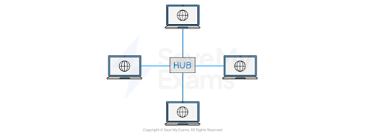
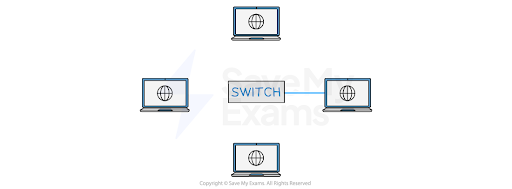
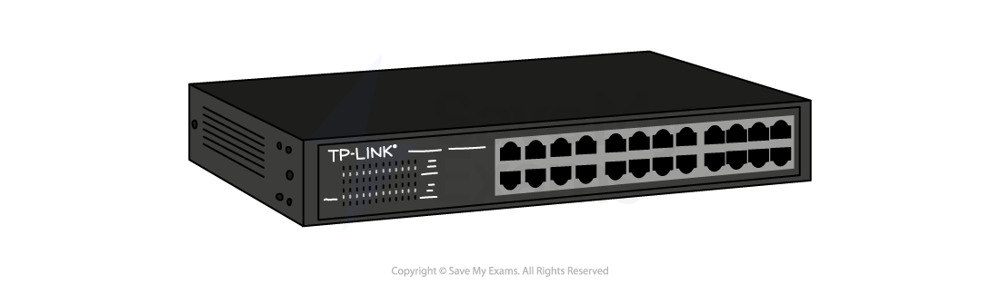
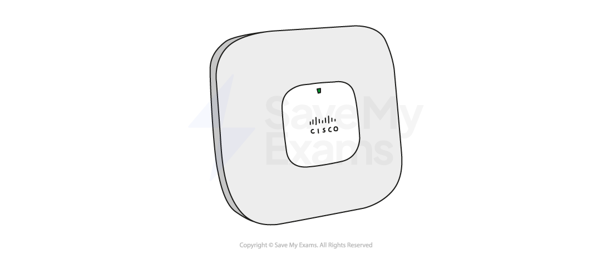
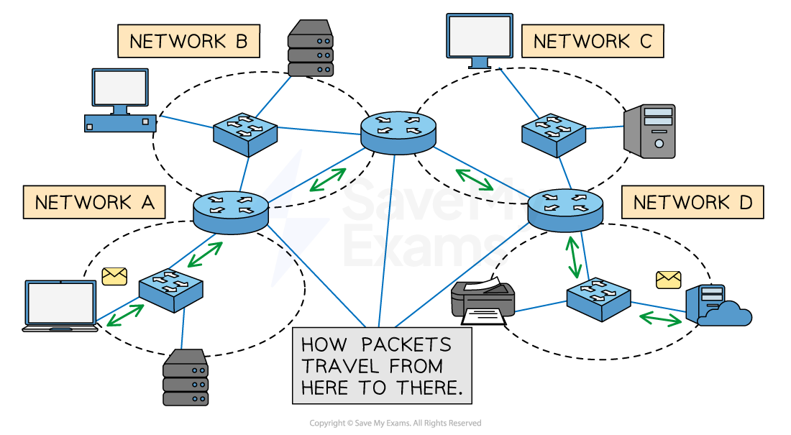

# Network Hardware

## LAN hardware

> **Spec point** — `spcpt_9tDHddgpkNkn7kKy`

## LAN hardware

### Hub

- A hub is a networking device which is used to **connect multiple devices in a network**
- Hubs are "**dumb**" devices that pass on anything received on one connection to** all other connections**
- Because all data is sent to all devices, it can lead to **network inefficiencies** and **security issues**
- Hubs allow **multiple **other devices to be connected to them

- Hubs are generally** much cheaper** than switches, but:

  - When a hub receives a data packet, it will** broadcast it to every device **on the network
- This creates two potential issues:

  - As the information is being broadcast to every device, it will make **unnecessary traffic**, especially if there are a large number of devices
  - As every device will receive the data packet, **security may be a concern**

### Switch

- A network switch is a networking device that **connects devices on a computer network** and uses **packet switching** to receive, process and forward data to the destination device
- Unlike a hub, a switch **only sends data to the device it was intended for**, which improves network efficiency

- This is done by each switch having a** lookup table**

| **Port** | **Mac address** |
|---|---|
| 1 | DF-42-B2-11-4D-E3 |
| 2 | 11-14-F2-1D-C3-C6 |
| 3 | 00-4B-17-7C-A2-C9 |

- When a switch receives a data packet, it **examines the destination MAC address** and **looks up that address in its lookup table**
- Once it has found the matching MAC address, it will then** forward the data packet to the corresponding port**

### Server

- A **server** is a powerful computer that provides **services or resources** to other devices on a network (called clients)
- Can **manage and store files**, **host websites**, **control access to printers**, or **run applications**
- Often kept in **dedicated rooms** or data centres due to their importance and high uptime requirements
- Designed to handle **multiple requests at once** and stay on **24/7**
- Servers usually run **specialist operating systems** (e.g. Windows Server, Linux)
- Can be part of a **LAN** (local server) or accessed remotely over a **WAN** (cloud server)
- Examples include: **file server, print server, web server, mail server**

### Network Interface Card (NIC)

- Historically a card** inserted into a slot on the motherboard** but now more likely to be **built into the motherboard**, that** enables a device to connect to a network**
- NICs have a **built-in ethernet port** and can be connected to a network via an **ethernet cable**
- It provides a **dedicated, full-time connection to a network**, converting the computer's data into a network-friendly format
- Every NIC has a **unique identifier called** a ***MAC address***, used to identify the device on the network
- The primary function of a NIC is to** send and receive data packets** between the computer or device and the network 

### Wireless Network Interface Card (WNIC)

- Allows a device to connect to a **wireless network (Wi-Fi)**
- Often **built into the motherboard** of modern laptops, tablets, and smartphones
- Uses **radio waves** to send and receive data to/from a **wireless router or access point**
- Provides a **dedicated connection** to the network, without needing physical cables
- Supports standard wireless protocols like **Wi-Fi 4, 5, or 6** depending on the model
- Has a unique **MAC address** used to identify the device on the network
- Converts the device’s data into a **wireless signal** suitable for network transmission

### Wireless Access Point (WAP)

- Allows **wireless devices** to connect to a **wired network**
- Acts like a **bridge** between the wired and wireless parts of a network
- Commonly found in **homes, schools, and offices** as part of a Wi-Fi setup
- Often **built into wireless routers**, but can also be a **separate device** in larger networks
- Uses **radio signals** to send and receive data from wireless devices (e.g. laptops, phones)
- Extends the **range of the wireless network**, especially in large buildings
- Supports communication using standard **Wi-Fi protocols** (e.g. 802.11ac, 802.11ax)

### Bridge

- Connects **two separate network segments** together
- Often used to join **two LANs** so they act as one larger network
- Operates at the **data link layer (Layer 2)** of the OSI model
- Can **filter traffic** by checking MAC addresses to decide if data should cross the bridge
- Helps **reduce network traffic** by only forwarding necessary data
- Commonly used in older or more complex network setups

### Repeater

- Used to **boost or regenerate signals** in a network
- Helps extend the range of a **wired or wireless signal**
- Receives a weak signal and **retransmits it at full strength**
- Used when data needs to travel **long distances** without losing quality
- Often used in **Wi-Fi range extenders** to improve coverage in large buildings
- Operates at the **physical layer (Layer 1)** of the OSI model

## Router

> **Spec point** — `spcpt_BxMWxDd54ntprhpy`

## Router

### What is the role of a router?

- A router is a network hardware device that routes data from a local area network (**LAN**) to another network connection -** it joins two networks together**
- Routers **analyse data packets** and **determine the best path** for the packet to reach its destination

  - The **header** contains information about the packet
  - The **payload** is the actual data being sent
  - The **IP address** of both the sender and intended recipient is stored in the header of the data packet
- The router can **often feature additional functionalities **such as wireless networking, built-in firewalls for enhanced security, and network switch capabilities
- A router being used to **connect a LAN to a WAN** will have a public ***IP address***, which has been assigned to it by an Internet Service Provider
- It is this public IP address that other routers use to** identify and direct packets **to the network

*Multiple networks connected by routers, represented by the blue circular objects*

- If the **data packet** is coming into the LAN, the router will send the data packet to the specific device within its LAN that the packet is meant for
- If the packet is being sent from a device within the LAN, it will **read the header** of the packet to **determine the intended destination** IP address

  - It might have to **travel through several routers** before it gets to its destination
  - Each pass from router to router is called a **hop**
  - It will then **forward **the packet to its destination
- The network access device or ‘**home hub**’ used in your home network will have a router **built into it**

| **Step** | **Description** |
|---|---|
| 1 | A router receives incoming data packets from one network and analyses the packet header to determine the destination IP address |
| 2 | It then looks up the IP address in a routing table (routing table of known networks) to determine the next network where the packet should be sent |
| 3 | The router then forwards the packet to the appropriate network or device |

- Every router **repeats this process** the data packet passes through until it reaches its destination
- In addition to routing data between networks, routers can also perform other functions such as:

  - **Assigning IP addresses to devices within the LAN**
  - **Filtering incoming traffic based on certain criteria, such as IP address, port number, or protocol type**
