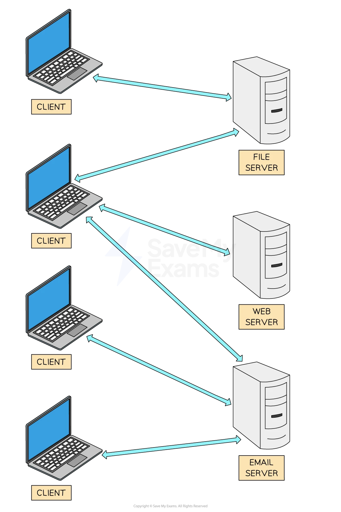
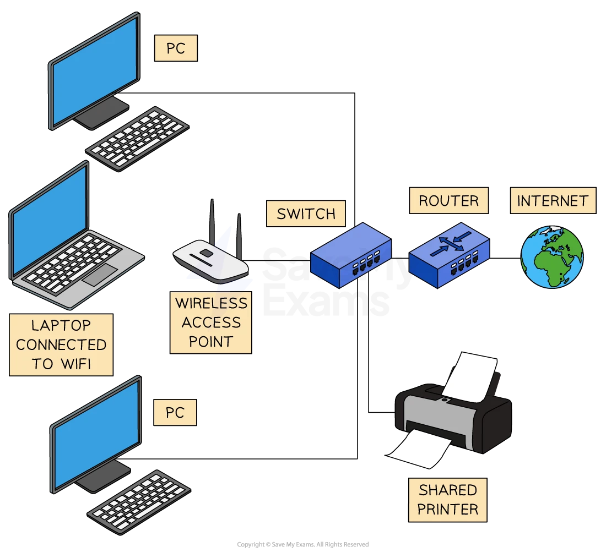

# Network Models

## Client-server & peer-to-peer

> **Spec point** — `spcpt_x2PCNzpvYrRTgRtf`

## Client-server & peer-to-peer

### What is a client-server network?

- A client-server network is when** powerful and reliable ‘server’ computers **control the network and **‘serve’ the clients** with services such as files, email, web access, etc
- Clients **connect to the servers** to access network services
- In this setup, the server **hosts**, **delivers **and **manages **most of the resources and services to be consumed by the clients

| **Benefits** | **Drawbacks** |
|---|---|
| Easier **central management** | **Single point of failure** -  if the server goes down, services could be unavailable |
| **Scalability**: new clients can be added easily | It can be **expensive **to set up and maintain - often need dedicated teams of people to maintain them |
| **Higher reliability** as resources are managed centrally |   |

- A client-server network is typically used by **larger organisations** where **centralised control is needed**, and reliability and security are paramount

*Client computers connected to different servers*

#### When to use a client-server network

- The choice between client-server and peer-to-peer depends on the **specific needs and resources** of the network in question
- **Security**, **cost**, **ease of setup**, and **maintenance **requirements should be considered

### Peer-to-peer

- This is the **simplest **type of network
- In this setup, all** computers in the network share equal responsibility,** and there is no central server
- All **machines have equal status**
- Each machine is the **responsibility of that machine’s user** in terms of security, backup, etc.
- **Data is often spread around the network, **with each user being responsible for their data

| **Benefits** | **Drawbacks** |
|---|---|
| **Easy to set up** and less expensive than client-server as no administrative staff are needed | **Lack of central control **can lead to security issues and vulnerabilities |
| **No dependency** on a central server | **Not suitable for large networks** as it can have performance issues |
| **Data can be shared directly** between systems without the need for a central server |   |

- A peer-to-peer network is typically used in** home networks**, by **small businesses**, or for **specific applications** like file sharing

*Peer to peer network example setup*

> **Worked Example**
> Describe the role of clients and servers on the Internet **[2]**
> 
> **Final answer:** **Answer**
> 
> 1 mark per point (**max 2**):
> 
> - Web pages/files are saved on servers **[1 mark]**
> - Clients send requests to the web servers** [1 mark]**
> - Web servers process the requests... **[1 mark]**
> - ...and return the results to the client **[1 mark]**
> - The client displays the results to the user **[1 mark]**

## Thin-client & thick-client

> **Spec point** — `spcpt_HGRp8vVYv5y7qwS7`

## Thin-client & thick-client

### What is a thin-client?

- A **thin client** relies on a **permanent connection** to a server to function
- Can be **hardware** (a device) or **software** (an app or program)
- Depends on the **processing power** of another computer or server
- **Cannot function** without being connected to a networked computer or server
- The server can be part of a **LAN** (local area network) or a **WAN** (wide area network)
- Examples of thin-clients include:

  - **Cloud-based apps** like Google Docs or Microsoft 365
  - **Remote desktop software** (e.g. Chrome Remote Desktop, Citrix)
  - **Supermarket *****POS***** systems** connected to a central server for prices, stock, and payments

### Thick-client

- Works **independently** without needing constant connection to a server
- Can be a **hardware device** or **software** installed on a local machine
- Uses the **processing power of its own device** to run applications
- May connect to a network for updates or data sharing, but **can function offline**
- Often used where **performance, speed or offline access** is important
- Examples of thick-clients include:

  - **Installed software** like Adobe Photoshop or Microsoft Word
  - **Standalone games** installed and played on a PC or console
  - **School or office PCs** running full applications locally
  - **Laptops** that can run applications without an internet connection

| Feature | Thin-client | Thick-client |
|---|---|---|
| **Dependence on server	** | Needs a **permanent connection** to a server to function | Can work **independently** of a server |
| **Processing power	** | Uses the **server’s processing power** | Uses its own **local processing power** |
| **Functionality when offline	** | **Does not work** without a connection | Can **function offline** |
| **Examples** | Google Docs, Microsoft 365, Remote Desktop, supermarket POS systems | Microsoft Word, Adobe Photoshop, standalone games, school laptops |
| **Best for	** | **Centralised control**, low-cost devices, shared environments | **Performance**, flexibility, offline access |
| **Network type	** | Part of a** LAN** or **WAN** | May connect to a network, but **not reliant** on it |
