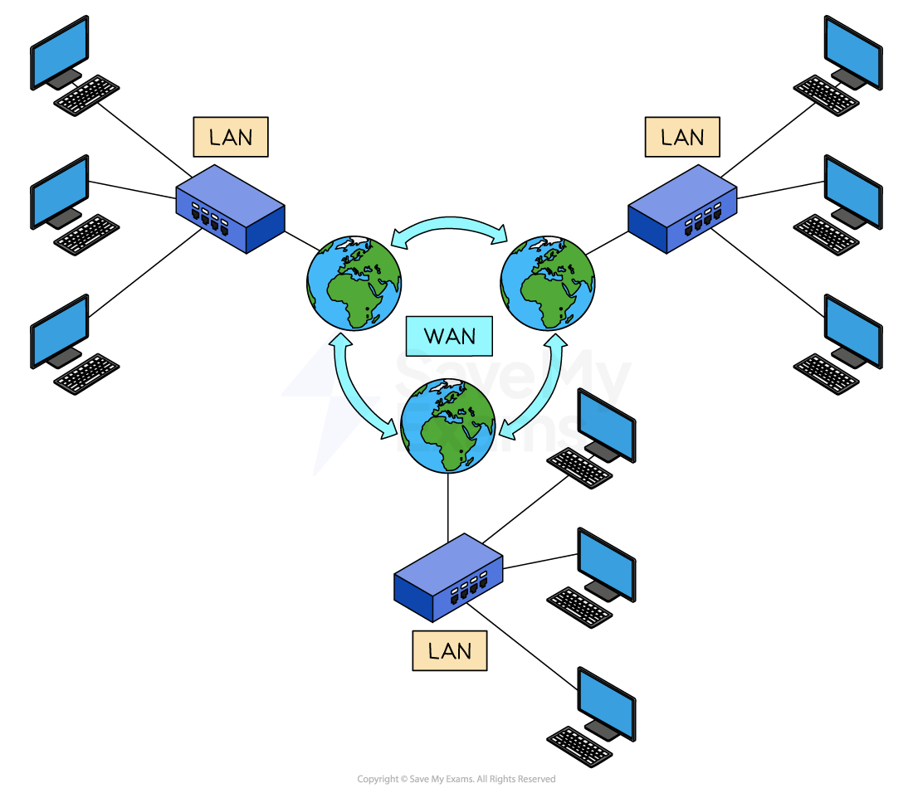

# Network Types

## Purpose & benefits of networking

> **Spec point** — `spcpt_dkP2Zff5GCpczrJn`

## Purpose & benefits of networking

### What is a network?

- A network is two or more **interconnected devices** (such as computers, printers, and servers) designed to:

  - **share resources**
  - **exchange data**
  - **communicate with each other**
- The purpose of a network is to enable **data **and **resource **sharing, **communication**, and **collaboration**

### Advantages and disadvantages of networks

| **Advantages** | **Disadvantages** |
|---|---|
| Devices (e.g. printers) can be **shared**, reducing costs | **Expensive setup** – cabling and servers can cost a lot |
| **Software licences** for networks are cheaper than for individual computers | **Difficult to manage** – large networks need skilled administration |
| Users can **share files and data** easily | If the **server fails**, the whole network can be affected |
| Access to **reliable, central data** (e.g. from a file server) | **Malware or hacking** can affect the entire network |
| Files can be **backed up centrally** each day | **Security risks** increase if connected to a larger WAN |
| Users can **communicate** via email or messaging |   |
| A **network manager** can control access rights and internet usage |   |

## LANs & WANs

> **Spec point** — `spcpt_mKY8hhtdxbWysxVq`

## LANs & WANs

### What is a local area network (LAN)?

- A local area network (LAN) is a network which has a **small geographical area** (under 1 mile)
- All of the hardware is **owned by the company/organisation/household using it**
- LANs will use unshielded twisted pair (**UTP**) cable, fibre optic cable or wireless connections (**Wi-Fi**)

#### Advantages and disadvantages of LANs

| **Advantages** | **Disadvantages** |
|---|---|
| Allows **centralised **management of updates, backups and software installations | If **hardware fails**, the network may not function properly or even at all |
| Can **secure **its devices with the use of firewalls, antivirus software and other security features to prevent unauthorised access | Networks are more **prone to attacks** than standalone computers |
| Allows users on the network to **share resources **such as printers and other peripherals | Access to data and peripherals can be slow depending on **network traffic** |
| Allows the users of the network to **collaborate **and** share files and folders** | Require **maintenance **to ensure that software is up to date, upgrades and backups which can be costly |

### Wireless Local Area Network (WLAN)

- A wireless local area network is a local area network where devices connect to the network **wirelessly **instead of using cables
- Extra hardware,** wireless access points** (**WAPs**) or **hotspots** are connected to the network so that users can connect using Wi-Fi

#### Advantages and disadvantages of WLANs

| **Advantages** | **Disadvantages** |
|---|---|
| Allows users to connect anywhere that is in the range of a **Wireless Access Point (WAP)** without the need for additional hardware or wiring. | **Limited **in their coverage and can be further affected by walls and other structures |
| Can be used in a** variety of environments **both indoors and out making them highly flexible | **Bandwidth** speeds can become an issue in high traffic areas |
| Additional wireless access points can be added relatively easily resulting in additional users being able to use the network or **increased network coverage** | **Interference** from other devices which can affect performance and connectivity |
| Access to **peripherals **such as printers | Vulnerable to **security threats **due to wireless signals being intercepted |

### Wide Area Network (WAN)

- A wide area network (WAN) is a network which has a **large geographical area** (over 1 mile)
- They are a** collection of LANs joined together**
- The computers on a WAN are **connected via routers**
- The hardware used to connect the networks together is **not all owned by the company/organisation/household using it**.
- For example, telephone lines **owned by telecommunication companies**
- WANs will use **fibre optic** cable,** telephone lines** and **satellite **to connect the LANs together

