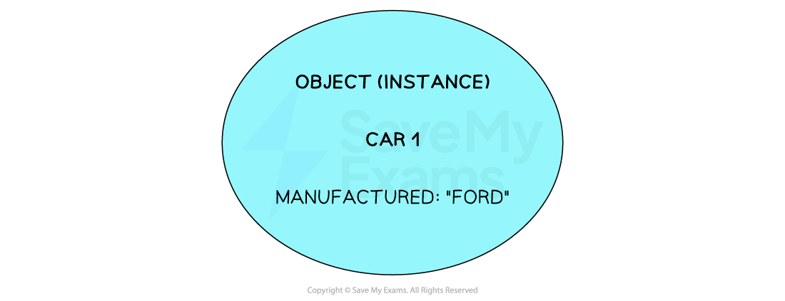
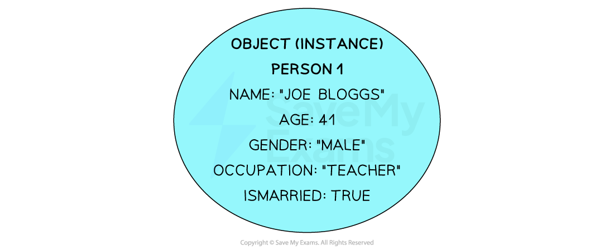
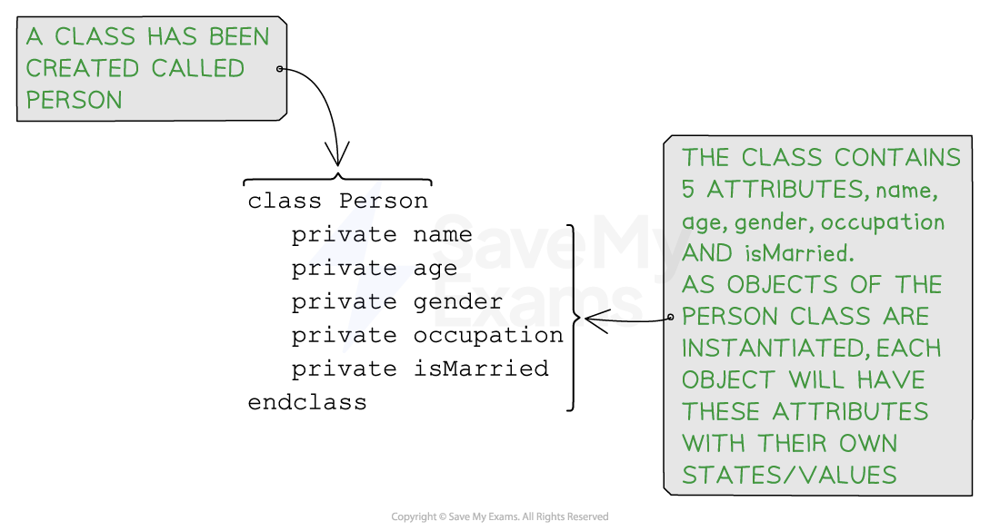

# Attributes (OOP)

## Attributes (OOP)

> **Spec point** — `spcpt_QWTDqxYwBJvHtwdr`

## Attributes (OOP)

### What is an attribute?

- In object-oriented programming (OOP), an attribute refers to **a data member or a property associated with** an ***object*** or a ***class***
- They define the **state of an object** and can have different values for different instances of the same class
- Attributes can be of** various data types**, such as integers, strings, Booleans, or even other objects
- Attributes can have **different access rights**

- The example below shows a Car class object with an attribute called manufacturer
- It has a private access meaning that it can be accessed only by instances of the Car class
- The data that this attribute will hold must be of the String data type

- The image below gives a visual representation of an object of this class being instantiated with a data value of “Ford” :

***An example instance of an object***

- In most cases each class has many different attributes
- Below is an example of an object of class "person":

***Example of an object of class "person"***

> **Exam Hint**
> - Attributes declared within methods (local variables) cannot have access modifiers because they are local to the method and have a limited scope
> - Local variables are only accessible within the block or method in which they are declared. They are not part of the class's state and cannot be accessed from other methods or classes

## Programming attributes (OOP)

> **Spec point** — `spcpt_9Mk8TpVF2qDYpJrn`

## Programming attributes (OOP)

### How do you program attributes?

#### Pseudocode

***Example of a created class, "Person", containing several attributes***

#### Java

#### Python

- In Python attributes are defined using the `self` keyword followed by the attribute name and its initial value
