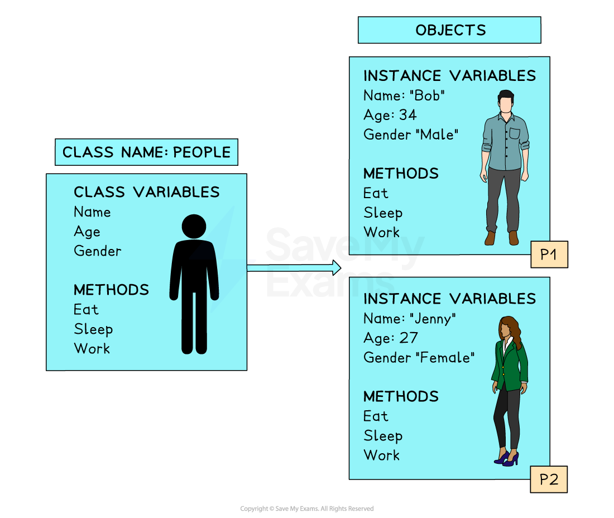
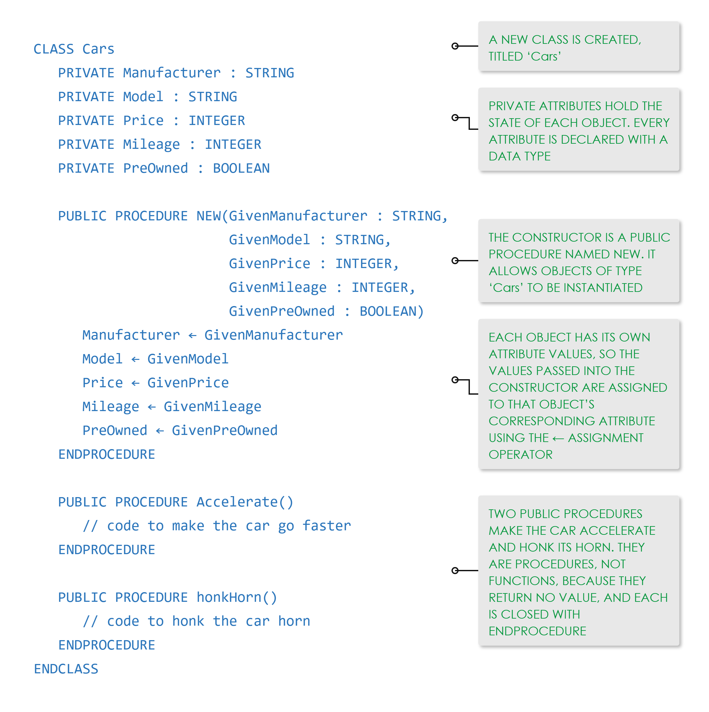

# Classes (OOP)

## Classes (Object-Oriented Programming)

> **Spec point** — `spcpt_NRYKc3qkB8XSKVKf`

## Classes (Object-Oriented Programming)

### What is a class?

- A **class** is a **blueprint** used to create **objects** in Object-Oriented Programming (OOP)
- It** defines a structure for attributes** (data) and **methods **(behaviour)

#### Key terms

| **Term** | **Definition** |
|---|---|
| **Object** | An instance of a class with its own **state and behaviour** |
| **Attribute** | A variable defined in a class (also called a **class variable**) |
| **Instance Variable** | Attribute stored inside an individual object |
| **Method** | A function defined within a class; describes object **behaviour** |
| **Instantiation** | The process of **creating an object** from a class |
| **Identifier** | The name used to **refer to an object** |

#### Example

- A `Student` class could contain:

  - Attributes: `name`, `dateOfBirth`, `gender`
  - Each `Student` object (e.g. `John`, `06/10/2015`, `Male`) has its own values

#### Prebuilt vs custom classes

| **Prebuilt classes** | **Custom classes** |
|---|---|
| Provided by the language | Defined by the programmer |
| E.g. `String`, `Date`, `Random`, `Scanner` in Java | E.g. `Animal`, `Student`, `Book` |

- Below is a visual representation of both a **class** and **objects** that have been **instantiated**
- In the image, the identifiers are P1 and P2

***Example of a class and objects***

## Programming classes (OOP)

> **Spec point** — `spcpt_SKCx699zkYg5wKhS`

## Programming classes (OOP)

### How do you program a class?

- In this example we will:

  - Define a class for a car sales program where the following is required:
  
    - Name of Manufacturer
    - Model of Car
    - Price
    - Mileage
    - Whether the car is preowned
- Instantiate two objects for the car sales program ensuring that they have appropriate identifiers
- List two methods that would be useful for a car object

#### Pseudocode

*Pseudocode for creating classes, a constructor, and functions*

#### Java

#### Python

> **Worked Example**
> A computer game is being designed that will include different vehicles. A prototype for the game is being developed using object‑oriented programming.
> 
> The class `Vehicle` stores data about the vehicles. Each vehicle has an identification name, a maximum speed, a current speed and a horizontal position. The value `IncreaseAmount` is added to the current speed each time the vehicle increases its speed.
> 
> 
> 
> Write program code to declare the class `Vehicle`. All attributes must be private.
> 
> You only need to declare the class and its constructor. Do not declare any other methods.
> 
> Use your programming language’s appropriate constructor.
> 
> If you are writing program code in Python, include attribute declarations using comments. **[5]**
> 
> **Final answer:** **Answer**
> 
> - Class header (and close where appropriate) **[1 mark]**
> - 5 (private) attribute declarations including data types **[1 mark]**
> - Constructor header (and close where appropriate) taking 3 parameters (min) **[1 mark]**
> - Assigning `ID, MaxSpeed` and `IncreaseAmount` to parameters **[1 mark]**
> - Assigning `CurrentSpeed` and `HorizontalPosition` to 0 **[1 mark]**
> 
> Example program code:
> 
> **VB.NET**
> 
> **Java**
> 
> **Python**
