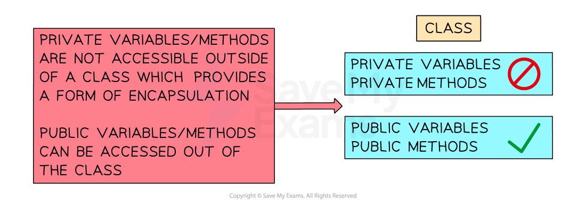
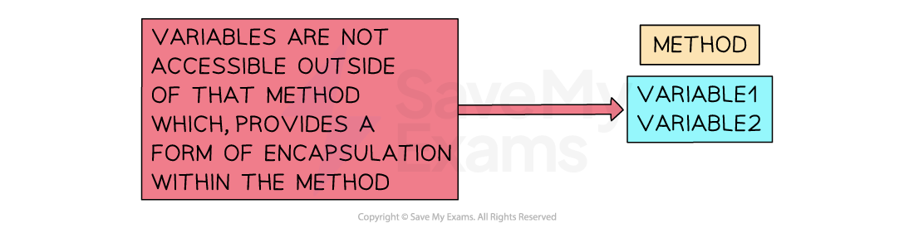
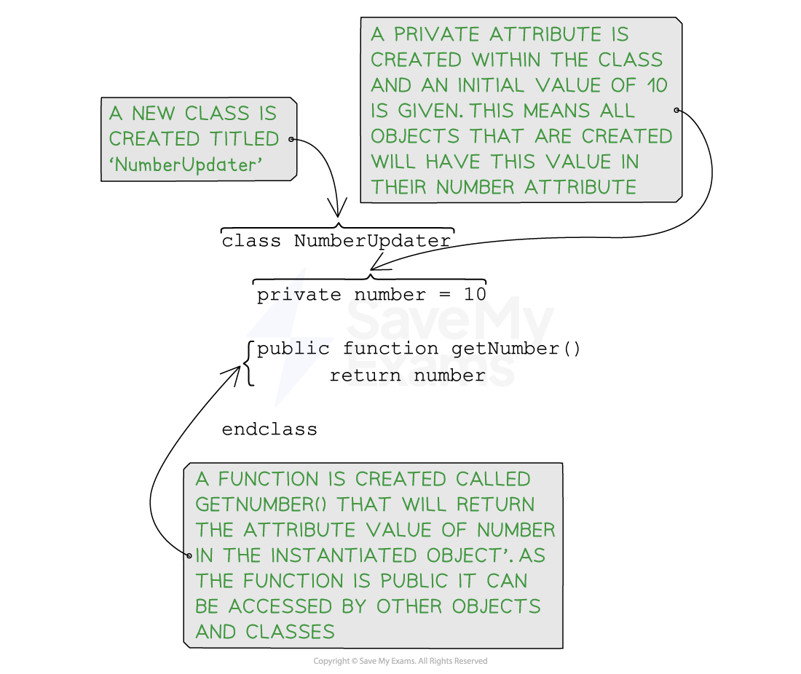
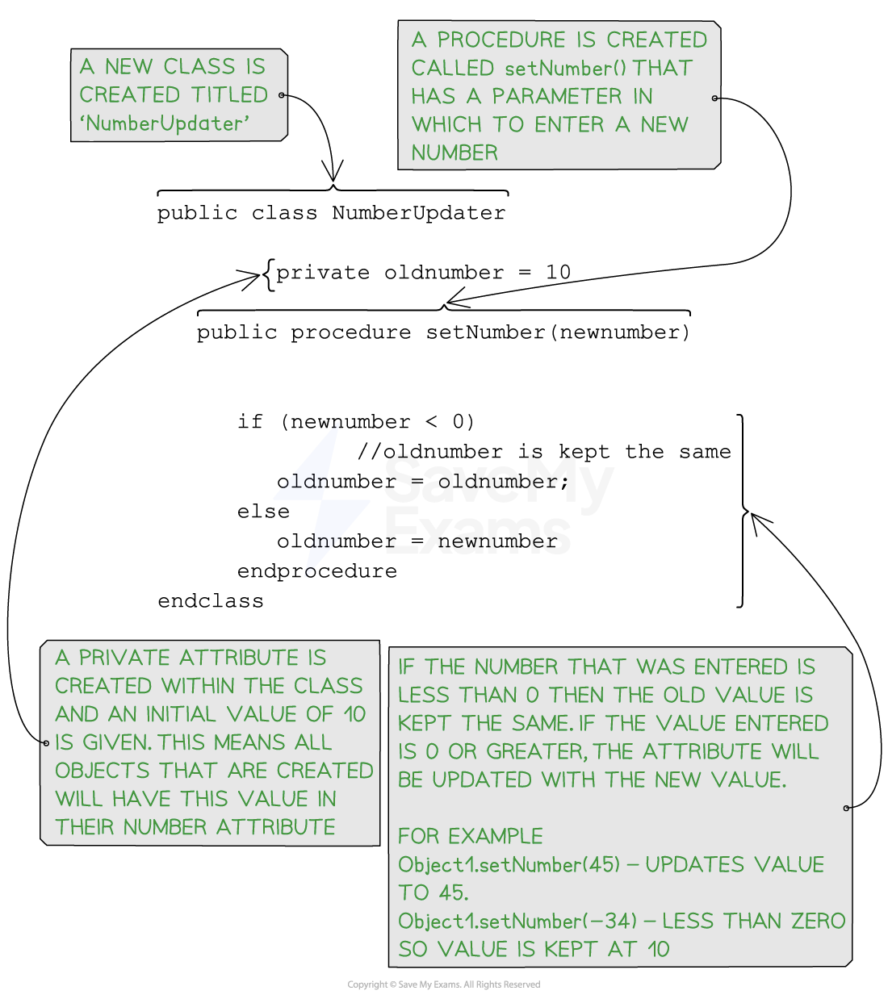

# Encapsulation (OOP)

## Encapsulation (OOP)

> **Spec point** — `spcpt_PZ6sxctzBrrGQRFT`

## Encapsulation (OOP)

### What is encapsulation?

- In A Level Computer Science, encapsulation refers to the **practice of grouping data** (attributes) **and methods **(functions) **within a class**
- Using encapsulation ensures that data remains secure and is not accidentally modified or misused by controlling access to them using access modifiers (e.g., public, private)
- It also helps to organize code by keeping related data and methods together within an ***object***
- Encapsulation promotes code reusability, which means the same object or class can be used in different parts of a program without rewriting the code
- **Encapsulation** uses a concept called **“Abstraction”** which reduces complexity by hiding the implementation details of the object, making it easier to understand and work with
- Programmers can use ***methods*** and ***classes*** from other parts of the program without having to understand how that it has been constructed internally

### Encapsulation in classes

- Private variables are only accessible within the class itself, and external code cannot access them directly.
- **Encapsulation** hides how things work inside a class from the outside. External code can interact with the class using public methods without needing to understand its internal details

***Encapsulation in classes***

### Encapsulation in methods

***Encapsulation in methods***

> **Exam Hint**
> - When determining whether a method or attribute is public or private, if neither keyword appears, then assume it is public

## Programming encapsulation (OOP)

> **Spec point** — `spcpt_7FZjfQ7P4Tn8D2dq`

## Programming encapsulation (OOP)

### What is a get method?

- The "get" method is a common naming convention for a type of method that is **used to retrieve the value of an object's private** ***attributes*** (instance variables)
- These methods are also known as "getter" methods or "accessor" methods
- The main purpose of a get method is to provide controlled access to the internal state (data) of an object without allowing direct modification
- **Attributes** are often declared as private to achieve **encapsulation**, so cannot be accessed directly from outside the class
- External code can use the public get methods to read the values of these private attributes (also known as instance variables)

#### Pseudocode

***Pseudocode for a get method***

#### Java

#### Python

### What is a set method?

- The "set" method is a common naming convention for a type of method that is used to **set the value of object's private instance variables**
- Setter methods, also known as “setter” methods or “mutator” methods
- Generally additional code is written within the method to allow controlled access by enforcing certain conditions or validations before updating the attribute

#### Pseudocode

` `

***Pseudocode for a "setter" method***

#### Java

#### Python

> **Worked Example**
> A computer game is being designed that will include different vehicles. A prototype for the game is being developed using object‑oriented programming.
> 
> The class `Vehicle` stores data about the vehicles. Each vehicle has an identification name, a maximum speed, a current speed and a horizontal position. The value `IncreaseAmount` is added to the current speed each time the vehicle increases its speed.
> 
> 
> 
> Write program code for the get methods `GetCurrentSpeed()`,
> 
> `GetIncreaseAmount()`, `GetMaxSpeed()` and `GetHorizontalPosition() `**[3]**
> 
> **Final answer:** **Answer**
> 
> - 1 get function header (and end where appropriate) with no parameter … **[1 mark]**
> - …returning attribute (without overwriting) **[1 mark]**
> - 3 further correct get methods **[1 mark]**
> 
> Example program code:
> 
> **VB.NET**
> 
> **Java**
> 
> **Python**
