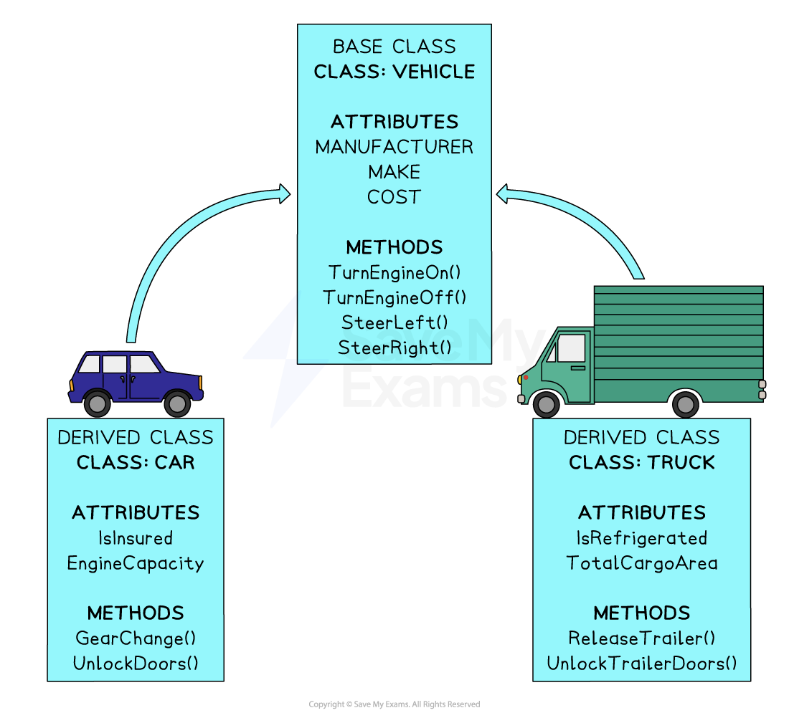
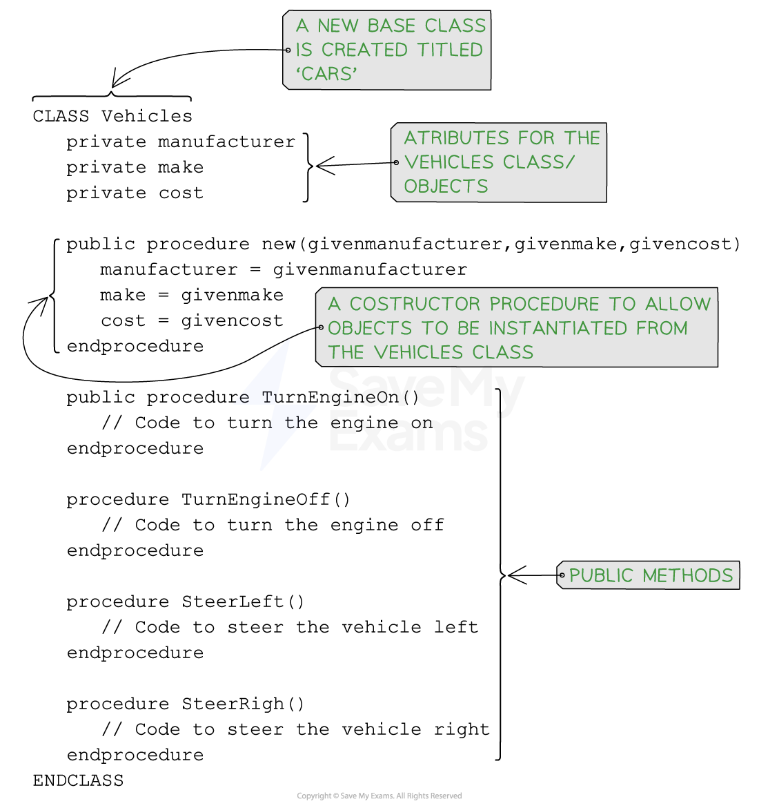
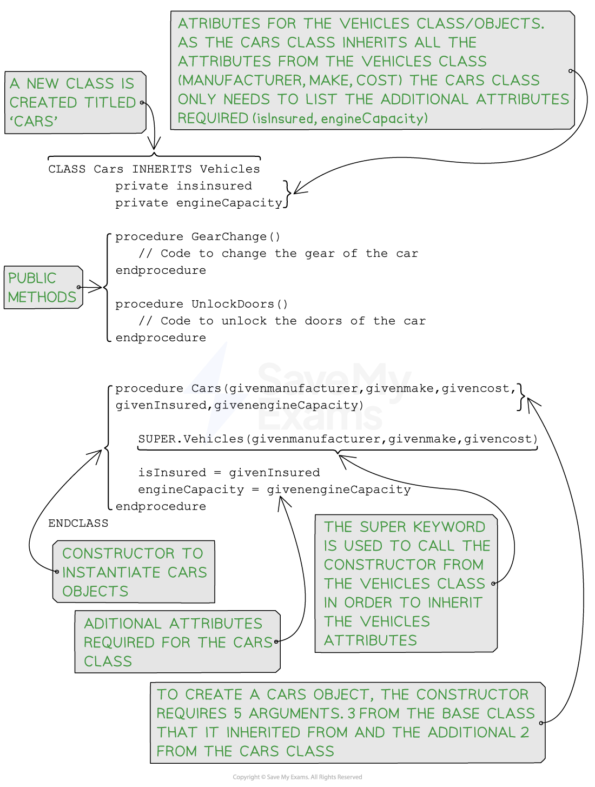

# Inheritance (OOP)

## Inheritance (OOP)

> **Spec point** — `spcpt_DZTVTnD8468FWpMj`

## Inheritance (OOP)

### What is inheritance?

- **Inheritance** is a key concept in **object-oriented programming (OOP)** that allows a **class** to inherit the properties and behaviours (methods and attributes) of another class
- **Inheritance** promotes code reuse by allowing ***derived classes*** to inherit and utilise the existing code from the ***base class***. This avoids duplicating code and promotes better organization and maintainability
- **Inheritance** establishes an **"IS-A" relationship** between the base class and the derived class
- For example, if you have a base class called Vehicle and a derived class called Car, you can say that "a Car is a Vehicle."
- The car class** inherits** the properties and behaviours associated with being a vehicle
- Inheritance involves two main entities:

  - The **base class** (also known as the parent class or superclass) and the derived class (also known as the child class or subclass)
  - The **derived class** inherits the characteristics of the base class, meaning it can access and use the methods and attributes defined in the base class

***Example of a base class and derived classes***

- **Base Class**: The base class serves as the blueprint or template from which the derived class inherits

  - It defines common properties and behaviours that can be shared among multiple derived classes
- **Derived Class**: The derived class inherits the attributes and methods of the base class

  - It can add additional attributes and methods
- If a car object was to be created, it may have the following attributes:

  - Manufacturer - The company that makes the car
  - Make -The model of the car
  - Cost – The price of the car to purchase
  - IsInsured – Whether or not the car is insured
  - EngineCapacity – The size of the engine for the car

- It may also have access to the following **methods**:

  - `TurnEngineOn()` – To start the car engine
  - `TurnEngineOff()` – To turn off the car engine
  - `SteerLeft()` – To turn the car to the left
  - `SteerRight()` – To steer the car to the left
  - `GearChange()` – To change the gear of the car
  - `UnlockDoors()` – To unlock the doors to the car

- The above **methods** are only a select few and there could be many more added for extra functionality

- In the following code, the **super keyword** is used in inheritance to refer to the superclass (Base class: Vehicles) and access its members (methods, attributes, or constructors) from within the subclass (Derived Class: Cars)

## Programming inheritance

> **Spec point** — `spcpt_XRj64GWyhZFKdc87`

## Programming inheritance

### How do you program inheritance?

### Pseudocode

***Pseudocode for a class created using inheritance***

#### Java

#### Python

> **Worked Example**
> The child class `Helicopter` inherits from the parent class `Vehicle`. A helicopter also has a vertical position and changes the vertical position when it increases speed.
> 
> 
> 
> Write program code to declare the class `Helicopter`. You only need to declare the class and its constructor. You do not need to declare the other methods.
> 
> Use your programming language’s appropriate constructor.
> 
> All attributes must be private.
> 
> If you are writing in Python, include attribute declarations using comments. **[5]**
> 
> **Final answer:** **Answer**
> 
> - Class header (and end where appropriate) inheriting from Vehicle **[1 mark]**
> - 3 (private) attribute declarations with data types **[1 mark]**
> - Constructor (and end where appropriate) with (min) 5 parameters **[1 mark]**
> - Calling parent constructor with appropriate parameters **[1 mark]**
> - Initialising `VerticalPosition` to 0 and `VerticalChange` and `MaxHeight` to attributes **[1 mark]**
> 
> Example program code:
> 
> **VB.NET**
> 
> **Java**
> 
> **Python**
