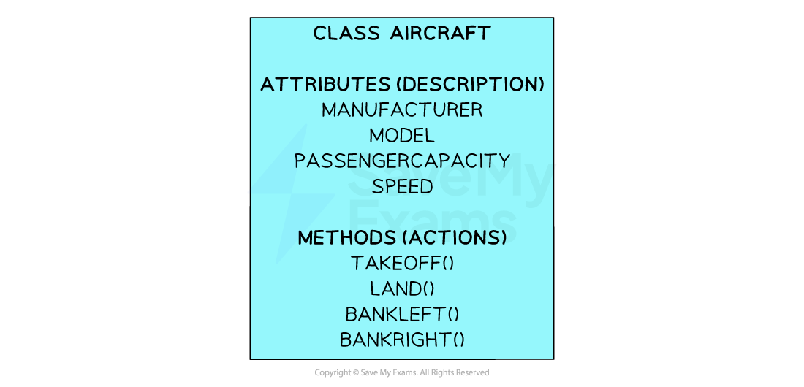
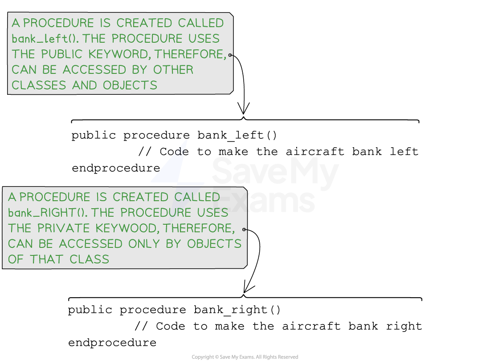

# Methods (OOP)

## Methods (OOP)

> **Spec point** — `spcpt_nxt9SD2gf3Z5xGsn`

## Methods (OOP)

### What is a method?

- **Methods** are fundamental in **object-oriented programming (OOP)** and are functions associated with ***objects*** or ***classes*** that define the behaviour and actions that objects can perform
- There are two main types of methods:

  - **A function**
  
    - A function performs a task and returns a value
  - **A procedure**
  
    - A procedure performs a task buts does nor return a value
- For example, there are many different types of aircraft which all differ in design, but all require a ‘take off’ and ‘landing’ method
- An example of an aircraft **class** with both ***attributes*** and **methods** is shown below:

***Example class for "aircraft" containing several methods***

- Each **object** that is created from the aircraft class will have:

  - A manufacturer value to determine the company that created the aircraft
  - A model name for the type of aircraft
  - A value for passenger capacity to determine how many people it can carry
  - A speed value to determine its maximum speed
- Any** objects** that are created for the aircraft class also have access to the following Methods:

  - A take off method to get the plane airborne
  - A land method to land the plane safely
  - A bank left method to allow the plane to turn to the left
  - A bank right method to allow the plane to tur to the right
- As you can imagine, for an aircraft there would be many more methods that could be implemented such emergency landing and altitude cruising actions
- Once **objects** have been created, they can use the **methods** from within their** class** by using the dot (.) notation
- As these methods are associated with objects, they are called instance methods
- For example if an **object** has been created as below:

  - jumboJet = new aircraft (“Boeing”, ”747”, 416, 547)
- It can use methods by doing the following:

  - Objectname.Methodname:
  - For example:    jumboJet.Takeoff()

> **Exam Hint**
> - In some OOP languages there are both instance methods and static methods
> 
>   - Instance methods
>   
>     - Instance methods are associated with individual instances (objects) of a class. They operate on the specific data and properties of an object (see above on the Jumbo Jet object example)
>   - Static methods
>   
>     - Static methods are associated with a class itself and can be called without creating an instance (object) of the class

### Public and private methods

- When declaring **methods**, it is important to determine how they can be accessed:

| **Public Methods** | **Private Methods** |
|---|---|
| Accessible and can be ***invoked*** by any code within the same class or from any external classes | Private methods are only accessible within the same class and cannot be** **invoked by external code or other classes |
| Changes to public methods may have an impact on other parts of the codebase, so they should be carefully designed, documented, and backward compatible whenever possible | Changes to private methods have a localized impact since they are only used internally within the class, providing flexibility to modify or refactor them without affecting other parts of the program |
| Public methods are used when you want to provide access to certain functionalities or behaviours of an object or class to other parts of your program | Private methods are used when you have internal implementation details that should not be accessed or used by external code. They are meant to be used only within the class itself for organizing and managing the code internally |

> **Exam Hint**
> - If a method does not specify the keyword public or private then its default value is set to public.

## Programming methods (OOP)

> **Spec point** — `spcpt_Cv3J4Pp483HfxyS7`

## Programming methods (OOP)

### How do you program a method?

#### Pseudocode

***Pseudocode for creating methods***

` `

#### Java

#### Python

- In Python, there is no explicit **access modifier** for methods like "private" in Java
- By convention, methods with a single leading underscore _ are considered private and should not be accessed directly from outside the class

- It's important to note that even though the method is marked as private, it can still be accessed and **invoked** from outside the class
- However, as a rule, other developers should treat it as private and avoid accessing it directly
