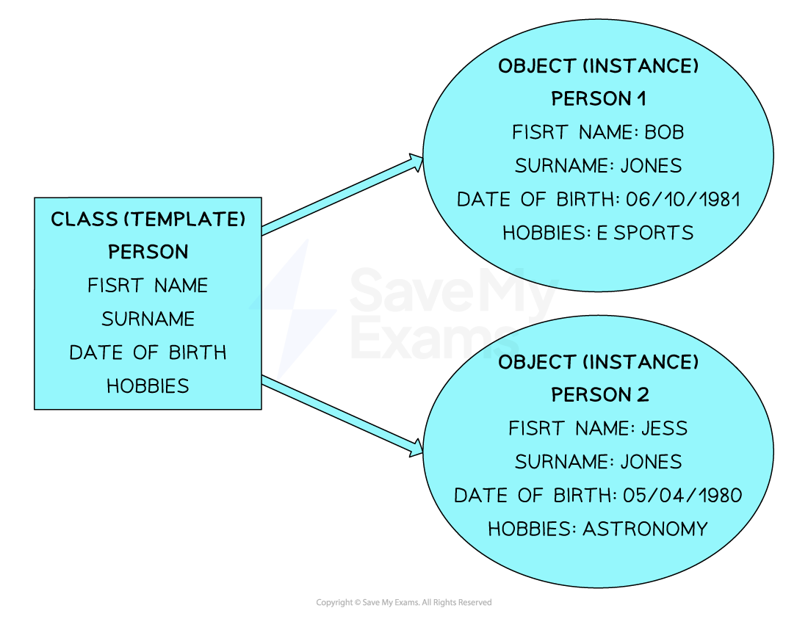
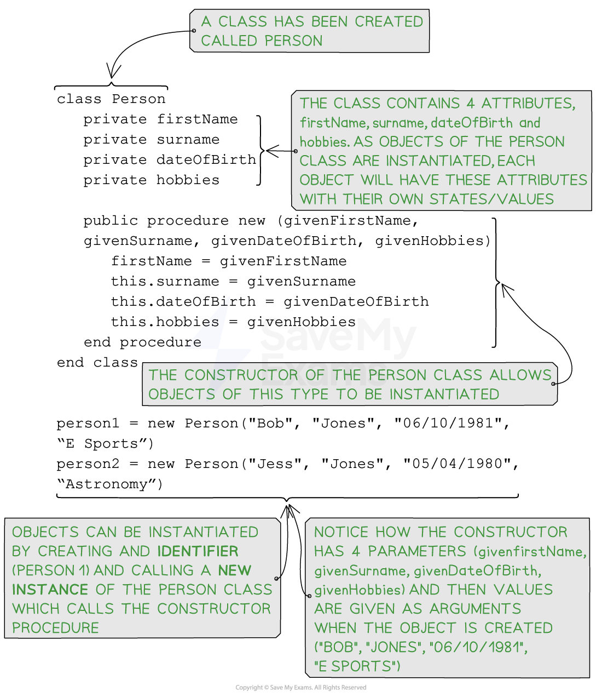

# Objects (OOP)

## Objects (OOP)

> **Spec point** — `spcpt_vbxKPQbQygRpCNDr`

## Objects (OOP)

### What is an object?

- An **object** is a representation of a real-world entity eg teacher, aeroplane, mobile phone, cat etc
- A **class** is like a blueprint that describes the properties and behaviours of objects, while an **object** is a specific instance created based on that blueprint with its own unique values for the properties
- A constructor is a special **method** within a class that is automatically called when an **object** of that class is created  (***instantiated***)
- **Constructors** typically define the initial values of** instance variables** and perform any necessary setup to prepare the **object** for use

***Example of 2 objects belonging to a class***

## Programming objects (OOP)

> **Spec point** — `spcpt_PMGDvYWx2Pj6bswW`

## Programming objects (OOP)

### How do you program an object?

#### Pseudocode

***Pseudocode for the class 'person' and instantiating two objects***

#### Java

#### Python
