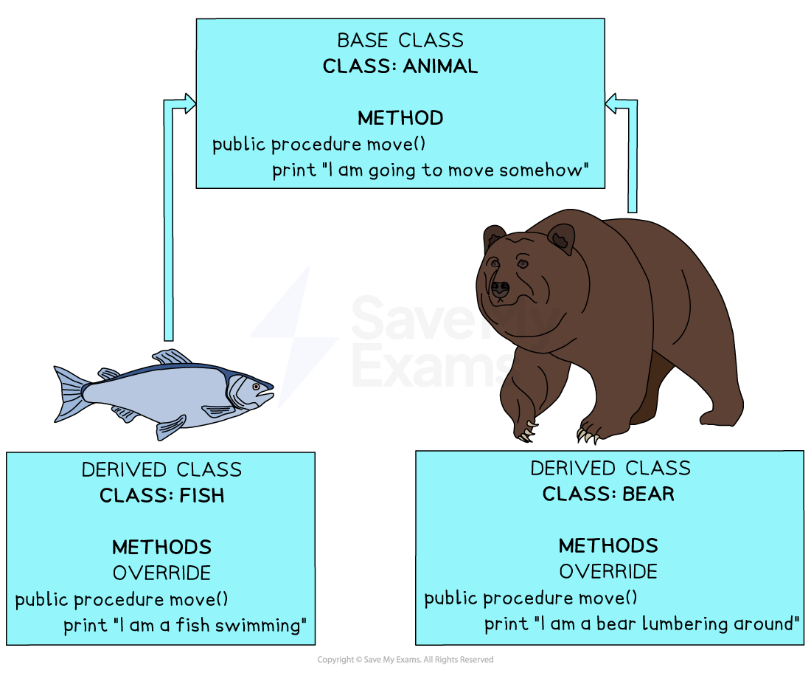
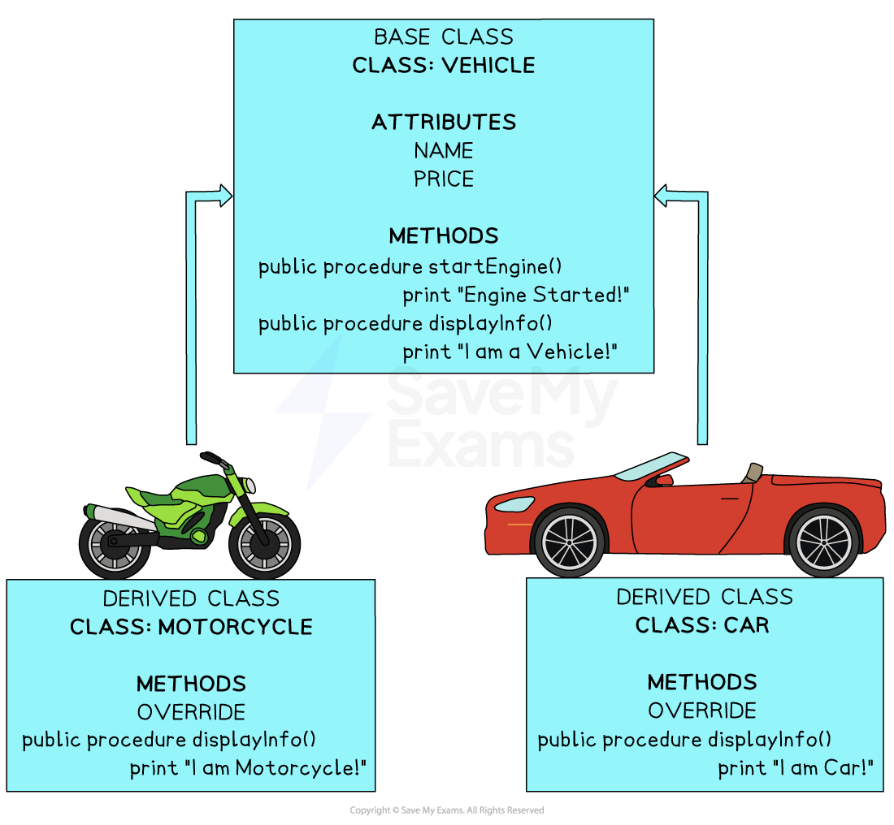

# Polymorphism (OOP)

## Polymorphism (OOP)

> **Spec point** — `spcpt_nb6Kj8kq5CKfyjHF`

## Polymorphism (OOP)

### What is polymorphism?

- In A Level Computer Science**, **polymorphism is a **concept in programming** that allows ***objects*** to take on **different forms or behaviours**
- Different **objects** can share the same name or behaviour but can work in different ways
- It helps make code more **flexible**, **reusable**, and **easier **to maintain
- It allows **flexibility **and **reusability **in programming, making it easier to write and manage code
- **Objects** can be treated as belonging to a common group, even if they belong to different ***classes***, making your code more versatile and adaptable to changes

#### Example 1 – method overloading

***Method Overloading Example 1***

- In the example above, all three **classes** all have a **method** named `move()`. **Polymorphism** allows methods to be declared with the same name but execute different code (in this case printing different messages)
- The ***override*** keyword Is used to provide a new **implementation** for a method that is already defined in the parent class (***base class***)

#### Example 2 - method overloading

***Method Overloading Example 2***

- In the above example both the Motorcycle class and the Car class both **inherit** from the base class 'Cars'
- **Objects **from the Motorcycle Class and the Car class can call the `startEngines()` **method** which will output `"Engines Started!"`
- If either of the object types call the `displayInfo()` method, the program will execute the method from the objects class as it **overrides** the Vehicle class method
- For example

  - If a motorcycle object calls the `displayInfo() `method,` "I am a Motorcycle!"` will be output
  - If a Car object calls the `displayInfo()` method, `"I am a Car!"` will be output

### Treating objects as common groups

- **Polymorphism** also allows objects of different classes to be treated as objects of a common **superclass** or **base class**
- For example:

  - `Vehicle vehicle1 = new Car()`
  - `Vehicle vehicle2 = new Motorcycle()`
- This allows an array of type Vehicle to store both Motorcycle and Car objects rather than in separate data structures

  - If the `vehicle1.displayInfo()` method is called, it will still output "I am a Car!"
  - If the `vehicle2.displayInfo()` method is called, it will still output "I am a Motorcycle!"
- This flexibility provided by **polymorphism** are essential for creating more maintainable and modular code

## Programming polymorphism (OOP)

> **Spec point** — `spcpt_rk33CCQF8Gst9pyS`

## Programming polymorphism (OOP)

### How do you program polymorphism?

#### Run-time polymorphism

- This happens when a **subclass overrides a method** defined in a **superclass**, and the correct version is chosen at **run-time**, not compile-time

### Example scenario: Animal, dog, and cat

#### Step-by-step logic (pseudocode)

1. **Define a superclass** called `Animal` with a method `speak()` that does nothing
2. **Create subclasses** called `Dog` and `Cat` that inherit from `Animal`
3. In each subclass, **override** the `speak()` method to provide a specific output
4. Write a function `make_sound(animal)` that **accepts an object** of type `Animal` and calls its `speak()` method
5. Create instances of `Dog` and `Cat`, and pass them to `make_sound()`

- `Animal` is a **base class** with a `speak()` method
- `Dog` and `Cat` are **subclasses** that override the `speak()` method
- `make_sound()` takes an `Animal` object but **calls the correct version** of `speak()` depending on whether it’s a `Dog` or a `Cat`
- This demonstrates **run-time polymorphism** – the method call is resolved based on the actual type of the object

#### Python

- This shows **method overriding**
- The `make_sound()` function relies on **dynamic method binding**

#### Java

- Recognise use of a **superclass reference** (`Animal animal`) pointing to a **subclass object**
- Polymorphism occurs when `animal.speak()` dynamically calls the correct overridden method

> **Worked Example**
> The child class `Helicopter` inherits from the parent class `Vehicle`. A helicopter also has a vertical position and changes the vertical position when it increases speed.
> 
> 
> 
> The `Helicopter` method `IncreaseSpeed()` overrides the method from the parent
> 
> class and:
> 
> - adds the amount of vertical change to the vertical position
> - adds `IncreaseAmount` to the current speed
> - adds the updated current speed to the horizontal position.
> 
> The vertical position of a helicopter cannot exceed its maximum height.
> 
> The current speed of a helicopter cannot exceed its maximum speed.
> 
> Write program code for the method `IncreaseSpeed() `**[4]**
> 
> **Final answer:** **Answer**
> 
> - Method header (overriding where required) with no parameter **[1 mark]**
> - Adding vertical change to vertical position … **[1 mark]**
> - …limiting to maximum height **[1 mark]**
> - Repeating/calling/using the code from original for horizontal increase (in every case) **[1 mark]**
> 
> Example program code:
> 
> **VB.NET**
> 
> **Java**
> 
> **Python**
