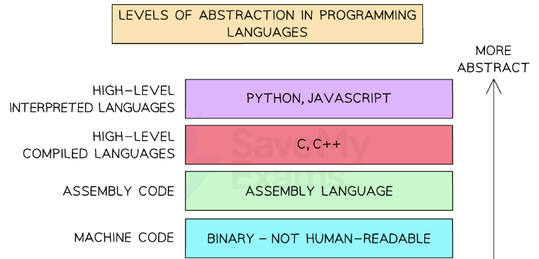

# Assembly Language Basics

## Machine code vs assembly

> **Spec point** — `spcpt_PfZ6VmBkxyXVhWZd`

## Machine code vs assembly

### What is machine code?

- **Machine code** is a first-generation language
- Instructions are **directly executable by the processor**
- Written in **binary code**

*Levels of Abstraction of Programming Languages*

### What is assembly?

- **Assembly code** is a second-generation language
- The code is written using **mnemonics**, abbreviated text commands such as **LDA (Load), STA(Store) **
- Using this language programmers can write **human-readable programs** that correspond **almost exactly to machine code**
- **One assembly language instruction** translates to **one machine code instruction**
- **Needs to be translated **into machine code for the computer to be able to execute it
- Each type of computer CPU has a **specific** **instruction set**

#### Instruction set

- An instruction set is a list of **all the commands** that can be **processed by a CPU**
- Each command has a **binary code** which is the **machine code**
- In assembly the binary code is written using mnemonics and split into an **opcode **and **operand**
- The **opcode** is the **part of an instruction** that tells the CPU what **operation** to perform
- It's short for **"operation code"**
- Example operations: *LDA* (load), *STA* (store), *ADD*, *INP*, *OUT*, *BRZ*, *BRA*
- The **operand** is the **data** or **memory address** the opcode will work with
- It gives the **extra detail** the CPU needs to complete the instruction
- Often used to specify a **memory address**, a **value**, or a **label**

| **Opcode** | **Operand** | **Explanation** |
|---|---|---|
| `LDM` | `#n` | Immediate addressing. Load the number `n` to the accumulator (ACC). |
| `LDD` | `<address>` | Direct addressing. Load the contents of the location at the given address to ACC. |
| `LDI` | `<address>` | Indirect addressing. Use the value at the given address as a new address. Load contents to ACC. |
| `LDX` | `<address>` | Indexed addressing. Use `<address> + index register` to get the final address. Load to ACC. |
| `LDR` | `#n` | Immediate addressing. Load the number `n` to the index register (IX). |
| `MOV` | `<register>` | Move the contents of ACC to the given register (e.g. IX). |
| `STO` | `<address>` | Store the contents of ACC at the given memory address. |
| `ADD` | `<address>` | Add the contents of the given address to ACC. |
| `SUB` | `<address>` | Subtract the contents of the given address from ACC. |
| `INC` | `<register>` | Increment the contents of the register (ACC or IX) by 1. |
| `DEC` | `<register>` | Decrement the contents of the register (ACC or IX) by 1. |
| `JMP` | `<address>` | Unconditional jump to the given address. |
| `CMP` | `<address>` | Compare the contents of ACC with the contents of the given address. |
| `CMP` | `#n` | Compare the contents of ACC with the number `n`. |
| `CMI` | `<address>` | Indirect addressing. Compare ACC with the contents at the address stored in `<address>`. |
| `JPE` | `<address>` | Jump to `<address>` if the previous compare result was **true** (equal). |
| `JPN` | <address> | Jump to `<address>` if the previous compare result was **false** (not equal). |
| `IN` |   | Take input from the keyboard and store its ASCII value in ACC. |
| `OUT` |   | Output to the screen the character stored in ACC. |
| `END` |   | End the program and return control to the operating system |
| All questions will assume there is only one general purpose register available (Accumulator)  `ACC` denotes Accumulator  `IX` denotes Index Register  `<address>` can be an absolute or symbolic address  `#` denotes a denary number, e.g. #123  `B` denotes a binary number, e.g. B01001010  `&` denotes a hexadecimal number, e.g. &4A |   |   |
