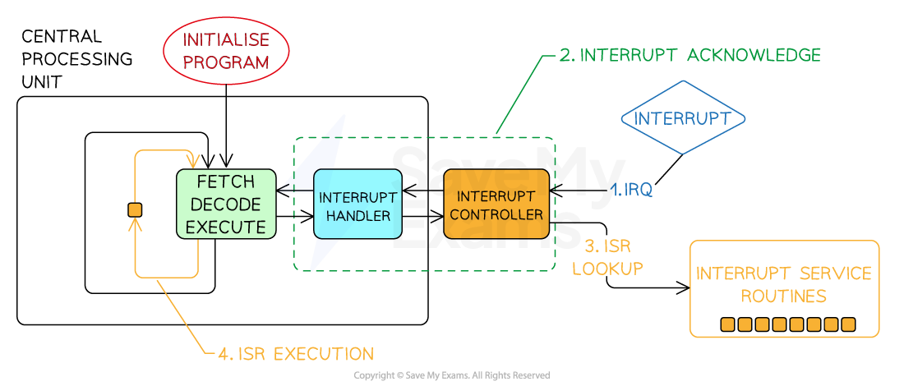
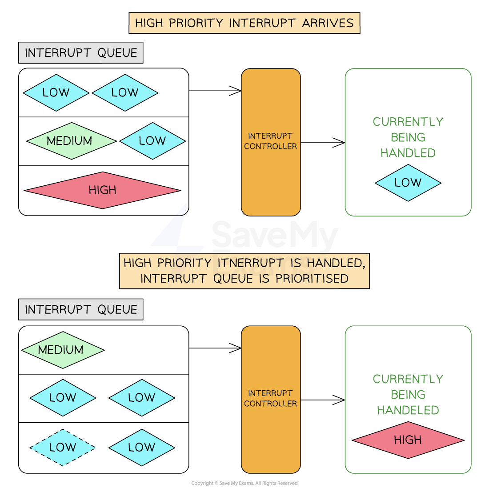

# Interrupts

## Interrupt handling

> **Spec point** — `spcpt_mkQtdg2xB6dgPMsJ`

## Interrupt handling

### What are interrupts?

- An interrupt is a **signal **to the processor that **stops its current task** and performs a different task temporarily
- Interrupts can be** hardware events or time-sensitive tasks**
- When an interrupt occurs, the processor **suspends the current program** execution and transfers control to an **interrupt service routine**

#### Purpose and role of interrupts

- **Real-time Event Handling**: hardware errors and signals from input devices e.g. hard disk failure
- **Device Communication**: alerts from external devices e.g. printer jams and network errors
- **Multitasking**: suspending processing in one application so that the user can switch to another

#### Types of interrupts

| **Type** | **Definition** | **Example** |
|---|---|---|
| **Hardware Interrupts** | Generated by hardware devices | Keyboard key pressed, printer out of paper, disk I/O complete |
| **Software Interrupts** | Triggered by software or the operating system | Application requests to open a file, ***division by zero*** errors |

#### The interrupt process

1. **Interrupt raised**

  1. A hardware device or software sends an interrupt and an **interrupt flag** is set in the interrupt register
2. **Interrupt detected**

  1. At the end of the current **F-E cycle**, the processor checks the interrupt register
  2. The **priority** of the interrupt is compared with the current process
  3. If it is lower priority, the processor carries on with the next F-E cycle and the interrupt waits
3. **Current state saved**

  1. If it is higher priority, the **current contents of the processor registers are saved on the stack**
4. **ISR called and executed**

  1. The processor calls the appropriate **Interrupt Service handling Routine (ISR)** for that interrupt
  2. The ISR runs to handle the interrupt
5. **Return**

  1. When the ISR finishes, the processor checks for any further higher-priority interrupts
  2. Otherwise, the **register contents are restored from the stack** and the interrupted process continues with the next **F-E cycle**

*The interrupt process*

#### What is an ISR?

- An ISR is a **special function** that handles a particular interrupt type
- Each type of interrupt has a **corresponding routine**

  - E.g. printer jam, hard disk failure, file download error, network connection error all have routines to be followed when they happen
- ISRs should be **concise**, **efficient**, and carefully designed to **minimise the time taken to execute**, as they often need to handle time-sensitive events

#### Interrupt priority and nesting

- Interrupt prioritisation means the processor can acknowledge and **switch to resolving a higher-priority interrupt**
- Prioritising interrupts is vital because many things can go wrong **at the same time**
- **Lower-priority ISRs may be temporarily suspended** until the higher-priority ISR completes the execution
- **Nesting of interrupts** refers to the ability of the processor to handle interrupts within interrupts
- Proper management of nested interrupts** avoids potential conflicts** and ensures system stability

#### Interrupt priority handling

*System handling of interrupt priority*

> **Worked Example**
> Explain how the computer handles an interrupt when a key is pressed on the keyboard. **[5]**
> 
> **Final answer:** **Answer**
> 
> **1 mark per bullet (max 5):**
> 
> - An interrupt flag is raised in the interrupt register **[1 mark]**
> - The system finishes its current fetch-execute cycle **[1 mark]**
> - The interrupt register is checked for a higher priority interrupt **[1 mark]**
> - If a higher priority interrupt is found, the current register contents are pushed to the stack **[1 mark]**
> - The appropriate Interrupt Service Routine (ISR) is executed **[1 mark]**
> - The ISR processes the key press and completes **[1 mark]**
> - The register contents are restored from the stack **[1 mark]**
> - Control is returned to the original process **[1 mark]**
