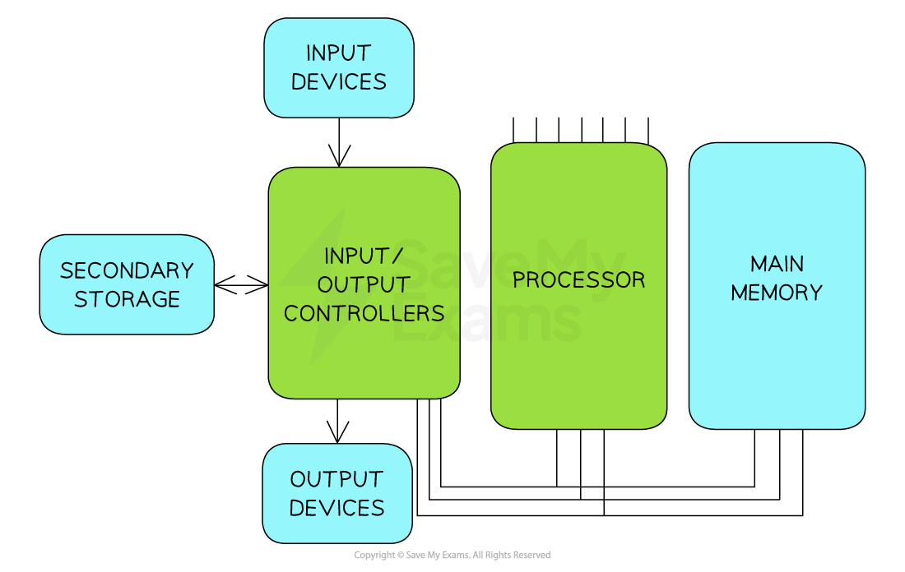

# System Architecture

## Von Neumann Model

> **Spec point** — `spcpt_kCG4YJc7PcSHvtMf`

## Von Neumann Model

### What is the Von Neumann model?

- The Von Neumann model is a** design of the CPU **which was proposed by Mathematician John Von Neumann in the 1940s, which most** general-purpose **computers are built upon
- The Von Neumann model outlines **how the computer memory, input/output devices and processor** all work together

*The Von-Neumann model*

- The Von Neumann model consists of:

  - **Central processing unit (CPU)**
  - **Able to access memory directly**
  - **Memory that can store programs as well as data (registers)**
  - **Stored programs that contain instructions that can be executed in order**

#### Registers

- Extremely **small**, extremely **fast memory **located **in the CPU**
- Hold small amounts of data **needed as part of the fetch-execute cycle**
- Includes both:

  - **General purpose registers**
  - **Special purpose registers**.
- A **general purpose** register can store **any data the CPU is currently working on**

  - It is **flexible **and can be used for various operations

## Special purpose registers

> **Spec point** — `spcpt_kmJ2B5YYGtGNhQRR`

## Special purpose registers

### What is a special purpose register?

- A special purpose register **has a dedicated role** within the operation of the CPU
- There are a number of special purpose registers that **control or track data**
- Examples of special purpose registers includes:

  - **The Program Counter (PC)**
  - **The Memory Address Register (MAR)**
  - **The Memory Data Register (MDR)**
  - **The Accumulator (ACC)**
  - **Current Instruction Register (CIR)**
  - **Index register (IX)**
  - **Status register (SR)**
- For each of the registers you must know

  - **The name of the register**
  - **Its acronym**
  - **The purpose of the register**

| **Name** | **Acronym** | **Purpose** |
|---|---|---|
| **Program Counter** | **PC** | - **Holds the** **memory address** of the **next instructions** to be executed - **Increments** **by 1 **as the fetch-decode-execute cycle runs |
| **Memory Address  Register** | **MAR** | - **Holds the memory address** of where data or instructions are **to be fetched from** **memory** |
| **Memory Data Register** | **MDR** | - **Stores the data or instruction** which has been fetched from memory |
| **Current Instruction Register** | **CIR** | - **Stores the instruction** the CPU is currently decoding or executing |
| **Accumulator** | **ACC** | - **Stores the** **results** of any calculations that have taken place in the Arithmetic Logic Unit (ALU) |
| **Index Register** | **IX** | - **Stores a value** that can be **added to an address** to get the effective memory address - Used for** indexed addressing** |
| **Status Register** | **SR** | - **Stores flags** that reflect the **outcome of the CPU operations** - Holds **individual bits (flags)** which are **set or cleared depending on the result of an instruction** (e.g. overflow) |
