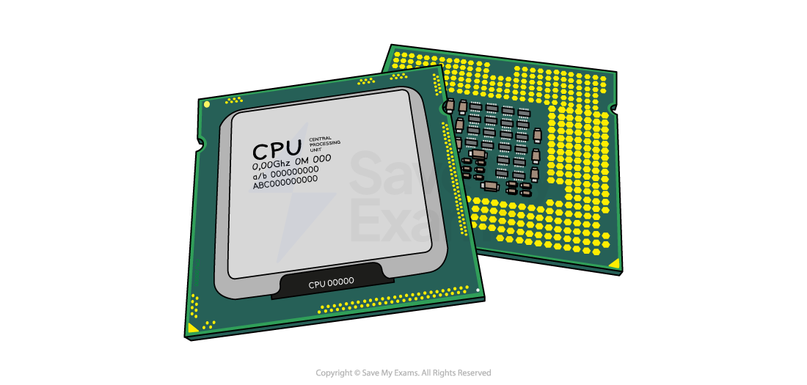
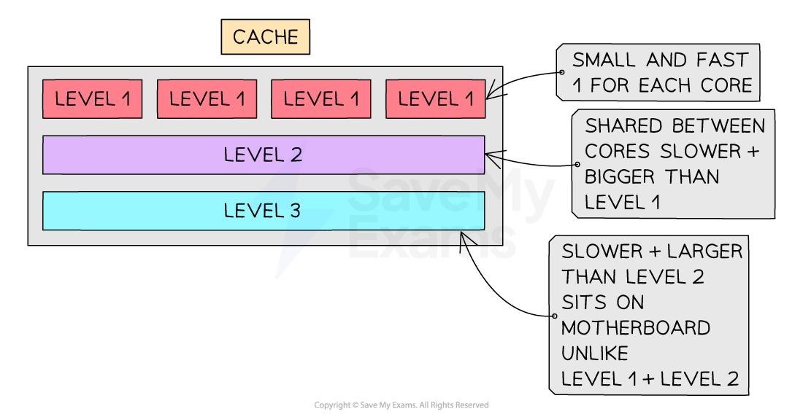

# System Performance

## Cores

> **Spec point** — `spcpt_hcX5gFV85CjPxKGc`

## Cores

### What is a core?

- A core acts like a **mini CPU**, it can **fetch, decode, and execute** instructions on its own
- Each core has its own:

  - **Control Unit (CU)**
  - **Arithmetic Logic Unit (ALU)**
  - **Registers**

- A CPU with **more than one core **is a** multicore CPU**
- Allows for **parallel processing**, multiple instructions are processed **at the same time**
- Example:

  - A **dual-core** processor has **2 cores**
  - A **quad-core** processor has **4 cores**
- More cores = **better performance**, especially for powerful programs
- Example:

  - A **quad-core CPU** can run up to **four sequences of instructions at the same time**, one on each core

- A **dual-core** processor isn't always **twice as fast** as a single-core

  - Some time is used for **organising tasks between cores**
- Not all tasks can be **split across cores**

  - Some tasks are **sequential** and must be done **step-by-step**

## Clock speed

> **Spec point** — `spcpt_gtz89tmjhC4zK57C`

## Clock speed

### What is clock speed?

- The **clock** controls the **timing of operations** inside the CPU
- It constantly **switches between 0 and 1**, each switch is called a **state change**
- A **state change** can represent **one step** in the **fetch-execute (F-E) cycle**

  - Some instructions may take **more than one cycle**
- **Clock speed** measures **how many state changes happen per second**
- **1 cycle per second = 1 Hz**
- A typical clock speed is around **2.3 GHz**

  - That’s **2.3 billion cycles per second**
- A **higher clock speed** means the CPU can **execute more instructions per second**
- This helps the computer **run tasks more quickly and efficiently**

## Cache memory

> **Spec point** — `spcpt_dQ4JhDcjqMDgBtCp`

## Cache memory

### What is cache memory?

- Cache is part of **primary storage**
- Stores **frequently used data and instructions**
- Located **closer to the CPU** than RAM, so it’s **faster to access**
- Some cache is built **directly into each processor core**
- **Speeds up** the performance of the CPU
- More cache = **more data stored** nearby = **less time waiting** for data from RAM
- Example:

  - When a program runs a loop, the **same instructions are needed again and again**
  - After they are first fetched from RAM, they are **kept in cache**
  - On later passes they are fetched from cache, which is **faster than fetching from RAM**, so the CPU spends less time waiting

#### Levels of cache

| **Level** | **Location** | **Speed** | **Size** |
|---|---|---|---|
| **Level 1 (L1)** | Inside each CPU core | **Fastest** | **Smallest** |
| **Level 2 (L2)** | Inside or near each core | Fast | Medium |
| **Level 3 (L3)** | Shared by all cores | Slower than L1/L2 | **Largest** |

*Diagram of the levels within the cache*

## Bus width

> **Spec point** — `spcpt_ddMfxchnq2rSTShF`

## Bus width

### What is bus width?

- Bus width is the number of **bits** a bus can carry at once
- A **wider bus** can transfer **more bits in a single operation**
- Example:

  - A **32-bit bus** transfers 32 bits at a time
  - A **64-bit bus** transfers 64 bits at a time
- **Increases performance**, more data can be moved in the same amount of time
- A **wider address bus** means:

  - **More memory locations can be directly addressed**, e.g. a 32-bit address bus can address 232 memory locations
- Important for **high-performance tasks** like gaming, video editing, or large data processing
