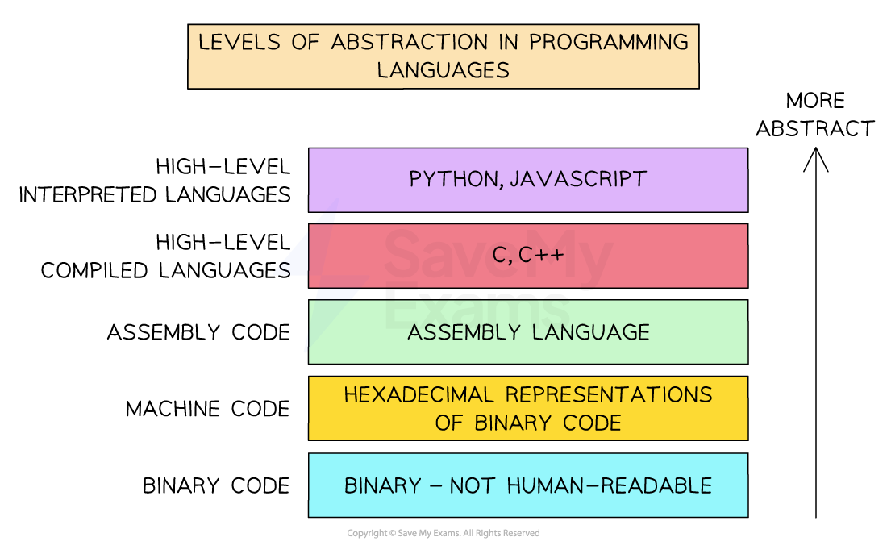

# Translator Types

## What is a translator?

- A translator is a program that **translates **program **source code **into **machine code** so that it can executed directly by a processor
- **Low-level languages** such as** assembly code** are translated using an **assembler**
- **High-level languages** such as **Python **are translated using a **compiler **or **interpreter**

## Assembler, compiler, interpreter

> **Spec point** — `spcpt_JSpsp5hvwsWwRzdX`

## Assembler, compiler, interpreter

### What is an assembler?

- An assembler translates **mnemonics written in assembly language** (low-level) in **to machine code**
- **Each line** of assembly language is **assembled **into a **single machine code** instruction
- Assemblers have been used less and less since high-level languages were introduced

| **Advantages** | **Disadvantages** |
|---|---|
| Speed of execution | Difficult to write due to limited and hard to understand commands |
| Optimises the code | Changes mean it must be reassembled |
| Original source code will not be seen | Designed solely for one specific processor |

### What is a compiler?

- A compiler translates high-level languages into machine code **all in one go**
- Compilers translate inputs into machine code **directly**
- Compilers are generally used when **a program is finished** and has been checked for syntax errors
- Compiled code can be **distributed (creates an executable) **and run **without the need for translation software**
- If compiled code contains any errors, after fixing, it **will need re-compiling**

| **Advantages** | **Disadvantages** |
|---|---|
| Speed of execution | Can be memory intensive |
| Optimises the code | Difficult to debug |
| Original source code will not be seen | Changes mean it must be recompiled |
|   | It is designed solely for one specific processor |

### What is an interpreter?

- An interpreter translates high-level languages into machine code **one line at a time**
- Each line is executed after translation and if **any errors are found**, the **process stops**
- Interpreters **do not** generate machine code **directly**, appropriate machine code subroutines are called
- Interpreters are generally used when a program** is being written** in the development stage
- Interpreted code is more **difficult to distribute** as **translation software is needed for it to run**

| **Advantages** | **Disadvantages** |
|---|---|
| Stops when it finds a specific **syntax error** in the code | Slower execution |
| Easier to debug | Every time the program is run it has to be translated |
| Require less RAM to process the code | Executed as is, no optimisation |

## Compiler vs interpreter

> **Spec point** — `spcpt_85byqGdccCjpsRNT`

## Compiler vs interpreter

| **Aspect** | **Compiler** | **Interpreter** |
|---|---|---|
| **Software needed by user** | End users only need the **executable file**, not the compiler – so there’s **no extra cost or setup** | End users **need an interpreter** or compiler to translate and run the source code – may involve setup or cost |
| **Access to source code** | Users **do not receive the source code**, so they **can’t modify or extend** the program | Users receive the **full source code**, making it **easier to modify or extend** the program themselves |
| **Control and monetisation** | Developers keep control of the code and can **charge for upgrades** or customisations | Developers lose control over their code, making it **harder to monetise upgrades** or prevent copying |
| **Speed of execution** | Compiled programs **run faster**, as translation is done in advance and optimised machine code is used | Interpreted programs **run slower**, since each line is translated every time it runs |
| **Error handling** | Compiled programs don’t run until **all syntax and semantic errors** are fixed | Errors are **caught one line at a time**, making it easier for the developer to test and fix during development |
| **Portability** | Compiled code can be **run on different machines**, regardless of where it was compiled | Interpreted programs must be interpreted on the **same type of machine** – less portable |
| **Debugging experience** | More difficult to test sections – developers need to **write special routines** to check partial results | Developers can **view partial results as they go**, making it easier to test, debug, and refine ideas |
| **Crash risk** | Untested compiled programs may **crash the system** if run with errors | Interpreted programs are **safer during testing** – errors are caught before the system can crash |
| **User independence** | Users are **reliant on the developer** for updates or modifications – they can’t edit the code themselves | Users have **full access to code and libraries**, giving them **freedom to customise or fix** the program |

## Mixed mode translation

> **Spec point** — `spcpt_c32hVzKhMjckFJNB`

## Mixed mode translation

## What is mixed mode translation?

- Mixed mode translation **combines features** of both a **compiler** and an **interpreter**
- Instead of fully compiling or interpreting the code, the program is **partially compiled into an intermediate form**, which is then **interpreted at runtime**
- It works by:

  - The source code is **compiled into intermediate code**, not full machine code
  - This **intermediate code** (e.g. bytecode) is **interpreted by a virtual machine** (e.g. the Java Virtual Machine – JVM)
  - Optionally, some parts may later be **just-in-time (JIT) compiled** into machine code for better performance
- **Java** uses mixed mode translation:

  - Java source code is **compiled **to **bytecode** (.class file)
  - Bytecode is **interpreted **(or JIT compiled) by the **JVM** on any platform

| **Feature** | **Compiler** | **Interpreter** | **Mixed mode translation** |
|---|---|---|---|
| Translation | Entire program at once | One line at a time | Compiles to intermediate code |
| Speed of execution | Fastest (fully compiled) | Slowest | Medium (JIT makes it faster over time) |
| Portability | Not portable | Not portable | Highly portable (across platforms) |
| Errors shown | After full compilation | One at a time | During compile or runtime |
| Requires runtime system | No | Yes | Yes (e.g. JVM) |
| Example languages | C, C++ | Python, JavaScript | Java, C# (with .NET CLR) |

> **Worked Example**
> Jennifer uses an Integrated Development Environment (IDE) to write her computer program.
> 
> The IDE allows Jennifer to use both an interpreter and a compiler while creating her computer program.
> 
> Describe the ways in which Jennifer can use both a compiler and an interpreter while developing the program.**[4]**
> 
> **Final answer:** **Answer**
> 
> **Interpreter: **
> 
> - Use an interpreter while writing the program **[1 mark]**
> - … to test/debug the partially completed program **[1 mark]**
> - … because errors can be corrected and processing continue from where the execution stopped // errors can be corrected in real time // errors are identified one at a time **[1 mark]**
> 
> **Compiler:**
> 
> - Use the compiler after the program is complete **[1 mark]**
> - … to create an executable file **[1 mark]**
> - Use the compiler to repeatedly test the same (completed) section **[1 mark]**
> - … without having to re-interpret every time // compiler not needed at runtime **[1 mark]**
