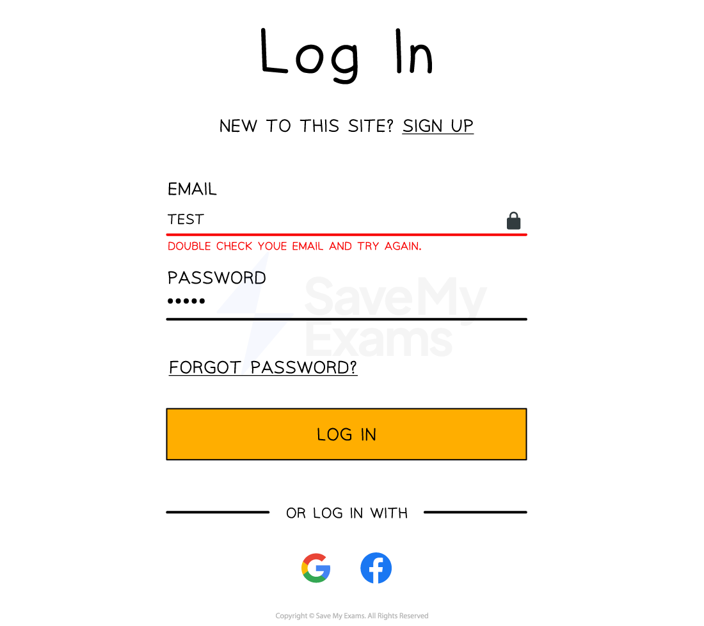

# Integrity Methods

## Validation & verification

> **Spec point** — `spcpt_Qwcvb7R46yWB7bgy`

## Validation & verification

### What is validation?

- Validation is an **automated process** where **a computer checks** if a user input is **sensible **and meets the program's requirements
- There are **seven categories** of validation which can be carried out on **fields** and **data types,** these are

  - **Range check**
  - **Format check**
  - **Length check**
  - **Presence check**
  - **Existence check**
  - **Limit check**
  - **Check digit**
- There can be occasions where **more than one type of validation will be used **on a field
- An example of this could be a password field which could have a **length**, **presence** and **format** check on it

### What is verification?

- Verification is the** act of checking data is accurate** when being **transferred **or **entered **into a system
- Verification methods include:

  - **Parity check (transfer)**
  - **Checksum (transfer)**
  - **Double entry checking (entry)**
  - **Visual checks (entry)**

## Validation methods

> **Spec point** — `spcpt_32jYtVRJtPznbZjb`

## Validation methods

| **Validation type** | **Definition** | **Example** |
|---|---|---|
| **Range check** | Ensures a number falls within a set range | Validating that a percentage is between 0 and 100 |
| **Limit check** | Checks that a value does not exceed a maximum limit | Ensuring no more than 5 items can be bought in a special offer |
| **Length check** | Checks the length of a string | Confirming a PIN is exactly 4 digits long |
| **Check digit** | An extra digit calculated from the other digits in a numeric code and added to the end; it is recalculated when the code is entered and compared | The final digit of an ISBN book number |
| **Presence check** | Checks that data has been entered and the field is not blank | Making sure a registration form is not submitted with blank fields |
| **Existence check** | Checks that a referenced value exists in a database or list | Confirming a student ID entered exists in the school records |
| **Format check** | Ensures data is in the correct format (e.g. patterns) | Making sure an email address contains '@' and a domain like '.com' |

- A **type check** (checking the data is the correct data type, e.g. age entered as a whole number) is not one of the seven named methods, but mark schemes do accept it as a validation check

### What is a check digit?

- A check digit is the** last digit** included in a code or sequence, used to **detect errors **in **numeric data entry**
- Examples of errors that a check digit can help to identify are:

  - **Incorrect digits entered**
  - **Omitted or extra digits**
  - **Phonetic errors**
- Added to the **end of a numerical sequence** they ensure **validity **of the data
- Calculated using **standardised algorithms **to ensure widespread **compatibility**
- Examples of where check digits can be used include:

  - **ISBN book numbers**
  - **Barcodes**

#### ISBN book numbers

- Each book has a **unique **ISBN number that **identifies **the book
- A standard ISBN number may be ten digits, for example, 965-448-765-9
- The check digit value is the** final digit** (9 in this example).
- This number is chosen specifically so that when the algorithm is completed the result is a whole number (an integer) with no remainder parts
- A check digit algorithm is performed on the ISBN number and **if the result is a whole number,** then the **ISBN is valid**

#### Barcodes

- Barcodes consist of **black and white lines** which can be scanned using barcode scanners
- Barcode scanners** shine a laser** on the black and white lines which **reflect light** into the scanner
- The scanner reads the **distance between these lines as numbers** and can identify the item
- Barcodes also use a** set of digits** to **uniquely identify each item**
- The **final digit** on a barcode is usually the **check digit**, which is used to **validate** the number when it is scanned or typed in

## Verification methods

> **Spec point** — `spcpt_Q4M6BsPSYkPpsctR`

## Verification methods

### What is a parity check?

- A parity check determines whether **bits in a transmission** have been **corrupted**
- Every byte transmitted has **one of its bits** allocated as a** parity bit**
- The sender and receiver must **agree** before transmission whether they are using **odd **or **even parity**
- If** odd parity** is used then there must be an **odd number of 1’s in the byte**, including the parity bit
- If **even parity **is used then there must be an **even number of 1’s in the byte**, including the parity bit
- The **value of the parity bit** is determined by **counting the number of 1s in the seven data bits**: if the count does not already match the agreed parity, a parity bit of **1** is appended, otherwise a parity bit of **0** is appended
- If the number of 1’s **does not match the agreed parity** then an** error has occurred**
- Parity checks **only check that an error has occurred**, they do not reveal where the error(s) occurred

#### Even parity

- Below is an arbitrary binary string

| **EVEN** **Parity bit** | **Byte** |   |   |   |   |   |   |
|---|---|---|---|---|---|---|---|
| ***0*** | ***1*** | ***0*** | ***1*** | ***1*** | ***0*** | ***1*** | ***0*** |

- If an **even parity bit** is used then** all bits** in the byte, including the parity bit, must **add up to an even number**

  - There are four 1’s in the byte
  - This means the parity bit must be 0 otherwise the whole byte, including the parity bit, would add up to five which is an odd number

#### Odd parity

- Below is an arbitrary binary string

| **ODD** **Parity bit** | **Byte** |   |   |   |   |   |   |
|---|---|---|---|---|---|---|---|
| ***1*** | ***1*** | ***0*** | ***1*** | ***1*** | ***0*** | ***1*** | ***0*** |

- If an **odd parity bit** is used then** all bits** in the byte, including the parity bit, must **add up to an odd number**

  - There are four 1’s in the byte. This means the parity bit must be a 1 otherwise the whole byte, including the parity bit, would add up to four which is an even number
- The table below shows a number of examples of the agreed parity between a sender and receiver and the parity bit used for each byte

| **Example #** | **Agreed parity** | **Parity bit** | **Main bit string** | **Total number of 1’s** |   |   |   |   |   |   |
|---|---|---|---|---|---|---|---|---|---|---|
| #1 | ODD | ***0*** | ***1*** | ***1*** | ***0*** | ***1*** | ***0*** | ***1*** | ***1*** | **5** |
| #2 | EVEN | ***1*** | ***0*** | ***0*** | ***0*** | ***1*** | ***0*** | ***0*** | ***0*** | **2** |
| #3 | EVEN | ***1*** | ***0*** | ***1*** | ***0*** | ***1*** | ***1*** | ***1*** | ***1*** | **6** |
| #4 | ODD | ***1*** | ***0*** | ***1*** | ***1*** | ***1*** | ***0*** | ***0*** | ***1*** | **5** |
| #5 | ODD | ***1*** | ***1*** | ***0*** | ***1*** | ***0*** | ***1*** | ***0*** | ***1*** | **5** |
| #6 | EVEN | ***0*** | ***1*** | ***0*** | ***0*** | ***1*** | ***1*** | ***1*** | ***0*** | **4** |

- Example #1: The agreed parity is **odd**. All of the 1’s in the main bit string are added** (5)**. As this number is** odd already** the **parity bit **is set to** 0** so the whole byte **stays odd**
- Example #2: The agreed parity is **even**. All of the 1’s in the main bit string are added **(1)**. As this number is **odd** the **parity bit** is set to** 1** to make the** total number of 1’s even** **(2)**
- Example #6: The agreed parity is **even**. All of the 1’s in the main bit string are added** (4)**. As this number is **even already** the **parity bit **is set to** 0** so the whole byte **stays even**

#### How do errors occur?

- When using parity bits, an** error** occurs when the number of **total bits does not match the agreed parity**
- Bits can be** flipped** or **changed** due to** interference** on a wire or wirelessly due to **weather **or **other signals**

| **Example #** | **Agreed parity** | **Parity bit** | **Main bit string** | **Total number of 1’s** | **Error** |   |   |   |   |   |   |
|---|---|---|---|---|---|---|---|---|---|---|---|
| #1 | ODD | ***1*** | ***1*** | ***1*** | ***0*** | ***1*** | ***0*** | ***1*** | ***1*** | ***6*** | ***Error*** |
| #2 | EVEN | ***1*** | ***0*** | ***0*** | ***0*** | ***1*** | ***0*** | ***0*** | ***0*** | ***2*** | **Final answer:** **No error** |
| #3 | EVEN | ***1*** | ***0*** | ***1*** | ***1*** | ***1*** | ***1*** | ***1*** | ***1*** | ***7*** | ***Error*** |
| #4 | ODD | ***1*** | ***0*** | ***1*** | ***1*** | ***1*** | ***0*** | ***0*** | ***1*** | ***5*** | **Final answer:** **No error** |
| #5 | ODD | ***1*** | ***1*** | ***0*** | ***1*** | ***0*** | ***1*** | ***1*** | ***1*** | ***6*** | ***Error*** |
| #6 | EVEN | ***0*** | ***1*** | ***0*** | ***0*** | ***0*** | ***1*** | ***1*** | ***0*** | ***3*** | ***Error*** |

- Parity checks are **quick **and** easy to implement** but **fail to detect bit swaps** that cause the parity to remain the same

### What are parity byte & block checks?

- Parity blocks and parity bytes can be used to **check an error has occurred** and **where the error is located**
- Parity checks on their own **do not pinpoint where errors in data exist**, only that an error has occurred
- A parity block consists of **a block of data **with the number of 1’s totalled **horizontally **and **vertically**
- A parity byte is also sent with the data which contains the **parity bits **from the **vertical parity calculation**
- Below is a parity block with a parity byte at the bottom and the parity bit for each byte in the **last column**

| **ODD** | **1** | **2** | **3** | **4** | **5** | **6** | **7** | **Parity bit** |
|---|---|---|---|---|---|---|---|---|
| Byte 1 | ***1*** | ***1*** | ***0*** | ***1*** | ***0*** | ***1*** | ***1*** | ***0*** |
| Byte 2 | ***0*** | ***0*** | ***0*** | ***1*** | ***0*** | ***0*** | ***0*** | ***0*** |
| **Byte 3** | ***0*** | ***1*** | ***0*** | **1** | ***1*** | ***1*** | ***1*** | ***1*** |
| Byte 4 | ***0*** | ***1*** | ***1*** | ***1*** | ***0*** | ***0*** | ***1*** | ***1*** |
| Byte 5 | ***1*** | ***0*** | ***1*** | ***0*** | ***1*** | ***0*** | ***1*** | ***1*** |
| Byte 6 | ***1*** | ***0*** | ***0*** | ***1*** | ***1*** | ***1*** | ***0*** | ***1*** |
| Byte 7 | ***0*** | ***1*** | ***1*** | ***1*** | ***1*** | ***1*** | ***0*** | ***0*** |
| Byte 8 | ***1*** | ***0*** | ***1*** | ***1*** | ***0*** | ***0*** | ***0*** | ***0*** |
| **Parity byte** | ***1*** | ***1*** | ***1*** | ***1*** | ***1*** | ***1*** | ***1*** | ***1*** |

- Each** byte row** calculates the** horizontal parity** as a parity bit **as normal**
- For each column, the parity byte is calculated **down the columns**, not across the rows
- It is **calculated before transmission** and **sent with the parity block**
- Each **parity bit tracks if a flip error** occurred in a byte while the **parity byte** calculates if an **error occurred in a bit column**
- By **cross referencing** both **horizontal and vertical** parity values the **error can be pinpointed**
- In the above example the **Byte 3, column 4** cell is the error and **should be a 0 instead**
- The error could be **fixed automatically or a retransmission request could be sent **to the sender

### What is a checksum?

- A checksum is a value that can be used to determine if data has been** corrupted or altered**
- It indicates whether data **differs from its original form** but **does not **specify where
- Checksums are **calculated using an algorithm** and the value is **added to the transmission**
- The receiving device **re-calculates** the checksum and **compares** to the original
- If the **checksums do not match**, it is assumed an error has occurred

### What is double entry checking?

- Double entry checking involves** entering the data twice **in separate input boxes and then comparing the data to ensure they both match
- If they do not, an error message is shown

### What is a visual check?

- A visual check involves the user **visually checking the data on the screen**
- A popup or message then **asks if the data is correct** before proceeding
- If it isn’t the **user then enters the data again**
