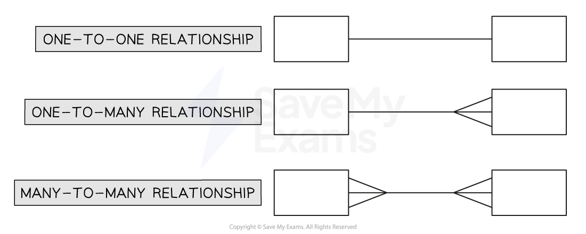

# Database Design

## Entity-relationship (E-R) diagrams

> **Spec point** — `spcpt_XdgV5kCRhdjch4fd`

## Entity-relationship (E-R) diagrams

### What is an entity?

- An entity in something worthy of **capturing and storing data about** e.g. *students, orders, products, courses, customers*
- Entities become **tables **in a **relational database**
- Relational databases store different entities in **separate tables**
- Linking tables depends on the** relationships between entities**
- There are 3 types of (sometimes called degrees of) **relationships:**

  - **One-to-one**
  - **One-to-many**
  - **Many-to-many**
- Imagine a company has

  - A table of `products`
  - A table of `customers`
  - A table of the `orders` the customers have made
- What is the relationship between a **customer **and an **order**?

  - **One **customer can make multiple (**many**) orders
  - But each order relates to a specific (**one**) customer
  - So the relationship between customer and order is **one-to-many**
- Now consider the relationship between a **product **and an **order**

  - An order could have more than one (**many**) products on it
  - A product could be on more than one (**many**) order
  - So the relationship between order and product is **many-to-many**
- **One-to-one** relationships also exist but are not very common in databases

### What is an entity-relationship (E-R) diagram?

- An entity relationship diagram** **(***E-R***) is a **diagram that represents the entities** (tables) that will be in a database and the **relationships between these entities**
- The entities are drawn as **boxes **with the ***entity*** name in
- The relationships are drawn in as what is known as ‘**crow’s feet notation**’
- This is how to draw the relationships in the exam:

- The **names **of the entities would go inside the boxes

> **Exam Hint**
> These diagrams are simple but tell us some important things about the database:
> 
> - The names of all the tables
> - Which tables will have a foreign key - when an entity has a ‘many’ relationship against it that means it will have a foreign key in it that links to the primary key of the connected entity
