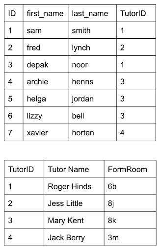

# Database Models

## Limitations of file-based systems

> **Spec point** — `spcpt_P787CgxNkKFMC6Sx`

## Limitations of file-based systems

### What is a file-based system?

- A file-based system refers to any system where **data is stored in separate files** (e.g. text files, spreadsheets)
- Each application or department may have its **own files**, often with **redundant or duplicated data**
- There is **no central control** or shared structure, files are often standalone
- Common in older systems or small-scale setups

#### Limitations

| **Limitation** | **Explanation** |
|---|---|
| **Data redundancy** | The same data is stored in multiple files, leading to duplication |
| **Data inconsistency** | If one file is updated but others aren’t, the data becomes unreliable |
| **Lack of data integrity** | It's harder to ensure data is accurate and consistent across all files |
| **Poor security** | Limited control over who can access or modify different files |
| **Difficult to update** | Changes must be made in several places, increasing time and risk of error |
| **Limited scalability** | Not suitable for large volumes of data or complex data relationships |
| **No central control** | Each application manages its own data, leading to lack of coordination |
| **Hard to manage relationships** | Cannot easily link related data across files (e.g. customers and their orders) |

## Flat file vs Relational

> **Spec point** — `spcpt_WN37ppXhzxdy2v2d`

## Flat file vs Relational

- A **flat file database** is one that stores all data in a **single table**

  - It is simple and easy to understand but causes data redundancy, inefficient storage and is harder to maintain
- A **relational database** is one that organises data into **multiple tables**

  - It uses keys to connect related data which reduces data ***redundancy***, makes efficient use of storage and is easier to maintain
- Consider this example **flat file** table of students

- This table has **redundant data** - the tutor and form room information repeats
- This is **inefficient**
- If a tutor changed their name we would need to find all instances of that name and change them all
- Missing any would mean the table had** inconsistent data**
- A **relational **database would solve this issue:

  - A new **table **could be created to store the tutor information and the tutor information in the student table could be moved to the new **table**
  - A **foreign key** in the student **table **(`TutorID`) could link a student to their tutor

- Now the name of each tutor and their form room is stored **only once**
- This means if they change only one piece of data, the data is **updated in the entire database **and ***inconsistency*** is avoided

## Database terminology

> **Spec point** — `spcpt_nt6wCsbXQScDX5S8`

## Database terminology

| **Term** | **Definition** |
|---|---|
| **Entity** | A real-world object or concept that data is stored about (e.g. `Student`, `Book`) |
| **Table** | A collection of data about an entity, organised in rows and columns |
| **Record (Tuple)** | A single row in a table representing one instance of an entity |
| **Field (Attribute)** | A single column in a table, storing one piece of data about the entity |
| **Primary key** | A unique identifier for each record in a table (e.g. `StudentID`) |
| **Candidate key** | A field (or combination of fields) that could be used as a primary key |
| **Secondary key** | A candidate key that has not been chosen as the primary key; an alternative key used as well as the primary key to locate specific data |
| **Foreign key** | A field that links to the primary key in another table to create relationships |
| **Relationship** | A logical connection between two tables/entities |
| **One-to-One** | One record in a table relates to one record in another table |
| **One-to-Many** | One record in a table relates to many records in another table |
| **Many-to-Many** | Records in one table relate to many records in another, and vice versa |
| **Referential integrity** | Ensures foreign keys match a primary key in the related table to prevent broken links |
| **Indexing** | A technique to speed up searching in a table by creating an ordered list of key fields |
