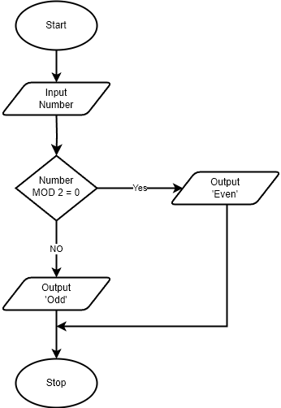

# Translation Skills

## Structured English/Flowchart to Pseudocode

> **Spec point** — `spcpt_tQ74wpHyRyJwcbWH`

## Structured English/Flowchart to Pseudocode

### Example - Structured English

A customer is buying an item. If the customer has a discount code, they receive 10% off the price. Otherwise, they pay the full amount. The program should ask for the item price and whether they have a discount code, then calculate and display the final price.

#### Step 1 - Structured English

1. Ask the user to enter the price of the item
2. Ask the user if they have a discount code
3. If they do have a discount code
 → Calculate 10% off the price
 → Subtract the discount from the original price
4. Otherwise
 → The price stays the same
5. Output the final price

#### Step 2 – Identifier table

| **Identifier** | **Description** |
|---|---|
| `ItemPrice` | Original price of the item |
| `HasDiscount` | TRUE if user has a discount code |
| `DiscountAmount` | Amount taken off the original price |
| `FinalPrice` | Price after discount is applied |

#### Step 3 – Pseudocode

## Structured English/Pseudocode to Flowchart

> **Spec point** — `spcpt_rkVZyJmwwKynTj9B`

## Structured English/Pseudocode to Flowchart

### Example - Pseudocode

#### Step 1 – Identifier table

| **Identifier** | **Description** |
|---|---|
| `Number` | The number entered by the user |

#### Step 2 – Flowchart structure

| **Pseudocode statement** | **Flowchart symbol** | **Purpose** |
|---|---|---|
| `INPUT Number` | Parallelogram (Input/Output) | User enters a number |
| `IF Number MOD 2 = 0` | Diamond (Decision) | Checks if the number is divisible by 2 |
| `OUTPUT "Even"` | Parallelogram (Input/Output) | Displays message if the condition is true |
| `OUTPUT "Odd"` | Parallelogram (Input/Output) | Displays message if the condition is false |
| Start/End | Oval | Denotes beginning and end of the process |
| Arrows | Lines with arrows | Indicate flow of control |

#### Step 4 - Flowchart

