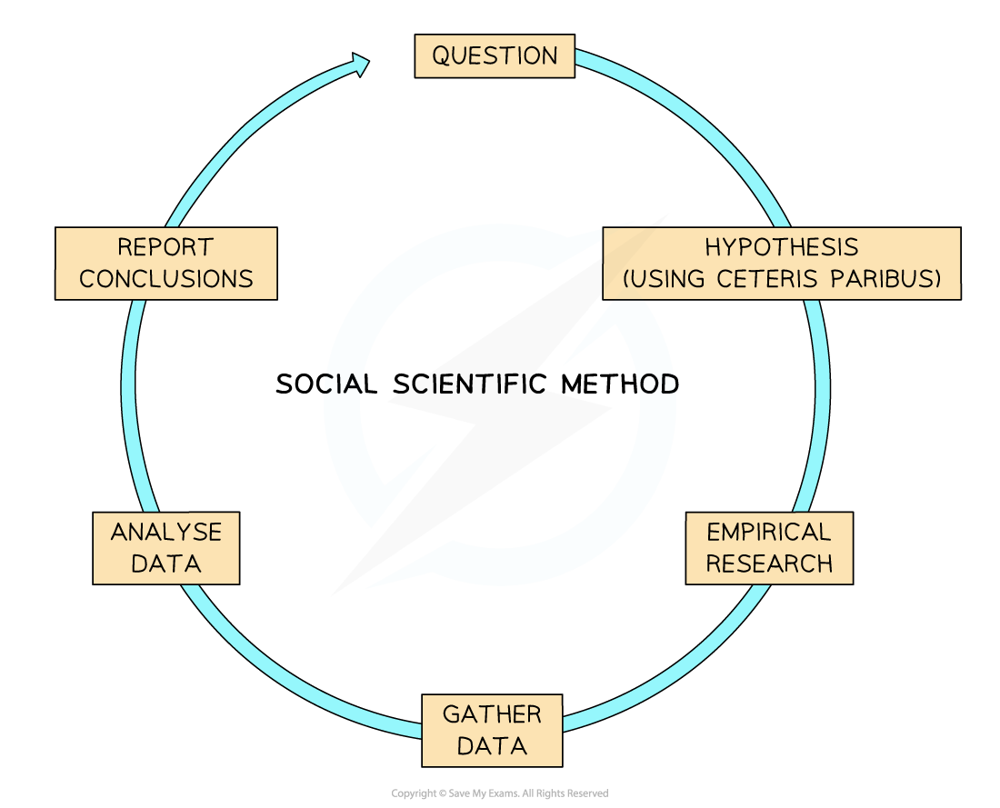

# Economics as a Social Science

## Economics as a Social Science

> **Spec point** — `spcpt_FFrmqDJRbmxs6yXD`

## Economics as a social science

- Economics is a **social science**

  - Social sciences study societies and the **human interactions** within those societies
  - Human interactions are complex and are influenced by **many variables**
  - Social sciences also include subjects such as Psychology, Politics, Geography and Business Studies
- Due to the complexities within societies, economists **build models** so as to better understand certain interactions

  - A model is a **simplified version** of reality
  - Some models are **more complex** than others. Examples of models include, the circular flow of income, production possibility curves, demand and supply
  - All models make a** range of assumptions**. These are often generalizations about behaviour, choices and likely outcomes
  - These assumptions are necessary so as to account for complex human behaviour and **constantly changing variables**
  - When evaluating different models, the **underlying assumptions** should always be considered
- To **think like an economist** involves identifying which variables will be studied and which ones will be excluded

  - This way of thinking considers the type of relationship between variables **(causal or correlation)**. E.g. Data shows that when ice cream sales increase, so do car thefts. Correlation, yes. Causation, no
  - Some economists will **build an argument** to include certain variables in a study and others will argue to exclude them. They will each provide a** justification** for their decision
  - Two economists analysing the same data may end up with **vastly different interpretations.** This is often due to the different variables that each economist chooses to focus on
  - This is the complexity found within **social sciences**

## The Social Scientific Method

> **Spec point** — `spcpt_x7SBmBCHFrmSHKN6`

## The social scientific method

- As a **social science**, Economics deals with complex and continuously changing **human interactions**

  - It is hard to examine a relationship between** two variables** and always come to the same conclusion (as can be done in Science or Maths)
  - There are a variety of tools used in economic analysis to help ensure that **positive (factual) statements** can be made with a degree of reliability

### 1. The use of logic

- When analysing markets, a **range of assumptions** are made about the **rationality** of ***economic agents*** involved in the transactions
- In classical economic theory, the word** 'rational' **means that economic agents are able to consider the outcome of their **choices** and **recognise the net benefits** of each one
- Rational agents will select the choice which presents the **highest benefits**

  - **Consumers** are assumed to act rationally. They do this by **maximising their** ***utility***
  - **Producers** are assumed to act rationally. They do this by **selling goods/services** in a way that **maximises their profits**
  - **Workers** are assumed to act rationally. They do this by **balancing welfare** at work with consideration of both pay and benefits
  - **Governments **are assumed to act rationally. They do this by placing the interests of the people they serve first in order to maximise their welfare

### 2. The use of hypotheses, models and theories

- The **social sciences** use a variation of the **scientific method** of research, which is called the **social scientific method**
- There is an **inability to make scientific experiments,** the results of which can be proven time and time again

  - This is due to the complexity of human nature and the significant** number of social interactions** that are taking place in any economy **at any given point in time**
- The steps in the **social scientific method** are similar to the ***scientific method ***but there is a key difference

*The social scientific method uses empirical research to gather data*

- ***Empirical research*** is collected through **observations, surveys, opinion polls** etc.

  - The results of **the same hypothesis** can vary significantly when conducted by **different researchers** at **different time periods** and **between different places and cultures**
- **Refutation** is the act of a statement or theory being proved to be wrong by the empirical evidence

  - Refutation helps to determine if an **economic statement is positive**
  - **Economic models** are developed by economists once a **hypothesis has been repeatedly proven or rejected** in **different circumstances**
  - A model is a **simplified version** of reality
  - All models make a** range of assumptions**. These are often generalisations about behaviour, choices and likely outcomes
  - These assumptions are necessary so as to account for complex human behaviour and **constantly changing variables**
  - When evaluating different models, the **underlying assumptions** should always be considered

## The Ceteris Paribus Assumption

> **Spec point** — `spcpt_KV4XcchdVNYgJcPm`

## 3. The ceteris paribus assumption

- Due to the **large number of variables** that can influence any particular economic interaction in society, economists **create models** using the principle of **ceteris paribus**

  - Translated from Latin, 'ceteris paribus' means **'all other variables remain constant'**
  - It allows economists to **simplify and explain** causes and effects, even if the explanation is somewhat limited by the assumptions
  - E.g., there are **many factors** that affect the level of unemployment in an economy (interest rates, consumer confidence, firms' investment, government policies, etc.). Using **ceteris paribus**, economists  can simplify the **economic model** to analyse **just two variables **(e.g. unemployment and interest rates)

## Positive and Normative Statements

> **Spec point** — `spcpt_n4mbKnbmVbbFGmJ8`

## Positive and normative statements

- **Positive economics** is concerned with **objective statements** of how a market or an economy works.

  - These **positive economic statements **are based on empirical evidence and tend to be **statements of fact**
  - They can be proven to be **true or false**
  - These are examples of positive economic statements
  
    - The UK unemployment rate **has fallen** from 4% to 3.7% in the past three months
    - Increasing the minimum wage last year in the UK **resulted in improvements** to wage inequality
    - Prices in the UK **have risen dramatically**, partly due to the 20% **increase in the price of oil**
- **Normative economics** focuses on **value judgements**. These judgements are built around **opinions and beliefs** as to what the best economic policies or solutions may be

  - These judgements are called '**normative economic statements'**
  - **Normative economic statements** are what separate political parties and the different economic agendas they put forward
  - These are examples of normative economic statements
  
    - Every economy **should** aim to provide free healthcare for its citizens
    - Corporation taxes in an economy **should** be higher than personal income taxes
    - **The best way** to deal with a rise in crime is to employ more police

> **Exam Hint**
> Examiners will often assess your understanding of positive and normative economic statements. They do this by asking you to identify statements from the text
> 
> Normative statements often have the word 'should' in them (but not always). Value judgement must be used in definitions, not opinions
> 
> Positive statements usually include data that is hard to challenge. Any use of concrete data points towards the statement being a positive statement

## The Role of Value Judgements

> **Spec point** — `spcpt_rH3VJ2Qkbnc5nsbr`

## The role of value judgements

- **Value judgements influence individuals'** choices in the **economic decisions** they make

  - These decisions can be related to any part of their lives, from what they eat, to where they work, to how they maintain their health
  - For example, deciding not to eat meat is often a **value judgement** based around unethical methods of food production
  
    - By providing statistics on the harmful impact that meat production has on the environment, environmental campaigners are attempting to demonstrate that this is **no longer a normative issue**
  - Another example is the way that many individuals choose to smoke nicotine-based products
  
    - The value judgement they make is that the benefits they get from smoking outweigh any risk of cancer.
- **Value judgements influence governments'** choices with regards to the **economic policies** they choose to adopt and spend money on

  - The USA spends more money on imprisoning drug users than rehabilitating them
  - In the UK, the Government has recently increased its spending on **rehabilitation**
  - To say the **UK approach is better** would be a normative statement
  - To say that the UK government spends more per head on rehabilitation would be a **positive statement**

## The Importance Of Time Periods

> **Spec point** — `spcpt_qZ25X7YjV9Q7pjT2`

## The importance of time periods

- Economies are constantly changing. Change affects daily life, work, and the way resources are used in production.
- Economists use **time periods** to analyse how change influences economic activity over time
- Different time periods are useful when considering the **factors of production** – the resources used to produce goods and services (land, labour, capital, and enterprise)

#### Short run

- In the **short run**, a firm can only change some of its inputs
- Typically, **labour** is variable, while other factors such as land and capital remain fixed
- Example: Hiring more workers can increase output, but the size of the factory or machinery cannot change

#### Long run

- In the **long run**, all factors of production can be adjusted
- Firms can expand capital, improve technology, or build new factories to increase efficiency and output
- This allows firms to plan more effectively to meet their objectives

#### Very long run

- In the **very long run**, all factors of production **and other key inputs** can change
- Key inputs include technology, government policies, and social factors
- Firms can fully adapt to changes in the economic and social environment

> **Exam Hint**
> You must avoid using time periods such as weeks, months or years
> 
> There is no fixed timescale for the short, long, or very long run
> 
> The distinction depends on which factors of production can be varied, not on a set number of months or years
