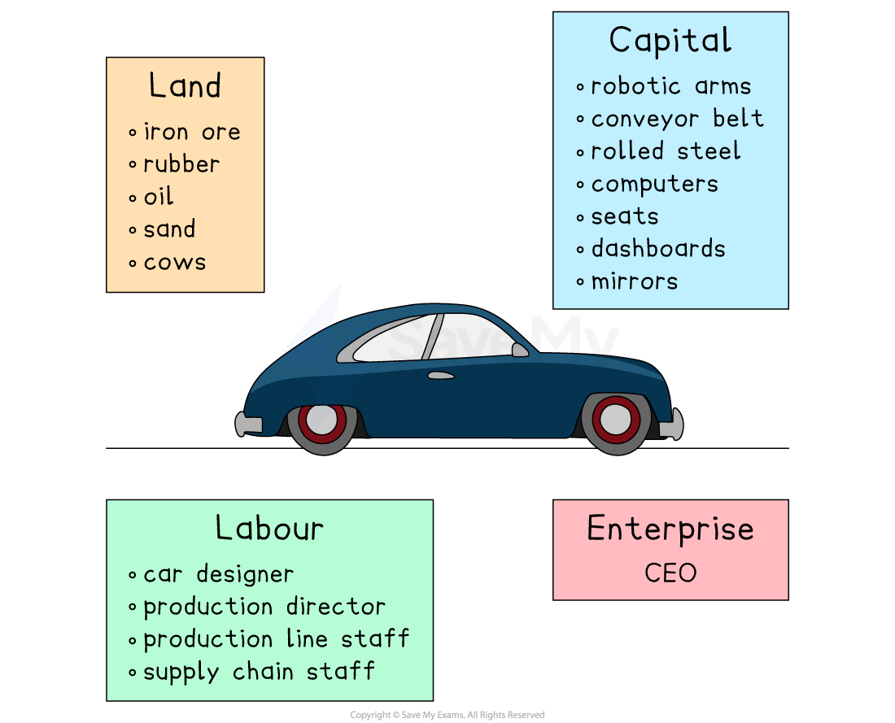
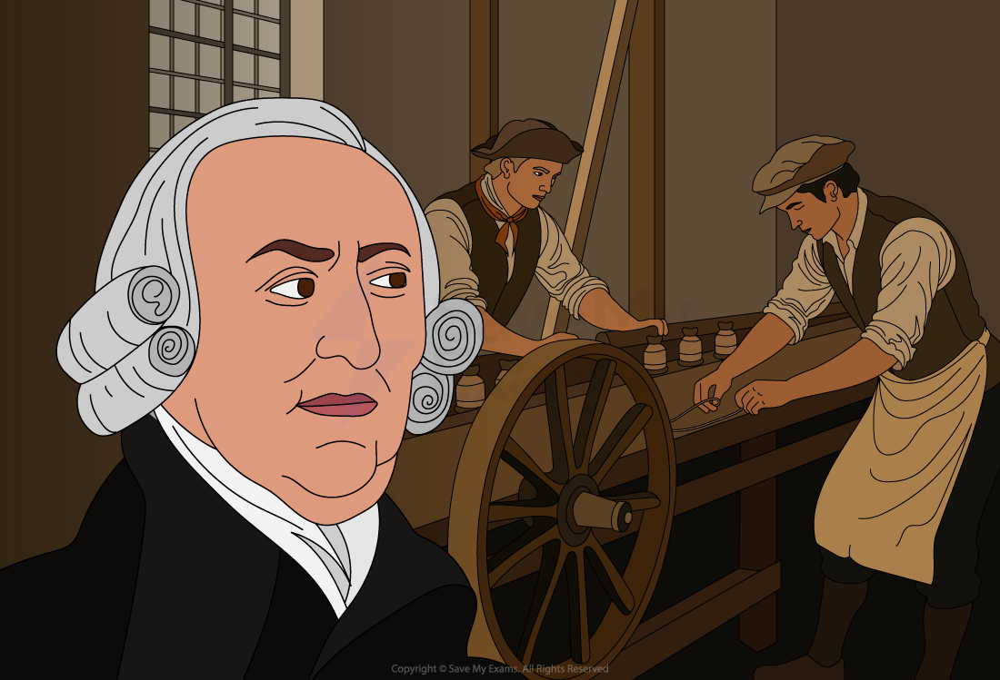

# Economic Resources

## The Four Factors Of Production

> **Spec point** — `spcpt_xXrz75nbcV8ZHrJM`

## The factors of production

- **Factors of production** are the resources used to produce goods and services

  - Land, labour, capital and enterprise
- The production of any good/service requires the use of **a combination of all four factors of production**

  - Goods are physical objects that can be touched **(tangible)** e.g. mobile phone
  - Services are actions or activities that one person performs for another **(intangible)** e.g. manicure, car wash

### The four factors of production

#### 1. Land

- **Non man-made** **natural resources **available for production
- Some countries have a vast amount of a particular natural resource and so are able to ***specialise ***in its production

  - E.g., oil, wood, fish, corn, iron ore

#### 2. Labour

- The **human input** into the production process
- Labour involves mental or physical effort
- Not all labour is of the same quality

  - It can be **skilled or unskilled**
  - Some workers are more productive than others because of their education, training and experience

#### 3. Capital

- Capital is any **man-made** **resource **that is used to produce goods and services
- E.g., tools, buildings, machines and computers

#### 4. Enterprise

- Enterprise involves **taking risks** in setting up or running a firm
- An entrepreneur decides on the combination of the **factors of production** necessary to produce good and services with the aim of generating ***profit***

#### Some of the factors of production required to produce a motor car

*Factors of production in manufacturing a car*

## Human And Physical Capital

> **Spec point** — `spcpt_5MM6Zz4qWWjRQ2D6`

## The difference between human capital and physical capital

### Physical capital

- Refers to **tangible assets** like factories, machinery, and infrastructure
- Created through** investments **by businesses and governments
- Especially crucial for economic growth in low-income and lower-middle-income countries
- Both **quality and quantity** of physical capital matter

### Human capital

- Represents the **value of labour **in driving productivity and future economic growth
- Includes **skills, knowledge, and experience** of individuals and the workforce
- Seen as an **investment **by individuals, employers, and governments
- Influences **future earnings **and national economic performance

## Rewards For The Factors Of Production

> **Spec point** — `spcpt_pfChCzxKCc5pVMFd`

## Rewards for the factors of production

- In a ***free market economic system***, the factors of production are privately owned by households or firms

  - Households make these resources available to firms that use them to produce goods/services
  - Firms purchase land, labour, and capital from households in ***factor markets***
- **Households** receive the following financial rewards (factor income) for selling their **factors of production**

  - The factor income for land → **rent**
  - The factor income for labour → **wages**
  - The factor income for capital →** interest**
  - The factor income for entrepreneurship → **profit**

## Division Of Labour And Specialisation

> **Spec point** — `spcpt_J64YHq4g9rXJyFkY`

## Specialisation and the division of labour

- **The division of labour is when a task is broken up into several component tasks**

  - This allows workers to **specialise** by focusing on one (or a few) of the components that make up the production process and thereby gain significant skill in doing it
  
    - This results in higher **output per worker** and so increases productivity

*Adam smith observing work behaviour in a factory*

- Based on observations made during a visit to a pin factory, famous economist **Adam Smith** developed the ideas of **specialisation** and the **division of labour**

  - He noted that a single worker could not make more than 20 pins a day as it involved around 18 different processes, such as cutting the wire, sharpening the end, stamping the head etc.
  - However, if the labour was **divided up into different tasks** and workers **specialised in just that one task**, Adam Smith estimated that just 10 workers could produce 48,000 pins per day
- **Specialisation** occurs on several different levels

  - On an** individual** level
  - On a **business** level, for example, one firm may only specialise in manufacturing drill bits for concrete work
  - On a **regional** level, for example, Silicon Valley has specialised in the tech industry
  - On a **global **level, as countries seek to trade, for example Bangladesh specialises in textiles and exports them to the world

#### Advantages and disadvantages of the division of labour and specialisation

| **Pros** | **Cons** |
|---|---|
| - Higher labour productivity **lowers cost/unit** for firms | - **Task repetition** often leads to boredom and a **decrease in worker motivation** |
| - **Lower cost/unit** can be passed on to consumers in the form of **lower prices** | - A decrease in motivation may lead to **less productivity** and/or **poorer manufacturing quality** |
| - **Lower cost/unit** can mean **higher profits** for the firms. This may lead to **higher wages** for workers | - It may **increase worker turnover rates** as workers look to move on to a role that is more stimulating |
| - Increased productivity allows some firms to sell beyond their local market into** international markets** | - **Mass-produced products** often **lack variety** and do not take different consumer preferences into account |
| - It **creates** many low-skilled **jobs** | - If workers **lose their jobs,** then it may be hard for them to find work as they are **only trained in one skill** |

#### Pros and cons of the division of labour and specialisation in international trade

| **Pros** | **Cons** |
|---|---|
| - Higher labour productivity **lowers cost/unit** for firms, which makes their goods more competitive **internationally (exports)** | - International trade is beneficial for the firms that **can compete **globally. However, some industries will be **unable to compete** and will go out of business |
| - Increased exports can result in **economic growth** for the nation | - Many firms in an **entire industry** may close, leading to ***structural unemployment*** |
| - Economic growth usually leads to **higher income** and a better standard of living | - Specialisation may create **over-dependency** on other countries' resources. This may **cause problems **if conflict arises (For example, Europe's reliance on Russian natural gas during the Ukraine crisis) |
| - Income gained from exports can be used to **purchase** other goods from around the world **(imports). **This increases the **variety of goods** available in a country | - Specialisation using a country's **own resources** will lead to resource depletion over time. Specialisation will increase the **rate of resource depletion** |

## The Role Of Entrepreneurs

> **Spec point** — `spcpt_WpMYbDmYgtyMhgFf`

## The role of entrepreneurs

- Entrepreneurs play a vital role in organising production by bringing the **factors of production **together to create business ventures
- They often take** financial risks**, using either their own funds or borrowed capital, in pursuit of new opportunities
- Success in entrepreneurship typically depends on a** mix of personal traits **and **strategic thinking**

- An entrepreneur is a person who is **willing and able to create a new business idea** or invention and **takes risks** in pursuing success

  - Successful entrepreneurs can identify and pursue opportunities, **create value for customers **and build thriving businesses
- Entrepreneurs display three main characteristics

### 1. They organise resources

- An entrepreneur must be able to gather and **coordinate the resources** necessary to start and operate a business

  - E.g., when Michael Dell started his computer company from his garage, he had to organise resources such as space, computers, software tools, and employees, and manage the finances

### 2. They take risks

- Entrepreneurship involves taking risks – financial, personal, or professional

  - E.g., an entrepreneur may invest their life savings into a new venture or **quit a secure job** to start their own business
  - They may also take risks by **introducing new products** or entering new markets
- These risks can pay off with great rewards, but they can also lead to failure and financial loss
- As a business grows an entrepreneur may make the decision to **employ staff **to help with its day-to-day operations

  - The entrepreneur may take on the role of **mentor**, supporting new staff members to carry out their tasks in a particular way
