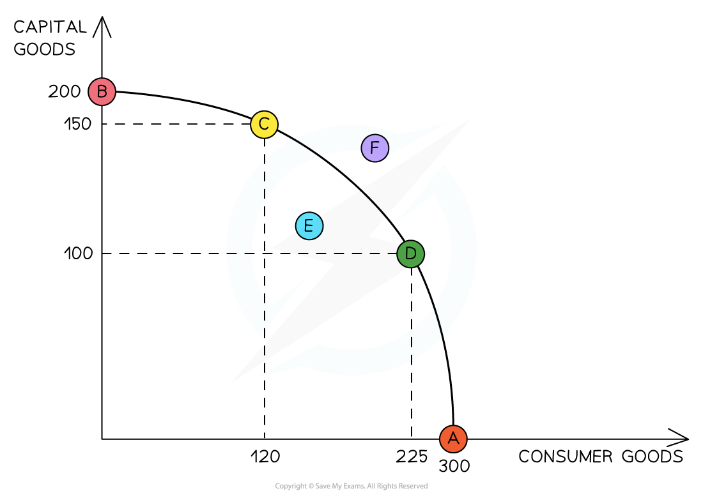
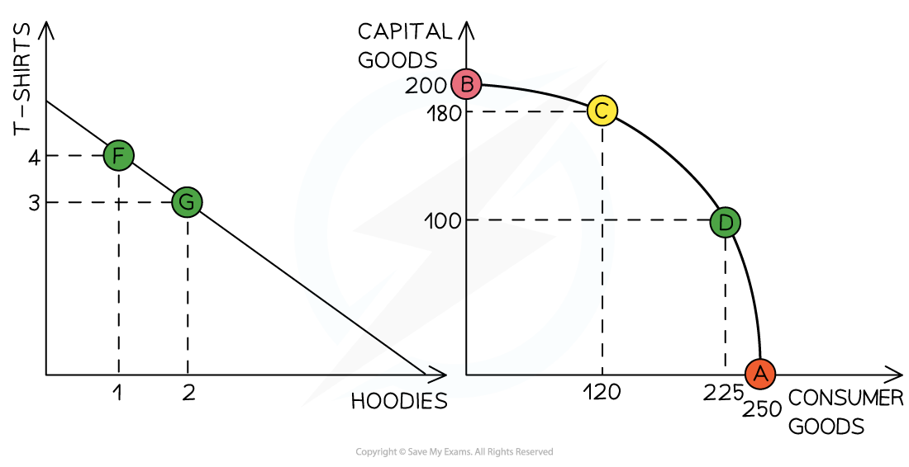

# Production Possibility Curves (PPCs)

## An introduction to production possibility curves

> **Spec point** — `spcpt_FXh3dCpJBBTfY9G9`

## An introduction to production possibility curves (PPCs)

- **The Production Possibility Curve (PPC) is an *****economic model***** that considers the maximum possible production (output) that a country can generate if it uses all of its factors of production to produce only two goods or services**

  - **Any two** goods or services can be used to demonstrate this model
- Many PPC diagrams show **capital goods** and **consumer goods** on the axes

  - **Capital goods are assets** that help a firm or nation t**o produce output** (manufacturing). For example, a robotic arm in a car manufacturing company is a **capital good**
  - **Consumer goods are end products** and have **no future productive use**. For example, a watch

#### Production possibility curve (PPC)

*A PPC for an economy demonstrating the use of its resources to produce capital or consumer goods *

### Diagram analysis

#### 1.The use of PPC to depict the maximum productive potential of an economy

- The curve demonstrates the **possible combinations of the maximum output** this economy can produce **using all of its resources** (factors of production)
- At A, its resources are used to produce **only consumer goods** (300)
- At B, its resources are used to produce **only capital goods** (200)
- Points C and D both represent **full **(efficient) use of an economy's resources, as these points **fall on the curve**. At C, 150 capital goods and 120 consumer goods are produced

#### 2. The use of PPC to depict opportunity cost

- To produce one more unit of capital goods, this economy must give up production of some units of consumer goods (limited resources)
- If this economy moves from point **C (120, 150)** to **D (225, 100**), the **opportunity cos**t of producing **an additional** 105 units of consumer goods is 50 capital goods
- A **movement in the PPC **occurs when there is any change in the **allocation of existing resources** within an economy, such as the **movement** from point C to D

## The shape of the PPC

> **Spec point** — `spcpt_qrQyrbQZHqDkTk8h`

## The shape of the PPC

### Increasing versus constant opportunity cost

- Two different types of opportunity cost can be illustrated using PPC curves
- **Constant opportunity cost** occurs when all of the factors of production used to produce one good can be switched to producing the other good without any loss/wastage of resources

  - One unit given up of one good results in one unit gained of the other
- **Increasing opportunity cost **occurs when the factors of production cannot be perfectly switched between the two products

  - One unit given up of one good results in less than one unit gained of the other

*Constant opportunity cost occurs when production is switched from T-shirts to hoodies.  Increasing opportunity cost occurs when production is switched from consumer goods to capital goods*

#### Diagram analysis

**Left diagram**

- For a country producing only **T-shirts and hoodies**, the factors of production can **easily be switched** between the two products, e.g. the same labour and land (cotton) can be used to make both products

  - **Changing production** from point F to G decreases the production of T-shirts from 4 to 3 and increases the production of hoodies from 3 to 4
  - There is **constant opportunity cost **when production is switched and **the PPC is a straight line**

**Right diagram**

- For a country producing **consumer goods and capital goods**, the factors of production **cannot easily be switched** between the two products, e.g. the labour required to make a washing machine may not have the skill to produce a robotic arm used in car manufacturing

  - **Changing production **from point A to point C results in a decrease of 130 consumer goods but yields an increase of 180 capital goods
  - Changing production from point C to point B results in a decrease of 120 consumer goods but only yields an increase of 20 capital goods
  - There is an **increasing opportunity cost** as production moves closer and closer to any particular axis

## Shifts in the PPC

> **Spec point** — `spcpt_wqJnghbJKm95yjxw`

## Shifts in the PPC

- As opposed to a movement along the PPC described above, the **entire PPC of an economy can shift** inwards or outwards, thereby changing its production possibilities

#### Inward and outward shift of the PPC

*Outward shifts of a PPC show potential economic growth and inward shifts show economic decline*

### Diagram explanation

#### 1. Economic growth

- **Economic growth** occurs when there is an increase in the **productive potential of an economy**

  - This is demonstrated by an **outward shift** of the entire curve. **More consumer goods** and **more capital goods** can now be produced using all of the **available resources**
- This shift is caused by an increase in the **quality or quantity of the available factors of production**

  - One example of how the **quality** of a factor of production can be **improved** is through the impact of **training and education on labour**. An educated workforce is a **more productive workforce** and the **production possibilities increase**
  - One example of how the **quantity** of a factor of production can be **increased** is through a change in migration policies. If an economy allows **more foreign workers** to work productively in the economy, then the **production possibilities increase**

#### 2. Economic decline

- **Economic decline** occurs when there is any impact on an economy that **reduces the quantity or quality** of the available factors of production

  - One example of how this may happen is to consider how the Japanese tsunami of 2011 devastated the **production possibilities** of Japan for many years. It **shifted the PPC inward,** resulting in **economic decline**

## Efficient and inefficient points

> **Spec point** — `spcpt_88KZRBP2BGcCKdW4`

## Efficient and inefficient points

- The PPC depicts efficiency, inefficiency, attainable and unattainable production

*A PPC for an economy demonstrating the use of its resources to produce capital or consumer goods *

- Producing at any point on the curve represents ***productive efficiency***
- Any point inside the curve represents **inefficiency** (point E)
- Using the current level of resources available, **attainable production** is any point on or inside the curve and any point outside the curve is unattainable (point F)

#### Productive and allocative efficiency on a PPC

- **Efficiency** is a key concept in economics
- Economists generally identify **two types of efficiency**

  - Productive and allocative efficiency

| **Type of efficiency** | **Explanation** |
|---|---|
| **Productive efficiency**   | - Producing at any point on the PPC represents** productive efficiency,** as it is the maximum output that can be produced from the available ***factors of production*** to produce goods and services    - There is **no wastage** of scarce resources  - Any point inside the curve represents **inefficiency** (point E)    - It does not use all possible combinations of factors of production to produce goods and services |
| **Allocative efficiency**   | - Makes the best possible use of **scarce resources **to produce the combinations of goods and services that are **optimal for society, **thus minimising resource waste - Not all points on the PPC are allocatively efficient - This is because more of one good or service cannot be produced without reducing output of another good/service - Any change to the **allocation of resources** in this market will make either the consumer or producer worse off (excess demand or excess supply would occur) |
